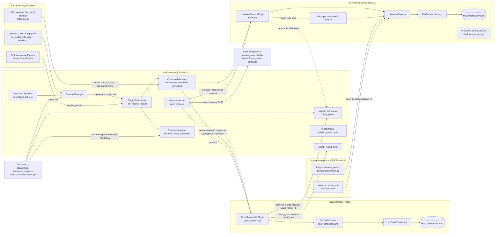
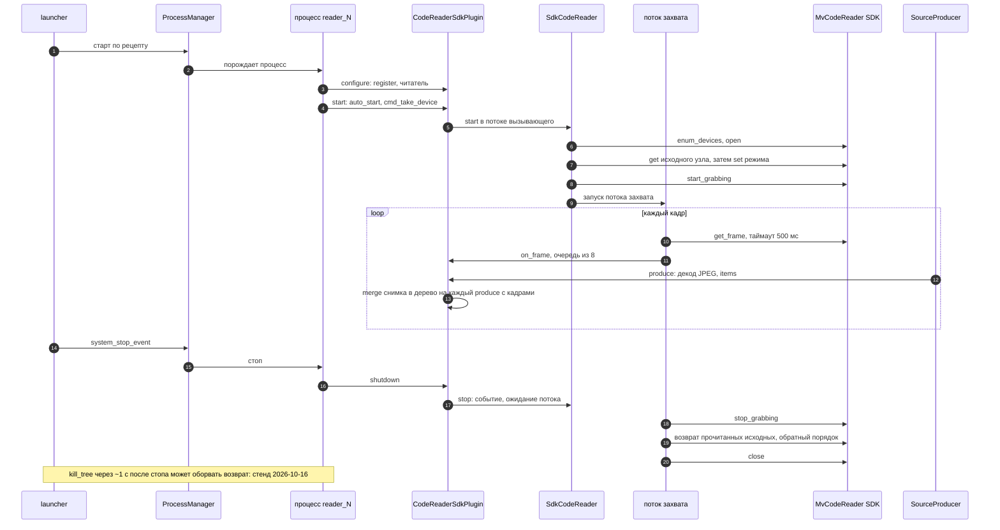
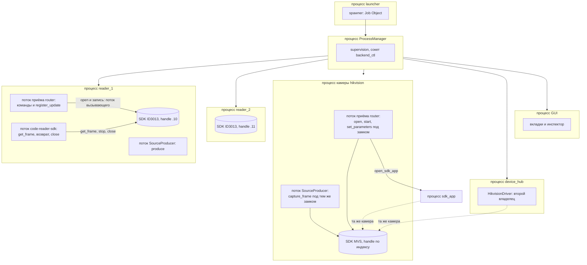
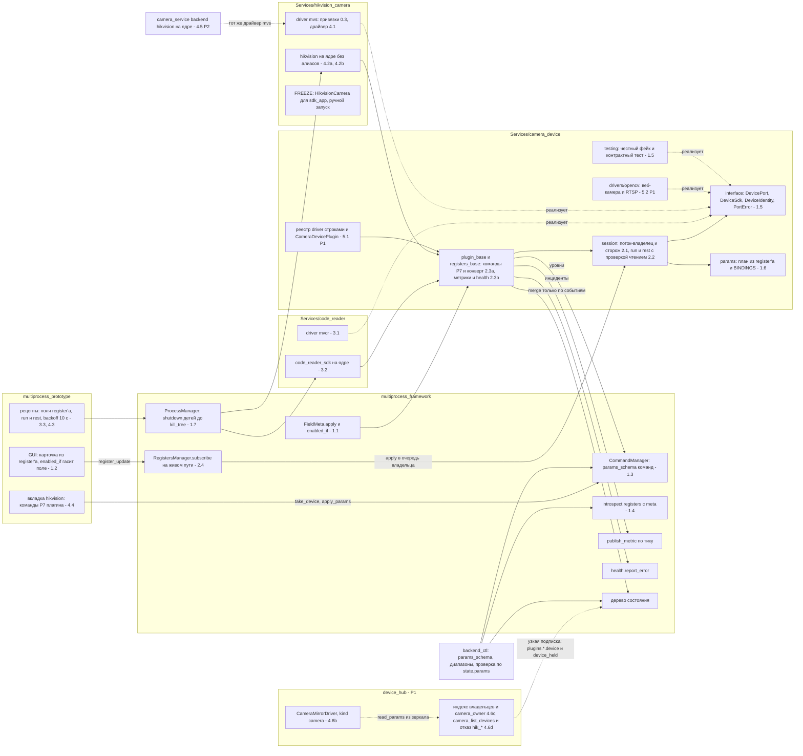
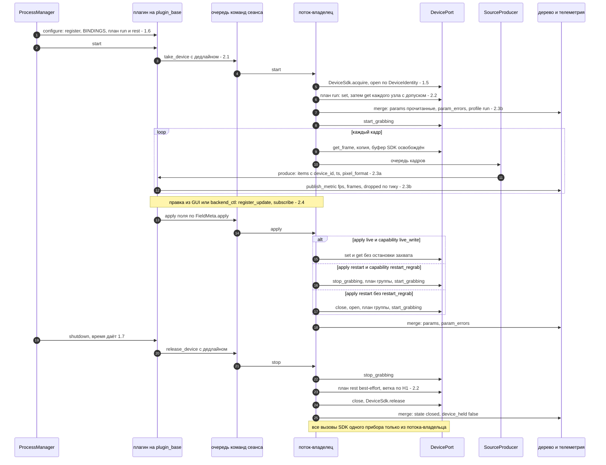
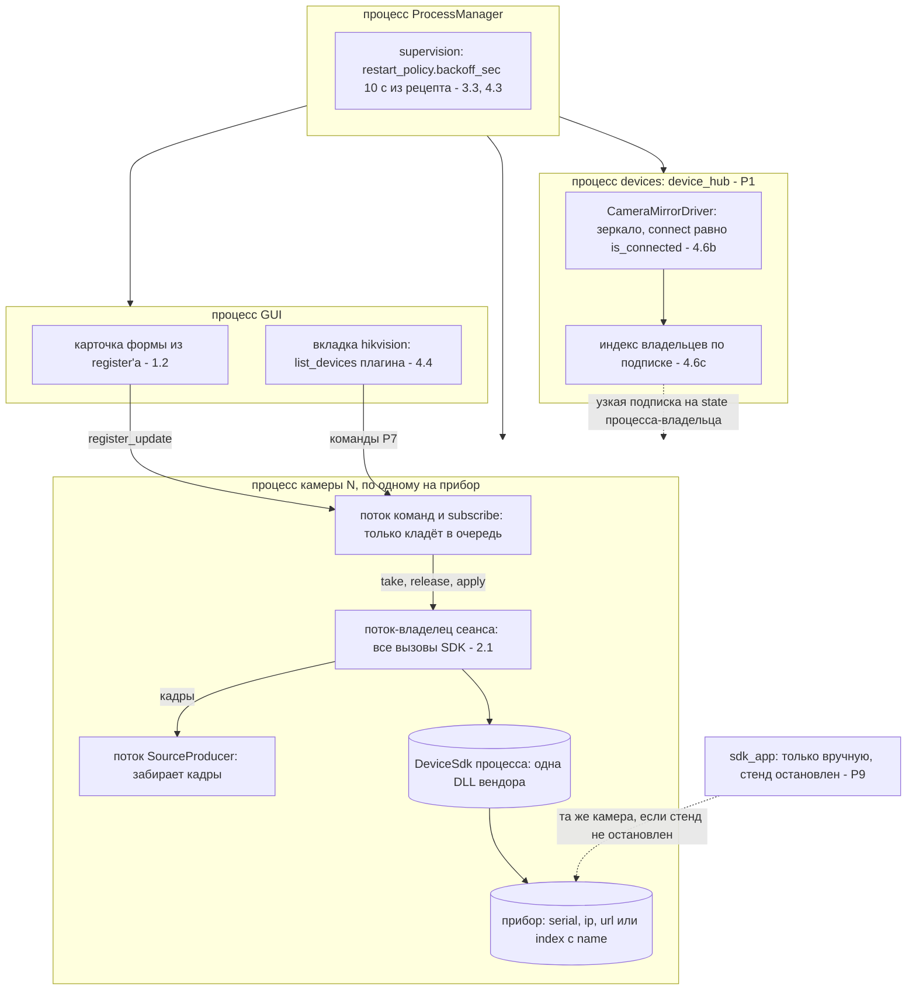
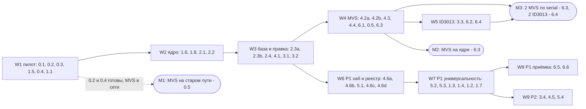

# Камеры и считыватели: система «как есть» и «после плана»

Статус: **описание и оценка, не решение** (Opus reviewer, раунд 2, 2026-10-18). Кода нет.
**Обновлено 2026-10-18 (investigator):** раздел 2 приведён к плану [`plans/2026-10-18_camera-device-service/`](../../plans/2026-10-18_camera-device-service/plan.md) — id задач плана вместо T0–T17, хаб-зеркало, К4', волны и вехи (2.5); советам §3 добавлен статус; новый раздел 3a «Готовое и популярное»; оценка §4 пересмотрена по P0. Раздел 1 («как есть») не менялся.
Основания: ревью `docs/reviews/2026-10-18_camera-services-unification-review.md` (раунд 1 + правки раунда 2), проект `docs/design/camera-device-service.md`.
Источники и их свежесть: код на HEAD `078b96ff3`; граф graphify `graphify-out/graph.json` собран на том же коммите (42 254 узла, 67 624 связи); индекс qex от 2026-10-15 (на 3 дня старше, числа из него не брал); числа — из grep.
Схемы — Mermaid (diagrams-as-code, `docs/diagrams/README.md`). Смотреть: VS Code Markdown Preview с mermaid-расширением или mermaid.live. Задачи T0–T17 и T6a — из раздела 3 ревью.

## 1. Как есть

### 1.1 Компоненты и связи

Что на схеме важно:
- Четыре пути открывают одну MVS-камеру: плагин `hikvision`, `sdk_app`, бэкенд `camera_service`, драйвер `device_hub`. Владельца нет (F14).
- Правка поля из GUI доходит до register'а, но не до прибора: подписчиков `RegistersManager.subscribe` в Services и Plugins нет (F10).
- Наблюдаемость обоих плагинов идёт мимо средств framework (F8, F9); телеметрия и health на схеме есть, но плагины ими не пользуются.

### 1.2 Старт -> захват -> стоп (`code_reader_sdk`, сейчас)

Слабые места этой последовательности: шаги 5–8 идут в потоке вызывающего, шаги 18–20 — в потоке захвата (F5, повтор R4a). «Исходное» на шаге 7 может быть остатком прошлого запуска (F6, повтор R4b/c).
У `hikvision` последовательность другая: потока захвата нет, `produce()` сам зовёт `capture_frame` под `_camera_lock` с таймаутом 200 мс (`plugin.py:163-166`), а `open` пишет `TriggerMode=Off` без проверки кода (F3).

### 1.3 Процессы и потоки (сейчас)

Оговорка: что обработчик команды исполняется именно в потоке приёма router (`router_module/core/_receiver.py:76`), я не проверял; на схеме это «поток команд». У `code_reader_sdk` `take_device` при `auto_start` идёт из `plugin.start()`, то есть из потока жизненного цикла процесса.

### 1.4 Простыми словами: как сейчас

- **Что где живёт.** Камеры одной фирмы обслуживают два независимых пакета. `Services/code_reader` держит считыватели ID3013 (свой SDK, свой поток захвата, коды в кадре). `Services/hikvision_camera` держит обычные камеры (другой SDK, захват прямо в `produce()`). Общего кода у них нет: разные команды, разные поля, разные ключи в кадре (Q4 ревью).
- **Кто кого вызывает.** Рецепт говорит PM, какие процессы поднять. В каждом процессе framework создаёт плагин, register, команды и цикл `produce()`. Плагин сам открывает прибор через SDK. GUI и backend_ctl говорят с плагином командами и правкой полей register'а.
- **Кто чем владеет.** Считывателем ID3013 владеет его процесс, и это хорошо: по процессу на камеру. MVS-камерой «владеют» сразу четыре места — плагин, `sdk_app`, `camera_service`, `device_hub`. Кто первым открыл, тот и владеет; остальные получают отказ или ложный успех (F1).
- **Что видит оператор и агент.** Считыватель кладёт своё состояние в дерево, но прямой записью мимо телеметрии framework. Камера Hikvision не кладёт ничего. backend_ctl видит имена команд без описаний и значения полей без диапазонов. Подтверждённая запись поля (`set_register_verified`) подтверждает register, а не прибор.
- **Где ломается.** Параметры из рецепта у Hikvision не доходят до камеры при старте (F10). Цветной кадр RGB8 теряется всегда (F4). Режим считывателя возвращается из «прочитанного исходного», и одна неудачная остановка навсегда меняет это «исходное» (F6). При выходе приложения дерево процессов сносится через ~1 с, и возврат не успевает (стенд 2026-10-16).

## 2. После плана (задачи `plans/2026-10-18_camera-device-service/tasks/`)

Номер на узле или стрелке — id задачи плана. Соответствие старым T: T1 -> 1.1/1.2, T2 -> 1.5, T3 -> 1.6, T4 -> 2.1, T5 -> 2.2, T6 -> 2.3a/2.3b, T6a -> 1.3/1.4, T7 -> 3.1/3.2, T8 -> 2.4, T9 -> 0.3/4.1, T10 -> 4.2a/4.2b/4.3/4.4/4.5, T11 -> 4.6a–4.6d, T12 -> 0.2, T13 -> 3.4, T14 -> 1.7, T15 -> 6.2 (и 0.5 для MVS), T16 -> 6.4, T17 -> 3.3. Приоритет: W1–W5 — P0, W6–W8 — P1, W9 — P2 (`plan.md`).

### 2.1 Компоненты и связи (цель)

Что изменилось против прежней цели: старых команд `hikvision` нет и алиасов нет (Р8); хаб камеру не открывает, а зеркалит
владельца (4.6a–4.6d, P1); `sdk_app` запускается только вручную при остановленном стенде (Р9); OpenCV-драйвер и реестр — P1.
К4' = 4.2a + 4.2b + 4.3 + 4.4 одним коммитом, хаб в К4' не входит (`plan.md`, W4).

### 2.2 Старт -> захват -> правка -> стоп (цель)

Ветку rest и умолчание `restart_regrab` выбирают опыты 0.5 (MVS) и 6.2 (ID3013). Проверка чтением может подтверждать
сама себя, если SDK читает из кэша GenApi, — гипотеза H7, раздел 3a.

### 2.3 Процессы и потоки (цель)

### 2.4 Простыми словами: после плана

- **Что где живёт.** Один общий пакет `Services/camera_device` знает, как правильно держать любую камеру: открыть, записать параметры, проверить их чтением, снимать кадры, остановиться. Пакеты `code_reader` и `hikvision_camera` становятся тонкими переводчиками: «как этот SDK называет узел и ошибку».
- **Кто кого вызывает.** GUI и backend_ctl меняют поле register'а или шлют одну из общих команд. Плагин кладёт просьбу в очередь. Единственный поток-владелец выполняет её в приборе и сообщает в дерево, что прибор показал на самом деле.
- **Кто чем владеет.** Прибором владеет ровно один процесс и в нём ровно один поток. `device_hub` и GUI только показывают описание и состояние. `sdk_app` — отдельный инструмент диагностики (FROZEN), запуск только вручную при остановленном стенде; бэкенд `camera_service` `hikvision` переводится на ядро в P2 (4.5), до этого он — прежний открыватель без владельца (ни один рецепт его не выбирает).
- **Что видит оператор и агент.** Одинаковые команды и поля у обеих камер. В дереве — прочитанные из прибора значения, ошибки по узлам, fps и потери под телеметрией framework. backend_ctl показывает форму параметров команд и диапазоны полей (1.3, 1.4 — P1); прибор проверяется по `state…params` (Р13). Старых имён команд `hikvision` нет — все потребители переведены в К4'.
- **Что остаётся риском.** Убийство процесса оставляет камеру в профиле работы до следующего старта (решение владельца, Q9-4). Поведение прибора после `StopGrabbing` (H1) неизвестно до опытов 0.5 и 6.2. До 1.7 (P1) общий стоп может не дать записать rest. Чтение проверки может идти из кэша GenApi (H7, гипотеза, 3a).

### 2.5 Что когда появится: волны W1–W9 и вехи М1–М3

| Когда | Что появится | Как увидеть | Железо |
|---|---|---|---|
| после W1 | базовая линия `sentrux`, ADR-CAM-001…004; порт и честный фейк проходят контрактный тест; кадр RGB8 старого пути на фейке; зонд MVS `--fake --dump` | тесты 1.5, 0.2, 0.4 | нет |
| М1 (день, когда MVS в сети, ~2026-10-20) | старый плагин `hikvision`: цветной кадр, параметры рецепта после `open`, коды отказа; дерево узлов MVS записано | стенд 0.5 | MVS |
| после W2 | рецепт `camera_device_demo` (`driver: fake`): кадры в дереве, все вызовы порта из одного потока, run с проверкой чтением | `state_get`, тесты 2.1, 2.2 | нет |
| после W3 | живая правка поля доходит до фейка; `code_reader_sdk` на ядре на фейке API | `set_register_verified` + `await_condition …params.exposure_time` | нет |
| М2 (W4) | MVS на ядре 60 с без потерь, правка поля подтверждена прибором, выбор по serial | `stand_probe` 6.1, стенд 6.3 | MVS |
| М3 | 2 MVS по serial (6.3, если вернутся ≥ 2); 2 ID3013 5 мин `fps_min ≥ 24`, `dropped == 0` (6.4) | 6.1 | MVS ×2, ID3013 ×2 |
| после W6 (P1) | хаб: `camera_owner` -> процесс-владелец, `hik_open` -> отказ с текстом | `send_command` в `devices` | нет |
| после W7 (P1) | контрактный тест по реестру из 4 драйверов; `params_schema` команд; `introspect_registers meta=true`; T14 | тесты 5.3, `capabilities` | веб-камера — по желанию |
| после W8–W9 | приёмка наблюдаемости; копии кадра; бэкенд `camera_service` на ядре; `ADD_A_VENDOR.md` | 6.5, 3.4 | ID3013 для 3.4 |

Сроки после М1 — оценка ревью плана (P6: путь к М2 ≈ 43–45 запусков, порядка 1–1,5 недели при одном ряде сессий), не замер.

## 3. Советы вне T0–T17 (по пользе к цене)

Статус в плане — из `plans/2026-10-18_camera-device-service/matrix.md`, «Советы архитектуры».

Польза и цена — моя оценка в баллах 1–3 (3 = много). Сортировка: сначала большая польза при малой цене.

| # | Совет | Польза | Цена | Почему | Доказательство | В плане |
|---|---|---|---|---|---|---|
| 1 | Метаданные `FieldMeta` в ответе `introspect.registers` (флаг `meta=true`, по умолчанию как сейчас) | 3 | 1 | агент видит диапазон, единицу, `readonly` без чтения исходников; `to_dict()` уже есть | `builtin_commands.py:780-783` (только значения), `field_meta.py:364` | в плане (1.4, P1) |
| 2 | Контракты и описания команд плагина (`command_contracts`, докстринг -> `description`) | 3 | 1 | `capabilities` покажет `params_schema` для `take_device`, `apply_params`; сейчас описание пустое | `plugins/base.py:1676`, `message_module/contracts/registry.py:102` | в плане (1.3, P1) |
| 3 | В README ядра и в приёмке: «прибор проверять по `state…params`, а не `set_register_verified`» | 3 | 1 | `set_register_verified` проверяет только register | `backend_ctl/registers.py:139-174` | в плане (Р13, 5.4, приёмка 6.3–6.5) |
| 4 | `seq_id` без переполнения у `hikvision`, `camera_service`, `phone_gateway`; `frame_id` по модулю оставить алиасом | 2 | 1 | ключ fan-in и имена файлов `frame_saver` повторяются каждые 121 кадр (F20) | `hikvision/plugin.py:183-189`, `join_inspector_manager.py:132` | в плане для плагинов ядра (2.3a); `camera_service`, `phone_gateway`, `capture` — отложено (OPEN_QUESTIONS, 6.6) |
| 5 | «Записанный фейк»: зонд снимает дерево узлов прибора (имя, тип, диапазон, доступ в каждом режиме) в JSON; фейк грузит JSON | 3 | 2 | фейк перестаёт быть догадкой; расхождение фейка с прибором видно сразу | зонд уже есть: `Services/code_reader/tools/mvcr_probe.py` | в плане (запись 0.4/0.5, 6.2; загрузка 1.5) |
| 6 | Сторож потока-владельца: вызов SDK дольше N с -> `health.degraded` + `flight_dump` | 2 | 1 | зависшая DLL сейчас видна только как «нет кадров» | `base.py:592` (`flight_dump`) | в плане (2.1) |
| 7 | Один скрипт стенда через backend_ctl: N камер, 60 с, таблица fps / dropped / param_errors | 2 | 1 | T16 повторяется одной командой, числа сравнимы между прогонами | `telemetry_snapshot`, `state_get` уже есть | в плане (6.1) |
| 8 | Единые часы item: `ts = time.time()`; `database` без подмены часов | 2 | 1 | в одной колонке два разных часа (F21) | `Plugins/io/database/plugin.py:121` | частично (`ts` в конверте, 2.3a); `database` — отложено |
| 9 | Общий контрактный тест порта с маркером `hardware`: тот же набор на фейке и на приборе | 3 | 2 | одна проверка верности фейка | — | в плане (1.5, 5.3) |
| 10 | Миграция флагом в register'е (`session: legacy или core`), рецепты по одному | 2 | 1 | откат без отката кода; FREEZE без «двух веток в коде навсегда» — флаг снять после T16 | — | **отклонено** (решение владельца 3: без двух путей, откат — `git revert`) |
| 11 | `HikvisionCameraService` пометить legacy-shell: статус `shell`, не `running` | 1 | 1 | ложный статус в `ServiceRegistry` (F22) | `Services/hikvision_camera/service.py` | в плане (4.2b) |
| 12 | Бюджет канала GigE (`GevSCPD`, размер пакета) — поля таблицы MVS, а не скрытая запись | 2 | 1 | 3 MVS-камеры на одном 1 ГбЕ могут забрать канал | `camera.py:163-166` | в плане (4.1, 4.2a) |
| 13 | Метрики команд `command_manager.command.execution.*` — в приёмку (длительность `take_device`, `apply_params`) | 2 | 1 | уже считаются, кода не нужно | `command_module/core/command_manager.py:262-317` | в плане (6.5) |
| 14 | README ядра со схемой состояний сеанса и таблицей «ошибка SDK -> `kind`» по вендорам | 2 | 1 | DX для следующего вендора | — | в плане (5.4, P2) |
| 15 | Просмотрщик узлов только для чтения (`describe_params` на всё дерево, без записи) | 2 | 2 | цель «все параметры» без динамической схемы (раздел 4) | — | **отложено** (после 6.3, по просьбе владельца) |

Не советую (и в плане нет): динамическую схему register'а по дереву узлов прибора. Снимок каталога (`multiprocess_prototype/frontend/forms/tests/test_catalog_kind_roundtrip.py:73`) и GUI ждут статический класс; цена высокая, а для настройки хватает курируемого списка + просмотрщика (совет 15).

## 3a. Готовое и популярное (выжимка)

Полный отчёт с URL и локальными замерами — [`docs/reviews/2026-10-18_camera-popular-solutions.md`](../reviews/2026-10-18_camera-popular-solutions.md).

| Берём | Своё (тонко) | Не брать сейчас |
|---|---|---|
| GenICam/SFNC как словарь: ключ `Binding` = имя узла SFNC | ядро: поток-владелец, run/rest, проверка чтением, ошибки в дереве — готовой библиотеки с этим нет | Aravis (на Windows только MSYS2), GStreamer (нет в колесе OpenCV) |
| диапазон, шаг, перечисления, доступ — из прибора через уже подключённые SDK (`MV_CC_Get*Value`, `MV_XML_GetNodeAccessMode`; у MvCodeReader — `Get*Value`) | `BINDINGS` «поле -> узел» — та же таблица, что у драйверов ROS 2 (`flir_camera_driver`, `camera_aravis2`) | PyAV — только если замер покажет проблемы RTSP у OpenCV |
| OpenCV (уже стоит): `CAP_DSHOW`/`CAP_MSMF` для веб-камеры, `CAP_FFMPEG` + таймауты для RTSP | `enabled_if` для GUI; допуск проверки | ONVIF — вне объёма; позже только `onvif-zeep-async` |
| MvCodeReader SDK для ID3013 — единственный путь к кадру и кодам (по GigE-потоку кадр не приходит, `Services/code_reader/docs/GENICAM.md`) | драйверы `mvcr`, `mvs` | vidgear (свой поток спорит с владельцем), pylablib (GPL), harvesters на критическом пути |

- **harvesters** уже объявлен (`pyproject.toml:31`) и стоит в `.venv` (1.4.3), импортов 0; GenTL-продюсер MVS `MvProducerGEV.cti` (x86-64) на машине есть, у IDMVS — нет. Решение — после **опыта S1** (вне пути, рядом с 0.5): harvesters против наших ctypes на MVS — 4 узла с min/max/inc/entries/access, 100 кадров из одного потока, h7, время повторного `open` после kill. Успех -> драйвер `gentl` для будущих GenICam-вендоров; иначе harvesters — в extra.
- **H7 (гипотеза):** GenApi кэширует узлы; у регистра триггера в XML камеры MVS тега `Cachable` нет. Тогда чтение проверки может вернуть кэш. Опыт: записать значение не кратное `inc`, прочитать без и после `MV_CC_InvalidateNodes`.
- **Окружение:** в `.venv` две сборки OpenCV, грузится `cv2 5.0.0` из `opencv-contrib-python`, которого нет в `uv.lock` — до 5.2 привести к lock.
- Влияния на критический путь к М2 нет; предложения к задачам (0.3, 0.4, 0.5, 2.2, 5.2, новые 0.6/5.5) — в отчёте, в план не внесены.

## 4. Честная оценка

Шкала 1–5: 1 — не работает или опасно, 3 — работает с известными дырами, 5 — нечего добавить. «После P0» — сделаны
W1–W5 (P0 плана), опыты 0.5 и 6.2 не опровергли проект. «Весь план» — плюс P1 и P2 (W6–W9). Оценки «после» — суждение
по тексту задач и ревью плана (`docs/reviews/2026-10-18_camera-plan-review.md`, P5), не по коду: кода ещё нет.

| Критерий | Сейчас | Доказательство «сейчас» | После P0 | Весь план | Что мешает 5 |
|---|---|---|---|---|---|
| Архитектура: слои и владение | 2 | 4 открывателя одной MVS-камеры (F14); open и close в разных потоках (R4a) | 3 | 4 | до 4.6b хаб может открыть камеру при `device_connect` записи `hikvision`; до 4.5 бэкенд `camera_service` — открыватель без владельца |
| Расширяемость: N камер, 3-й вендор | 2 | `device_ip=""` -> два читателя на одном приборе (R5); выбор по индексу (F13) | 3 | 4 | реестр и OpenCV — P1 (5.1–5.3); третий GenICam-вендор не проверен (опыт S1, 3a) |
| Наблюдаемость | 2 | прямой `merge` мимо гейта (`sdk_plugin.py:369`); `hikvision` не публикует ничего | 4 | 4 | формальная приёмка — 6.5 (P1); значения прибора — только в дереве |
| Управляемость через backend_ctl | 2 | команды без `params_schema` (`base.py:1676`); регистры без метаданных (`builtin_commands.py:780-783`) | 3 | 4 | `params_schema` (1.3) и `meta` (1.4) — P1; `set_register_verified` по-прежнему проверяет только register (Р13 — шаблон с `await_condition`) |
| Надёжность и изоляция отказов | 3 | `kill_tree` через ~1 с обрывает возврат; отравление «исходных» (R4b/c); коды записи MVS игнорируются (R6) | 3 | 4 | T14 (1.7) — P1: до неё общий стоп может не записать rest; убийство оставляет профиль run (риск принят); H7 не проверена |
| Тестируемость | 3 | шов `reader_factory` и фейк API; общего контрактного теста порта нет | 4 | 4 | верность фейка прибору — после записи дерева 0.4/0.5 и 6.2 |
| Соответствие принципам владельца | 2 | обход телеметрии (F8); вкладка GUI шлёт `open` и `start_capture` (`presenter.py:80-89`) | 4 | 4 | п.5: до 4.6b хаб остаётся возможным вторым открывателем; кнопки take/release во вкладке оставлены решением лидера |
| Готовность параметров к GUI | 2 | у `hikvision` 3 поля (`registers.py:24-52`); правка из GUI не доходит до прибора (F10) | 3 | 4 | гашение полей по `enabled_if` (1.2) — P1; диапазоны прибора динамические, схема статическая |
| Время до первого результата | — | — | М1 ~2026-10-20; М2 ≈ 43–45 запусков пути (оценка ревью плана P6) | — | ревью плана дало 2 из 5 (P5) до перевязок; волны и P0 сокращают путь, замера скорости нет |

Изменение против прежней оценки (все «после» = 4): P0 даёт 3 по владению, расширяемости, управляемости, надёжности и GUI —
потому что 4.6b, 5.1–5.3, 1.3/1.4, 1.7 и 1.2 отнесены планом к P1.

Где цель плана достижима только частично:
- **«ВСЕ параметры камеры в схеме» (цель 3).** У прибора GenICam сотни узлов. Статический `SchemaBase` и снимок каталога держат курируемый список. Полное дерево — только просмотр (совет 15), не карточка с правкой. Это ограничение выбора «статическая схема», а не недоработка плана.
- **«Нет конфликтов между процессами» (цель 5).** Эксклюзивность обеспечивает прибор, а не мы. IDMVS и замороженные пути (`sdk_app`, `camera_service`) могут занять камеру первыми; план даёт только ясный отказ `busy` с именем причины, не запрет.
- **«Отказ одной камеры не задевает соседей» (цель 5).** Падение процесса — да, изолировано. Общий канал 1 ГбЕ и full-replace топологии (все камеры перезапускаются вместе) остаются связью между камерами.
- **«SDK родные для framework» (цель 6).** Владелец согласовал framework-правки (`FieldMeta.apply`/`enabled_if` — 1.1; контракты и `meta` — 1.3, 1.4). 1.3 и 1.4 — P1: до них «управляемость» остаётся на 3.
- **«Проверка чтением подтверждает прибор».** Если SDK читает узел из кэша GenApi (H7), проверка подтверждает саму запись. До опыта h7 это гипотеза.

## 5. Что я оставил открытым / ненадёжным

- Mermaid-схемы проверены только моим структурным скриптом (парные `loop`/`alt`/`end`, кавычки, скобки, нет `;` в сообщениях). Настоящего парсера Mermaid в репозитории и на машине нет: `mmdc` не найден; `npx` есть, но тянуть пакет из сети я не стал (новая зависимость). Первая настоящая проверка — открыть файл в VS Code Preview или mermaid.live.
- Поток исполнения команд (поток приёма router или другой) не проверен; на схемах — «поток команд».
- Оценки 1–5 — суждение по коду и повторам на фейках, не по стенду. Ни одна оценка «после» не проверена: плана ещё нет.
- graphify видит импорты и вызовы, но не связь через строки IPC (имена команд, пути дерева); метки сообществ в графе местами ошибочны (например, `sdk_plugin.py` в сообществе `RobotControlWidget`), их я не использовал.
- qex ответил на один запрос (индекс от 2026-10-15); числа из него не брал.
- Схема процессов «как есть» показывает одну камеру hikvision и два считывателя — это состав dual-рецепта и рецептов `hikvision_*`, а не одного живого прогона.
- Окно сборки fan-in (~1 с) и риск столкновения ключей (F20) — из чтения умолчаний Haiku-агентом, не замер.

### 5.1 Открыто после обновления 2026-10-18

- Схемы раздела 2 нарисованы по тексту `plan.md`, `wave-protocol.md`, `decisions.md`, `matrix.md` и шапкам `tasks/*.md`, не по коду: кода нет. Прежние схемы «после плана» (по T0–T17) заменены; файл не в git (`git status` -> `??`), поэтому старой версии в истории нет.
- Mermaid проверен только структурным скриптом (парность `subgraph`/`end`, `loop`/`alt`/`end`, кавычки и скобки, нет `;` в подписях); настоящего парсера нет — открыть в VS Code Preview или mermaid.live.
- Оценки «после P0» и «весь план» — суждение по тексту задач; ни одна не проверена запуском.
- Паттерн подписки хаба (`…plugins.*.device`, `…plugins.*.device_held`) и поддержка глоба со `*` в середине — из `tasks/4.6c.md`; поведение `StateProxy.subscribe` не проверял (так же открыто в ревью плана).
- Раздел 3a опирается на отчёт `2026-10-18_camera-popular-solutions.md`: H7 и опыт S1 — предложения, в плане их нет.
- Срок М2 — оценка ревью плана, не замер; скорость запусков агентов никто не мерил.
