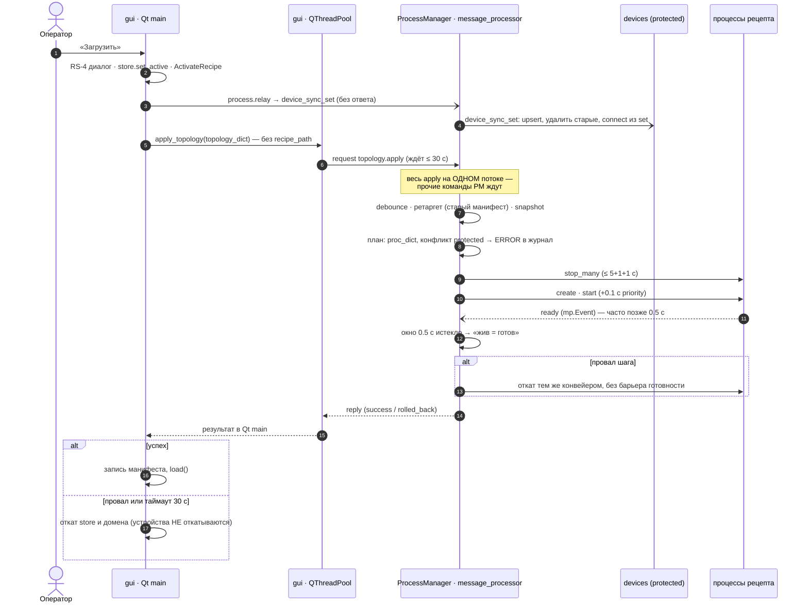

# Карта: смена рецепта (горячая и холодная)

- **Состояние кода:** `main` @ `bed74b8d4`, 2026-10-13. Номера строк — на эту дату; после правок сверять.
- **Источники:** пять срезов-разведок (haiku) — [`A.gui`](../../plans/2026-10-12_stand-recipe-switch/reports/recipe-switch-map/A.gui.md),
  [`B.pm`](../../plans/2026-10-12_stand-recipe-switch/reports/recipe-switch-map/B.pm.md),
  [`C.cold-vs-hot`](../../plans/2026-10-12_stand-recipe-switch/reports/recipe-switch-map/C.cold-vs-hot.md),
  [`D.devices`](../../plans/2026-10-12_stand-recipe-switch/reports/recipe-switch-map/D.devices.md),
  [`E.history`](../../plans/2026-10-12_stand-recipe-switch/reports/recipe-switch-map/E.history.md);
  живой стенд Task 1.1 ([`1.1.investigation.md`](../../plans/2026-10-12_stand-recipe-switch/reports/1.1.investigation.md));
  решающие места лид проверил чтением кода сам (помечено «проверено»). Остальное — чтение кода агентом, без запуска.
- **Дефекты:** R-8…R-21 в [`plans/queue/defects.md`](../../plans/queue/defects.md).
- **HTML-версия с диаграммой:** [`recipe-switch.html`](recipe-switch.html).

## Вердикт

**Замысел верный, исполнение недоделано: смена рецепта сегодня НЕ надёжна.**

Каркас транзакции в PM сделан по замыслу (июнь–июль 2026): валидация до первого стопа, параллельный стоп с бюджетом,
откат тем же конвейером, debounce, protected-процессы, routing epoch. Слабые места — на стыках:

1. **Вся смена идёт на единственном потоке сообщений PM.** Любая блокировка внутри — и PM глух ко всем командам (R-8).
   Найдено конкретное место, где такая блокировка возможна (гипотеза H1 ниже).
2. **Барьер готовности на Windows не работает.** Окно 0.5 с меньше холодного импорта тяжёлого процесса → готовность
   объявляется по живости, `success: true` значит «живы», а не «готовы» (R-15). При откате барьера нет совсем.
3. **У активации два хозяина.** ADR-RCP-007: владелец — бэкенд (`recipe.activate`, с `recipe_path`, пишет манифест).
   GUI идёт в обход: шлёт сырой `topology_dict` без `recipe_path` (R-11); переход GUI на `recipe.*` (gui-service 1b.3)
   заморожен решением О-16.
4. **Горячий путь собирает топологию не так, как холодный:** `log_dir` (R-9), нет слияния с фундаментом, другой
   источник `recipe_devices`, снимок `sys_config` с boot. Два сборщика одного и того же расходятся.
5. **Устройства живут вне транзакции.** `device_sync_set` уходит ДО apply, без ожидания ответа, и при откате apply не
   откатывается; порядок подключения случайный (R-10); носитель «сдаётся навсегда» (R-16).
6. **Таймаут GUI не отменяет работу PM.** GUI откатывается через 30 с, а PM может потом применить новый рецепт —
   сверки нет, GUI и бэкенд расходятся молча.

## Кто участвует

| Участник | Процесс | Поток | Роль |
|---|---|---|---|
| Вкладка «Рецепты» (`RecipesTab`, `RecipesPresenter`) | `gui` | Qt main | кнопка «Загрузить» (бывшая «Сделать активным»), откат при провале |
| `ProcessManagerProxy`, `RequestRunner` | `gui` | `QThreadPool` | синхронный `router.request` с таймаутом 30 с |
| `ProcessManagerProcess._cmd_topology_apply` → `apply_topology` | `ProcessManager` | **`ProcessManager_message_processor` (единственный)** | вся транзакция и ответ |
| `TopologyManager` + `FullReplacePlanner` (`backend/assembly/planner.py`) | `ProcessManager` | тот же | план: stop_all → cleanup → provision → create → start |
| `orchestrator_hooks._build_proc_dicts` + `BlueprintAssembler` | `ProcessManager` | тот же | сборка proc_dict нового рецепта |
| `DeviceHubPlugin.cmd_device_sync_set` | `devices` (protected) | поток команд `devices` + supervisor-очередь connect | устройства рецепта |
| `RecipeService.activate` (`multiprocess_framework/modules/recipe/service.py:348`) | хаб | — | путь бэкенда по ADR-RCP-007; **GUI им не пользуется** |
| Дочерние процессы | каждый свой | конец `run()` → `_announce_ready` (`process_module.py:1380`) | ready-событие (mp.Event, мимо IPC) |

## Горячая смена по шагам

| # | Шаг | Где | Поток | Блокирует? |
|---|---|---|---|---|
| 1 | Клик «Загрузить» → `on_set_active` | `recipes/tab.py:457-461` | Qt main | нет |
| 2 | Guards: нет slug / `_apply_in_flight` | `presenter.py:332-341` | Qt main | нет |
| 3 | RS-4: несохранённые правки → модальный диалог | `presenter.py:347-370` | Qt main | модально, ДО побочных эффектов |
| 4 | `store.set_active(slug)` | `presenter.py:381-386` | Qt main | — |
| 5 | `dispatch(ActivateRecipe(slug))` | `presenter.py:388-403` | Qt main | — |
| 6 | `device_sync_set` → `process.relay` → `devices` | `presenter.py:410-425`, `tab.py:419-426` | Qt main | **fire-and-forget**, без ответа |
| 7 | Источник топологии: v3 → весь сырой dict | `presenter.py:430-445` | Qt main | — |
| 8 | Кнопка «Применяется…», `apply_topology` | `presenter.py:447-453`, `process_manager_proxy.py:94` | Qt main → пул | — |
| 9 | `router.request(process.command / topology.apply, timeout=30)` | `command_sender.py:253-282`, `router_manager.py:1084-1101` | пул | ждёт до 30 с |
| 10 | PM: `receive` → `_dispatch_command` → `_cmd_topology_apply` | `router_manager.py:1299-1347`, `process_manager_process.py:751` | **message_processor** | всё ниже — на нём |
| 11 | debounce (`_replace_in_progress`, cooldown 1 с) | `:767`, `:798-824` | 〃 | нет |
| 12 | ретаргет адреса рецепта (без `recipe_path` → читает СТАРЫЙ манифест) | `:780`, `app_module/orchestrator.py:301` | 〃 | файловый IO |
| 13 | `DisplayRegistry.reload` до apply | `orchestrator_hooks.py:265` | 〃 | — |
| 14 | snapshot non-protected, пометка wires, `ProcessMonitor.stop()` | `:3871-3892` | 〃 | стоп монитора без явного таймаута |
| 15 | план: сборка proc_dict (валидация до стопа), diff = «все non-protected заменить» | `planner.py:216-299` | 〃 | — |
| 16 | конфликт protected → ERROR, apply НЕ прерывается | `planner.py:305-344` | 〃 | **запись журнала (см. H1)** |
| 17 | `stop_all` → `stop_many` параллельно: graceful 5 с → terminate 1 с → kill 1 с | `:4212-4234`, `stop_budget.py:35-49` | 〃 | до ~7 с |
| 18 | cleanup (best-effort), provision, create (+`apply_priority` sleep 0.1 с), start | `:4236-4311` | 〃 | по 0.1 с на процесс ×2 |
| 19 | барьер готовности: окно 0.5 с, затем «жив → готов» | `:4162-4196`, `:4041-4099` | 〃 | до 0.5 с |
| 20 | reissue wires, protected conflicts в ответ, `_refresh_after_topology`, replay телеметрии, сброс сессий наблюдаемости, `_resume_monitor` | `:3935-4039` | 〃 | не разобрано (открыто) |
| 21 | ответ `reply_to_request` по `request_id` | `router_manager.py:1345` | 〃 | — |
| 22 | GUI: успех → запись манифеста, `load()`; провал/таймаут → откат store и домена | `presenter.py:485-555` | Qt main | — |

## Транзакция apply в PM

- **План** (`planner.py`): `diff` всегда «есть изменения» (`:197-214`); все non-protected сносятся и пересоздаются,
  даже если не менялись — `IncrementalPlanner` упомянут в `planner.py:11`, не создан. Сборка и валидация proc_dict —
  до первой stop-команды (`:241`): невалидный рецепт ничего не трогает.
- **Protected** — PM и процессы с `protected: true` (`process_manager_process.py:1228-1238`): в прототипе `devices`
  (`backend/topology/base.yaml`, единственный процесс фундамента — **проверено**) и `gui` (overlay презентации).
  Конфликт их конфига (`planner.py:305-344`) сравнивает полный proc_dict, включая лог-пути и `recipe_devices` —
  поля, которые от рецепта к рецепту ОБЯЗАНЫ отличаться. Итог: ERROR почти на каждой смене, процесс остаётся со старым
  конфигом, устройства всё равно приходят через `device_sync_set`. Это шум по построению, а не сигнал.
- **Стоп:** одна `process.stop_all` → `stop_many` параллельно, лестница graceful → terminate → kill; неподтверждённая
  смерть → hard-fail и откат.
- **Готовность** (**проверено**, `:4186-4196`, `:4110-4140`): окно `start_ready_timeout_s` = 0.5 с; на дедлайне живой
  процесс без события считается готовым. Код сам называет единичный фолбэк «нормой старта при холодном импорте
  тяжёлого процесса»; на стенде 2026-10-13 фолбэк шёл подряд 4…7 раз — значит барьер систематически не ждёт.
  Не готов → `report_error`, но ответ остаётся `success: true`. При откате барьера нет (`:1888`).
- **Откат** (`_rollback_to_snapshot`, `:1801-1893`): тем же конвейером, best-effort; 2PC нет; неподтверждённые стопы
  выпадают из топологии до следующей смены — возможна смесь старого и нового.
- **Ответ:** синхронно после всей работы (`router_manager.py:1345`); отмены по таймауту клиента нет.

## Устройства

- `cmd_device_sync_set` (`Plugins/hub/device_hub/plugin.py:562-629`): upsert в порядке рецепта → удаление
  recipe-устройств прошлого рецепта (мосты первыми) → connect в очередь **из `set`** (`:617-622`) — порядок случайный
  между процессами (R-10). Ручные устройства (origin не `recipe:*`) не трогаются.
- Мост проверяет носителя только в момент connect (`Services/device_hub/manager.py:293-299`); при отказе повторяет сам
  драйвер, 3 попытки, затем `desired_connected=False` навсегда до ручного «Подключить» (`drivers/base.py:190-217`).
  Каскада «носитель подключился → разбудить мост» нет (каскад только на disconnect, `manager.py:323-330`).
- `devices` protected → при apply не перезапускается, sync не теряется; но его **конфиг** (`recipe_devices`) после apply
  остаётся старым — правда о составе устройств живёт только в рантайме.
- Порядок с apply: sync уходит ДО apply и не ждёт ответа; при откате apply устройства нового рецепта остаются.

## Холодный старт против горячей смены

| Что | Холодный (`backend/launch.py`) | Горячий (`orchestrator_hooks._build_proc_dicts`) | Совпадает? |
|---|---|---|---|
| `log_dir` | env `MULTIPROCESS_LOG_DIR` > `INSPECTOR_LOG_DIR` > yaml (`:51-76`, `:662`) | только yaml (`:85`) — **проверено стендом** | нет при env (R-9) |
| Фундамент `base` | слит (`:545-546`), дубль рецепта отброшен (`:161-168`) | не сливается; есть, только если payload уже слит (кнопка «Перезапустить» вкладки Pipeline) | нет для «Загрузить», «Запустить», `recipe.activate` |
| `recipe_devices` / `recipe_origin` | из файла рецепта, origin = имя или stem | из payload, origin из активного манифеста (старого) | нет |
| Источник рецепта | файл `app.pipeline` / override | `topology_dict` из GUI; файл читает только `recipe.activate` | нет |
| `sys_config`, плагины | файл, discover в launcher | снимок boot, discover в PM один раз | правка `system.yaml` после boot не доходит |
| Адрес рецепта, companion | файл рецепта, гейт `load_companion` | манифест (старый), гейта нет | нет без `recipe_path` |
| Валидация | `BlueprintInvalid` → выход | исключение → ошибка apply | та же проверка |

Четыре входа в `topology.apply`: (a) «Перезапустить» во вкладке Pipeline — слитая модель графа без `devices`;
(b) «Запустить» — сырой рецепт, манифест не пишет; (c) «Загрузить» во вкладке Рецепты — сырой рецепт, манифест после
успеха; (d) `recipe.activate` на хабе — с `recipe_path`, манифест после apply, вызывающих в прототипе нет.

## Замысел против кода

| Замысел (ADR / план) | Статус | В коде |
|---|---|---|
| Параллельный стоп, подтверждение смерти | DONE | `process_registry.py:350`, `stop_budget.py` |
| Откат тем же конвейером | DONE | `process_manager_process.py:1801-1893` |
| Барьер готовности по ready-событию (ADR-PMM-011) | DONE, но окно 0.5 с | фактически фолбэк по живости |
| Debounce | DONE | `:798-824` (флаг без лока — верно только на одном потоке) |
| Routing epoch, wire re-issue (ADR-PMM-010/012) | DONE | `:1117`, `:1955-2007` |
| Ретаргет адреса до сборки (R6) | DONE | `:751-790`, но без `recipe_path` от GUI бесполезен |
| Активация — владелец бэкенд (ADR-RCP-007) | 1b.1 DONE, 1b.3 ЗАМОРОЖЕН (О-16) | GUI в обход |
| IncrementalPlanner | не начат | только docstring `planner.py:11` |
| hot-swap Task 7: кадры после смены, развилка A/B | ОТКРЫТ, решение не записано | — |
| `process.hot_add/hot_remove` | сняты с действия (`6ef985e73`) | билдеры остались без обработчика |

## R-8: ведущая гипотеза H1 — запись в консоль на потоке сообщений

**Проверено чтением кода, на стенде НЕ воспроизведено.**

- Консольный сток журнала — `ConsoleChannel` (`multiprocess_framework/modules/logger_module/channels/log_channel.py:1043`)
  пишет через `logging.StreamHandler` в stderr процесса. Запись идёт **синхронно на потоке вызывающего**: прямой путь
  `channel_routing_manager.py:1069` зовёт `ch.write(record)` в цикле по каналам (батчинг снят в Ф7.4) — **проверено**.
- Защита от залипшего стока `_guarded_write` ограничивает только **ожидание лока**; сам `emit()` идёт под локом без
  предела — докстринг прямо говорит: «всё, что происходит внутри него, — уже за пределом досягаемости дедлайна».
  Первый поток, вошедший в запись к замёрзшей консоли, висит бесконечно; остальные отбрасывают записи по пределу.
- Консоль Windows замерзает, когда в окне PowerShell выделяют текст (режим QuickEdit, заголовок «Выделить»): любая
  запись в эту консоль ждёт, пока выделение не снимут. Владелец копирует вывод из окон стенда — это ровно такое
  выделение.
- Совпадение с симптомом R-8: обработчик «не возвращается сразу после ERROR планировщика» — ERROR пишется на потоке
  сообщений PM (шаг 16); если консоль заморожена, поток встаёт внутри записи журнала. Путь backend_ctl в Task 1.1 консоль
  не замораживал — 0 из 6.
- **Проверка (дёшево):** стенд → выделить текст в окне `prototype` → `topology.apply` через backend_ctl →
  ждать зависания (очередь PM растёт) → `uvx py-spy dump` PM: поток `ProcessManager_message_processor` в
  `StreamHandler.emit` / `write` → снять выделение (Esc) → apply доходит. Предсказание: зависание 1 из 1, стек на записи
  в консоль; без выделения — 0.
- Попутно: с 2026-10-13 `run_sim_all.ps1` пишет консоль через трубу в файл — при замёрзшей консоли теперь сначала
  заполнится труба, затем встанет тот же `emit`. Класс опасности тот же.

Если H1 подтвердится — правка двух уровней: консольный сток не пишет на потоке вызывающего (своя очередь и писатель с
дропом, по принципу «один пишущий логгер»); и независимо — Task 1.2, apply не на потоке сообщений.

## Правильный порядок (предложение, решает владелец / teamlead)

Сейчас GUI сначала меняет своё состояние (store, домен, устройства), потом просит бэкенд, а при провале откатывает своё,
не зная, что успел бэкенд. По ADR-RCP-007 и принципу владельца 6 порядок обратный:

1. GUI шлёт `recipe.activate(name)` — одна команда, с `recipe_path`, без своих побочных эффектов.
2. Бэкенд: валидация → apply (вне потока сообщений) → устройства как часть той же транзакции (носители раньше мостов)
   → барьер готовности по событию → запись манифеста → публикация «рецепт активен».
3. GUI отражает опубликованное состояние, а не своё ожидание; таймаут GUI — только индикатор, без отката.

## Что осталось открытым

- H1 не воспроизведена; блокирующий вызов R-8 по-прежнему не доказан стеком.
- Шаг 20 (`_refresh_after_topology`, replay телеметрии, `_reset_observability_sessions`, `ProcessMonitor.stop()`) не
  разобран на блокирующие вызовы.
- Поздний ответ PM после таймаута GUI, вечное «Применяется…», гонка DisplayRegistry при debounce — выводы из чтения кода.
- Тайминги переподключения устройств — оценка по коду; R-10 не воспроизводился.
- Потребитель `priority:` из yaml не найден; два класса `AppManifest` не сравнивались.
- Ответа полосы Ж (Task 1.2b-2, `process_manager_module`) на 2026-10-13 ещё нет — пересечение с Task 1.2 не согласовано.
- Второй GUI-путь к `topology.apply` — `TopologyBridge` (`frontend/.../topology_bridge.py:382-442`) и
  `apply_topology_diff` (`:518`) из undo/redo (`actions_module/handlers/topology_handler.py:31,78`): жив ли — не проверено.
- `recipe/DECISIONS.md:447` говорит, что `recipe.activate` зовёт `ManifestStore.set_pipeline`; в `service.py` прямого
  вызова нет, запись идёт через адаптер `multiprocess_prototype/orchestrator.py:131-147` — сверить формулировку ADR.

## Сверка с графами (2026-10-13)

Отчёт: [`F.graph-check`](../../plans/2026-10-12_stand-recipe-switch/reports/recipe-switch-map/F.graph-check.md).

- **graphify** (`graphify-out/graph.json` от 2026-10-13 09:31; 40 866 узлов, 65 755 рёбер): все проверенные узлы есть,
  номера строк совпали с кодом (`:751`, `:786`, `:3842`, `:4212`, `:1801`, `plugin.py:562`, `tab.py:457`, …).
  Рёбра через IPC (`process.relay` → `device_sync_set`, `topology.apply` из GUI в PM) и переход через override
  прототипа (`orchestrator.py:50-52`) в графе как вызовы не видны — это ожидаемо для статического графа.
- **Готовых диаграмм смены рецепта нет** ни в `docs/diagrams/`, ни в `multiprocess_framework/docs/DIAGRAMS.md`
  (там только жизненный цикл одного процесса, `:84-95`). Эта карта — первая.
- **Устаревшие описания** (говорят `replace_blueprint`, снят в `5eb98b8ce`, или называют старый путь):
  `multiprocess_framework/DECISIONS.md:154, 2224-2233` (ADR-132); `docs/COMMUNICATION_MAP.md:38, 161, 215, 235`;
  `docs/COMMUNICATION_ARCHITECTURE.md:47, 199`; `frontend_module/DECISIONS.md:101`;
  `process_manager_module/DECISIONS.md:448, 486, 692`; `Plugins/hub/device_hub/DECISIONS.md:19`.
  Подписи «Сделать активным» — `recipes/tab.py:8, 257`, `presenter.py:317`, `scripts/run_sim_all.ps1:5, 13, 121`.
- Билдер `process.hot_add` жив в `frontend_module/bridge/system_commands.py:64-86`, обработчика в PM нет.
