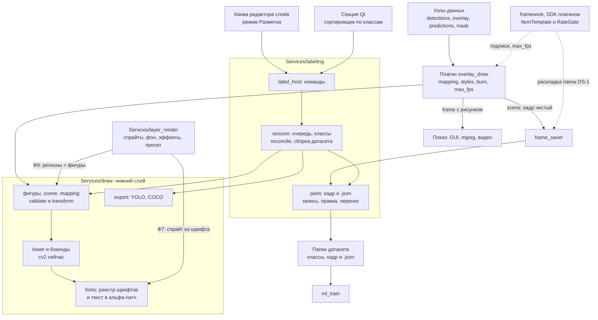

# Архитектура рисовальщика — предложение CTO, раунд 2 (Fable 5.2)

> Дата: 2026-11-11. Режим: предложение архитектуры, не вердикт. HEAD 7fd169ca6.
> Раунд 1: [`2026-11-11_draw-architecture-cto.md`](2026-11-11_draw-architecture-cto.md).
> Вводные владельца к раунду 2: инструмент разметки обязателен; RGB/BGR — не причина разделять `draw` и `layer_render`;
> шрифты подключаемые; общий помощник шаблонов полей — да; ограничение частоты не обязательно глобальное.
> Источник: отчёт агента `cto`, сохранён лидом без правок по существу. Лид перепроверил по коду:
> `Services/ml_train/data.py:96` (`FolderDataset` — подпапки-классы), `plans/layer-render/plan.md:123-136`
> (решения владельца 2026-10-02: один редактор, регион — вид слоя), `Plugins/processing/circle_detector/plugin.py:215`
> (рисует окружности в кадр). Решения владельца по вопросам раздела 5 — пока не приняты.

Схема после раунда 2: три модуля в `Services` с одним направлением импорта — `draw` (нижний слой: фигуры, шрифты, бэкенды, экспорт), `layer_render` (строится на `draw`, остаётся отдельным пакетом) и новый малый `labeling` (пары «кадр + `.json`» на диске и сессия разметки); редактор разметки — режим существующей канвы редактора слоёв, не второй редактор.

Код рисования, рецепты и топологии между 3ce3fbf1e и 7fd169ca6 не менялись (`git diff --stat` по этим путям пуст), ссылки раунда 1 в силе. Числа сняты на macOS arm64, не на стенде и не на Orin.

Что изменилось против раунда 1:
- добавлен `Services/labeling` и его место в системе;
- `layer_render` теперь официально стоит на `draw`; RGB/BGR и «новый массив против рисования на месте» сняты как причины;
- один шрифт в репозитории заменён реестром: встроенный шрифт по умолчанию плюс пользовательские;
- помощник шаблонов полей получил место и грамматику, проверенную прототипом;
- `transform_scene` принимает аффинную матрицу подобия вместо пары «масштаб, сдвиг»: регионам Ф9 нужен поворот;
- у правила `mapping` появилось поле `enabled`.

## 1. Схема модулей



`draw` не знает ни о спрайтах, ни о папках. `layer_render` берёт у него шрифты, фигуры и экспорт. `labeling` берёт фигуры и экспорт и владеет форматом пары на диске. Схему не рендерил.

## 2. Ответы на вводные

### 2.1 Инструмент разметки

**Решение.** Строится на `Services/draw`: метка кадра — та же сцена, что уходит в экспорт. Новый модуль `Services/labeling` держит только диск и сессию. Отдельного редактора нет: контуры рисуются на канве редактора слоёв в режиме «Разметка» (решения владельца от 2026-10-02 в `plans/layer-render/plan.md:123-136`: «не делать редакторов много», сначала веб, Qt вместе с Ф8).

**Почему отдельный модуль.**
- В `draw` нельзя: там нет работы с кадрами на диске (урок `RendererService`).
- В `layer_render` нельзя: он про синтетическую сцену и пресеты, а не про реальные кадры и папки.
- В `frame_saver` нельзя: формат пары нужен `ml_train`, а `Services` не импортирует `Plugins`.
- В `dataset_gen` отклонено: общий плагин сохранения стал бы зависеть от генератора синтетики.

**Кто что делает.**

| Часть | Где | Что |
|---|---|---|
| Словарь фигур, проверка, экспорт в YOLO и COCO | `Services/draw` | одна фигура — один формат для показа, разметки и Ф9 |
| Пара на диске | `Services/labeling/pairs.py` | атомарная запись (`.json` раньше картинки), правка с сохранением чужих ключей, перенос пары целиком |
| Сессия | `Services/labeling/session.py` | очередь, назначение класса, отмена, счётчики, сверка, сборка датасета |
| Команды | `Services/labeling/plugin` (`label_host`) | те же команды для веба и Qt |
| Канва | режим редактора слоёв в `pult_web`, позже Qt (Ф8) | прямоугольник, полигон, далее OBB и кисть |
| Сортировщик | секция в `multiprocess_prototype/frontend/widgets/tabs/services/neural` | миниатюра и клавиши классов; это список, не вторая канва |

**Связи.**
- `frame_saver` пишет пары через `pairs.write_pair`: один код формата вместо двух. DS-1 добавляет раскладку папок.
- Ручной перенос в проводнике остаётся законным. Поэтому для класса истина — папка; `.json` догоняет при `reconcile`, расхождения считаются.
- `ml_train` уже читает подпапки-классы (`Services/ml_train/data.py:96-112`, `FolderDataset`). Сортировщик даёт данные для обучения без правок `ml_train`.
- Ф9: регион в пресете — метка синтетического объекта в его координатах; при генерации она идёт через `transform_scene` в `.json` кадра. Формат тот же, что у ручной разметки.
- Машина и человек пишут в одно поле `scene`: `overlay_draw(burn: false)` даёт предразметку, человек правит. У фигуры поле `source`: `model`, `human` или `synthetic`.

**Расхождение с решением владельца.** Решение (1) от 2026-10-02 говорит «регион хранится в пресете как слой». У реального кадра пресета нет, поэтому метки реального кадра кладутся в `.json` рядом с кадром. Это расширение решения владельца, нужно его слово.

```python
# Services/labeling/pairs.py
@dataclass(frozen=True)
class Pair:
    image: Path
    sidecar: Path                      # тот же stem, .json

def iter_pairs(root: Path) -> Iterator[Pair]: ...
def read_sidecar(pair: Pair) -> dict[str, Any]: ...
def write_pair(image_path: Path, image: np.ndarray, sidecar: Mapping[str, Any]) -> Pair: ...
def update_sidecar(pair: Pair, patch: Mapping[str, Any]) -> dict[str, Any]: ...   # чужие ключи целы
def move_pair(pair: Pair, dst_dir: Path) -> Pair: ...                             # обе части или ни одной

# Services/labeling/session.py
class LabelSession:
    def __init__(self, root: Path, classes: Sequence[str]) -> None: ...
    def queue(self, *, folder: str | None = None, reviewed: bool | None = None) -> list[Pair]: ...
    def assign_class(self, pair: Pair, label: str) -> Pair: ...     # перенос + label, reviewed=True
    def set_scene(self, pair: Pair, scene: Scene) -> None: ...      # validate_scene из Services/draw
    def undo(self) -> Pair | None: ...
    def stats(self) -> dict[str, int]: ...

def reconcile(root: Path) -> list[Mismatch]: ...                    # папка против label в .json
def export_dataset(root: Path, out: Path, fmt: str) -> ExportReport: ...   # "folders" | "yolo" | "coco"

# добавка в Services/draw
def validate_scene(scene: Scene) -> None: ...                       # ValueError с номером фигуры
def transform_scene(scene: Scene, matrix: Affine2x3) -> Scene: ...  # сдвиг, поворот, равный масштаб
```

Ключи `.json`: `schema`, `label`, `label_source`, `reviewed`, `scene`, плюс поля `frame_saver` и узлов (`predictions`, `track_id`).

**Минимальная первая версия.** Сортировщик по классам: ядро, CLI (`stats`, `reconcile`, `export`) и секция Qt. Он закрывает поток DS-1 «папка „не распознана“ → нужная буква» и сразу кормит обучение. Рисование контуров — вторая версия: у него сегодня нет потребителя-тренера (в `Services/ml_train` есть только классификация) и оно ждёт канву после Ф5.

### 2.2 `layer_render` и `draw`

**Решение.** `layer_render` строится на `draw`; пакеты остаются раздельными.

Причины раунда 1, которые сняты:
- RGB/BGR. Цвет `Op` идёт в порядке каналов холста. Цвета сцены и стилей остаются BGR, как в рецептах сегодня; для RGB-холста `lower` меняет порядок.
- «Новый массив против рисования на месте»: это одна строка `copy()` у вызывающего.

Настоящие причины раздельных пакетов:
- **Работа разная.** В `layer_render` почти нет векторного рисования: единственный вызов — `cv2.line` в ядре смаза (`Services/layer_render/effects.py:57`). Остальное — пресеты, каталог, розыгрыш rng, эффекты, вырез. Векторному бэкенду там сегодня нечего заменять.
- **Размер и радиус тестов.** `draw` должен оставаться малым и без ассетов: его грузит ветка показа. `layer_render` несёт pydantic-пресеты, каталоги и 1613 тестов.

Пины и поток rng строить на `draw` не мешают; они требуют закреплённого бэкенда.

Что `layer_render` берёт у `draw`:

| Что | Когда | Зачем |
|---|---|---|
| Реестр шрифтов и текст в альфа-патч | Ф7 «спрайт из шрифта» | списки шрифтов сегодня зашиты в четырёх местах (см. 2.3) |
| Фигуры и `transform_scene` | Ф9, вид слоя «регион» | один словарь с показом и разметкой |
| Экспорт YOLO и COCO | Ф9 | один реестр экспортёров |
| Бэкенд примитивов | только для новых векторных слоёв | имя бэкенда задаётся явно |

Что не берёт: склейку спрайтов, фон и эффекты. Они остаются своим numpy-кодом, пока замер не покажет, что это узкое место.

Как пины переживают сменный бэкенд:
- `layer_render` никогда не зовёт `auto`: только `get_backend("cv2")`.
- Пин хранит имя бэкенда, а для текста ещё sha256 файла шрифта и версию Pillow.
- Другой бэкенд допускается под пины, только если объявил `exact_as="cv2"` и прошёл побайтный класс conformance на золотых сценах `layer_render`.
- Путь к общему ядру склейки открыт. Перебор всех 16 777 216 сочетаний (альфа, спрайт, фон) дал 0 расхождений между формулой `composite` на float32 (`Services/layer_render/compose.py:149-153`) и целочисленной `(a*s + (255-a)*d + 127) // 255`. Целочисленную формулу любой бэкенд повторит точно. Примитив `blit` добавляется, когда его попросит замер; сейчас не строить.

Правка LR-001 («самый нижний пакет рендера») нужна раньше, чем в раунде 1: при старте Ф7, а не Ф9. Добавить правила sentrux: `Services/draw` не импортирует `layer_render`, `labeling`, `line_sim`, `dataset_gen`, `ml_*`.

**Отклонено.** Один пакет на всё: радиус тестов и вес импорта. Перевод существующей склейки на бэкенд сейчас: функции не прибавляет, слой прибавляет.

### 2.3 Шрифты

**Решение.** Реестр шрифтов в `Services/draw/fonts.py`: встроенный шрифт по умолчанию плюс папки пользователя. Одно другому не противоречит.

- **Встроенный**: DejaVu Sans и Bold в `Services/draw/fonts/`, около 690 КБ файл. Нужен как запасной и как основа тестов. Его имена зарезервированы: файл пользователя с тем же именем — ошибка.
- **Пользовательские**: `.ttf` и `.otf` из `data/fonts/`. Импорт — `FontRegistry.add()` или просто положить файл в папку.
- **Имя, не путь.** Стиль и сцена ссылаются на шрифт по имени (`font: dejavu-bold`); сцена остаётся JSON, каждый процесс находит файл сам. Неизвестное имя — ошибка при `configure` со списком доступных.
- **Кириллица.** Шрифт без неё даёт одно предупреждение при `configure`. Цепочку запасных шрифтов не строить.

```python
@dataclass(frozen=True)
class FontInfo:
    name: str
    path: Path
    sha256: str            # смена файла под тем же именем видна
    source: str            # "bundled" | "user"
    has_cyrillic: bool

class FontRegistry:
    def __init__(self, user_dirs: Sequence[Path] = ()) -> None: ...
    def names(self) -> list[str]: ...
    def info(self, name: str) -> FontInfo: ...
    def load(self, name: str, px: int) -> ImageFont.FreeTypeFont: ...   # кэш (name, px)
    def add(self, src: Path, name: str | None = None) -> FontInfo: ...  # копия в папку пользователя
DEFAULT_FONT = "dejavu-bold"
```

Conformance и разные ОС:
- Тесты геометрии текста идут только на встроенном шрифте. Одна строка в 22 px заняла 252 px у DejaVu Bold, 200 px у Arial Bold и 248 px у Courier: между шрифтами сравнивать ширину нельзя.
- Пин текста — тройка «версия Pillow, версия FreeType, sha256 шрифта». Тройка совпала — сравнение побайтное; не совпала — с допуском, и тест печатает новую тройку.
- Пользовательский шрифт проверяется только на «открывается и даёт непустую маску».

Побочная польза: списки шрифтов сегодня зашиты в `Services/ml_inference/plugin/plugin.py`, `Services/dataset_gen/preview.py:17-21`, `Services/dataset_gen/tools/make_ru_letter_sprites.py:25-29`, а `Services/line_sim/tools/build_stand_assets.py:79` берёт DejaVu из matplotlib. Реестр заменяет все четыре, по мере правок этих файлов.

**Отклонено.** Сканирование системных шрифтов (зависит от ОС). Брать DejaVu из matplotlib в рантайме (лишняя зависимость на Orin).

### 2.4 Помощник шаблонов полей

**Место.** Framework: `multiprocess_framework/modules/process_module/plugins/item_template.py`, экспорт из SDK плагинов. Там определён контракт item; `frame_saver` по ADR-120 знает только SDK; помощник ничего не знает о зрении. `Services/draw/mapping.py` импортирует его оттуда же. Если импорт SDK окажется тяжёлым для CLI, файл переезжает в `data_schema_module` без смены API.

**Грамматика** (прототип на `string.Formatter`, запущен):

| Запись | Смысл | Проверено |
|---|---|---|
| `{predictions.0.label}` | путь: ключи через точку, целое — индекс списка | `Ж` |
| `{predictions.0.confidence:.2f}` | `:` — только формат Python | `0.97` |
| `{verdict.angle_deg\|bucket=45:03d}` | `\|` — именованный фильтр, `=` — его аргумент | `135` |
| `{verdict.word\|default=не распознана}` | значение при отсутствии поля | `не распознана` |
| `{{ }}` | буквальные скобки | да |

- С DS-1 не конфликтует: диапазон становится фильтром `bucket`. Голое `{verdict.angle_deg|45}` отклоняется с подсказкой «для диапазона пишите |bucket=N» (проверено).
- Нет поля и нет `default` — исключение `MissingField` с путём. Рисование пропускает часть подписи; `frame_saver` кладёт кадр в запасную папку.
- Выражений, арифметики и доступа к атрибутам нет: только ключи dict и индексы списка. Поэтому не голый `str.format`, который ходит по атрибутам объектов.
- `when` и `unless` в правилах `mapping` используют тот же `get_path`.
- Цена: 1,84 мкс на подпись, шаблон разбирается один раз при `configure`.

```python
class ItemTemplate:
    def __init__(self, template: str) -> None: ...     # ValueError на синтаксис и неизвестный фильтр
    fields: tuple[str, ...]
    def render(self, item: Mapping[str, Any]) -> str: ...   # MissingField
def get_path(item: Mapping[str, Any], path: str, default: Any = MISSING) -> Any: ...
```

Фильтры первой версии: `bucket`, `default`, `safe` (имя папки). `safe` не прототипирован.

### 2.5 Ограничение частоты

**Решение.** Регистр `max_fps` у `overlay_draw`, 0 — выключено. Реализация — класс `RateGate` в SDK плагинов, чтобы `frame_saver` и `mjpeg_sink` позже взяли тот же код.

- Кадр отбрасывается до сборки сцены и до копии, поэтому пропущенный кадр почти ничего не стоит.
- Счётчики `drawn` и `skipped` в регистрах: замер «до и после» читается с живой системы.
- На ветке сохранения (`burn: false`) по умолчанию 0: кадры датасета не теряются.

```python
class RateGate:
    def __init__(self, max_fps: float) -> None: ...
    def allow(self, now: float | None = None) -> bool: ...
```

Исправление `fps_limit` во framework остаётся необязательной отдельной задачей.

## 3. Миграция: только отличия от раунда 1

| Фаза | Что добавилось | Замер |
|---|---|---|
| 1. Ядро | реестр шрифтов (встроенный и папка пользователя); `ItemTemplate`, `get_path`, `RateGate` в SDK | пин текста по тройке; время импорта SDK из CLI |
| 2. Mapping | `max_fps` через `RateGate`; счётчики `drawn`, `skipped`; поле `enabled` у правила | `skipped / (drawn + skipped)` при 100 кадр/с и `max_fps: 30` — около 0,7 |
| 5a. Пары (с DS-1) | `Services/labeling/pairs.py`; `frame_saver` пишет через него; `scene` в `.json` | обрыв процесса посреди записи и переноса: число картинок равно числу `.json` |
| 5b. Сортировщик | `session`, CLI, секция Qt, `reconcile` | после переноса K кадров `FolderDataset` видит K кадров в новых классах; `reconcile` даёт 0 расхождений |
| 5c. Экспорт | YOLO и COCO из `scene` | как в раунде 1: IoU не ниже 0,95 на синтетике |
| L2. Контуры | режим «Разметка» на канве: прямоугольник и полигон; предразметка моделью. После Ф5 плана layer-render | полигон → YOLO → обратно, IoU не ниже 0,99; доля кадров, принятых без правок |
| L3 | OBB, кисть, регионы пресета Ф9, импорт записи стенда, канва Qt (Ф8) | — |
| LR | правка LR-001 при старте Ф7; `layer_render` берёт шрифты у `draw` | спрайты из шрифта побайтно прежние на встроенном шрифте |

Примитив `blit` для склейки — только по замеру.

## 4. Проверка страницы `docs/diagrams/system-map/draw-before-after.html`

Счётчики рецептов (8, 4, 3, 0) сходятся с grep CTO. Синтаксис Mermaid CTO не рендерил (лид рендерил: 6 SVG, 0 ошибок).

| Цитата | Что не так | Как исправить |
|---|---|---|
| «39 мс у `render_overlay` — не „полнокадровая заливка“. Основная цена — булев индекс numpy» | Заливка — треть цены: 11,0 из 35,0 мс. 39 мс — число стенда, 35 мс — машины CTO; разбор по шагам на стенде не снят | «Из 35 мс: 11,0 — заливка цветом по всему кадру, 24,5 — три прохода булева индекса. На стенде разбор не проверен» |
| «Бэкенд умеет пять примитивов и смешивание патча» | Патч — один из пяти | «Пять примитивов; пятый — смешивание альфа-патча» |
| Стрелка «фигуры с label» в `.json`; «Фигуры с полем `label` пишутся как `scene` в `.json`» | В `.json` пишется вся сцена; по `label` отбирает экспорт | «В `.json` — вся сцена; в YOLO и COCO идут фигуры с `label`» |
| «Регистры-списки GUI правит… Табличный редактор не нужен» | Правку вживую не запускали | Добавить «вживую не проверено»; «не нужен для первой версии» |
| «весь рисунок на 1080p стоит 2,4–3,9 мс на кадр» (разделы 2 и 4) | Сумма отдельных замеров, не сквозной прогон | Добавить «сумма отдельных замеров, macOS arm64» |
| «пять основных мест рисования и ещё шесть мелких» | «Мелких» не проверено: `circle_detector` рисует окружности прямо в кадр (`plugin.py:215`) | «ещё шесть неразобранных» |
| «Граница между ними — сцена, а точнее её сводка в пять примитивов» | Границ две. Сцена — данные, идёт между процессами и в `.json`. Список `Op` живёт только внутри процесса | Развести две границы |
| «Один плагин на всё рисование. Лежит на ветке показа» | С `burn: false` он стоит и на ветке сохранения | «на ветке показа или сохранения» |
| «`rendered_frame` — дисплей рецептов его не читает» | В `inspection_full.yaml:197` дисплей привязан именно к нему | «рецепты не читают; топология `inspection_full` читает» |
| «любой ndarray верхнего уровня от 8192 байт едет ссылкой на SHM» | Только числовой, ndim 2–3 | Добавить условие |
| «В ядре нет записи на диск» | После раунда 2 есть одна: копия файла шрифта по явной команде | «не пишет кадры и данные конвейера» |
| Раздел 7 целиком: «…и RGB. Сменный бэкенд под такими пинами их ломает» | Отменено: RGB не причина; пины живут с закреплённым бэкендом | Переписать по 2.2 |
| Раздел 8: «как сравнивать ширину текста между системами, предстоит решить» | Решено в 2.3 | Заменить решением |
| Раздел 9, пункты про шаблон, шрифты, разметку, `layer_render` | Решены в 2.1–2.4 | Убрать из нерешённого; добавить вопросы из раздела 5 |
| «в общем узле их заменяют регистры `mapping` и `styles`» (команды `render_overlay`) | В отчёте раунда 1 этого не было; для `toggle_detections` не хватало выключателя | Оставить, дописать «у правила есть поле `enabled`» |
| Блок conformance | Нет побайтного класса `exact_as`, а на нём теперь держатся пины `layer_render` | Добавить |
| «поэтому в июне 2026 `overlay_draw` переключили на `frame`» | Коммит 454c4ffb1 CTO не читал | Не проверено; оставить со ссылкой на коммит |

## 5. Что оставил открытым или ненадёжным

Не проверено:
- Стенд не запускался. Перебор формулы `composite` выполнен только на машине CTO; запас до границы округления (около 0,002 против погрешности float32 порядка 0,0001) говорит, что результат не зависит от платформы, но на Windows и Orin не запускался.
- Совпадают ли маски глифов побайтно между ОС при одной версии Pillow. На машине CTO Pillow 12.2.0 и FreeType 2.14.3; повтор на одной машине даёт тот же хеш.
- Лицензия DejaVu на распространение — по памяти.
- Как секции вкладки «Нейросеть» вызывают сервисы (в процессе GUI или командами бэкенду): транспорт для сортировщика выбран по образцу редактора слоёв, код секций не читан.
- Внутренности канвы `pult_web`: что она примет режим разметки, опирается на `plans/layer-render/plan.md:126-127`, код канвы не читан.
- Отсутствие тренера детекции — по grep в `Services/ml_train`.
- Время импорта SDK плагинов из CLI; README `data_schema_module` не читан.
- Поиск готовых регистров ограничения частоты и помощников пути — по узким шаблонам имён.
- Прототип шаблона — 60 строк во временной папке сессии, не код под ревью; скрипт проверок раунда 2 (`cto-draw/r2_checks.py`) тоже во временной папке.
- Хранение маски кистью (PNG рядом или RLE в `.json`) и импорт записи стенда не спроектированы.

Вопросы владельцу:
1. Метки реальных кадров хранить в `.json` рядом с кадром? Это расширяет решение (1) от 2026-10-02 «регион хранится в пресете».
2. Править LR-001 при старте Ф7 (шрифты), а не Ф9?
3. Класть два файла DejaVu (около 1,4 МБ) в репозиторий?
4. Для класса кадра истина — папка, а `.json` догоняет при `reconcile`? Иначе ручной перенос в проводнике перестаёт быть законным.
5. Контуры (L2) ждут Ф5 плана layer-render или идут раньше отдельной веткой канвы?
