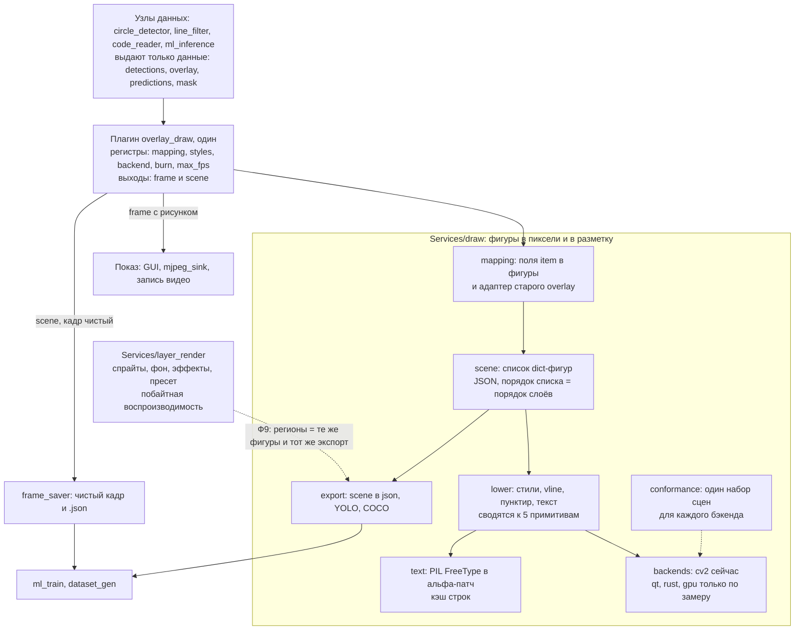

# Архитектура рисовальщика — предложение CTO (Fable 5.2)

> Дата: 2026-11-11. Режим: предложение архитектуры, не вердикт фазы. База: `main` 358faaeda.
> Источник: отчёт агента `cto` (Fable 5.2), сохранён лидом без правок по существу.
> Входные материалы: `docs/diagrams/system-map/index.html`, `docs/diagrams/system-map/draw-before-after.html`.
> Лид перепроверил по коду посылки 0.1 (`Plugins/render/overlay_draw/registers.py:21-31` — `color_table: list[dict]`)
> и 0.2 (`multiprocess_framework/modules/router_module/middleware/frame_shm_middleware.py:52-55` — claim check любого
> ndarray верхнего уровня от 8192 байт): обе подтвердились. Остальное — как в отчёте, с его пометками «не проверено».
> Решения владельца по вопросам раздела 7 — пока не приняты.

Рекомендуемая схема: два модуля — новый `Services/draw` (векторные фигуры → пиксели и → разметка, сменные бэкенды за одним вызовом на кадр) и существующий `Services/layer_render` (растровая сборка сцены, без изменений) — плюс один тонкий плагин `overlay_draw`; общий у модулей словарь фигур и экспорт разметки, а не растеризатор.

Числа сняты на macOS arm64, не на стенде и не на Orin.

## 0. Пять посылок задания расходятся с кодом

1. **«В регистрах нет полей-списков, GUI их не правит» — неверно.** `Plugins/render/overlay_draw/registers.py:21-31` держит `color_table: list[dict]`. Рецепт передаёт его списком (`multiprocess_prototype/recipes/qr_reader_sdk_demo.yaml:89-95`). GUI отдаёт list/dict в общий JSON-редактор (`multiprocess_prototype/frontend/forms/factory/kinds.py:171`, `json_editor.py`). Правку вживую не запускал.
2. **«SHM возит только `frame`, остальные массивы идут pickle» — устарело.** С Task 4.1 любой ndarray верхнего уровня (ndim 2–3, от 8192 байт) едет ссылкой на SHM со своим кольцом (`multiprocess_framework/modules/router_module/middleware/frame_shm_middleware.py:50-58, 79-99`). Вложенные массивы (список контуров) идут inline. Комментарий в `Services/ml_inference/plugin/plugin.py` про pickle для `rendered_frame` устарел.
3. **«39 мс у `render_overlay` — это полнокадровая заливка» — верно на треть.** Тот же код на 1080p дал 35,0 мс при покрытии маской 5 % и 98,3 мс при 44 %. По шагам: `zeros_like` + заливка цветом 11,0 мс, три прохода булева индекса по 8,1–8,3 мс, само смешивание 0,08 мс. Полнокадровое смешивание через cv2 стоит 1,78 мс. ROI для первых 20× не нужен.
4. **`fps_limit` дисплея никто не исполняет.** `git grep -F fps_limit` находит его только в конфиге, схемах, домене, вкладке GUI и реестре `display_module`. Ветка показа рисует с частотой камеры. На живом стенде не проверял.
5. **Мест рисования больше пяти.** Вызовы рисования cv2 есть ещё в `Plugins/processing/points_render/geometry.py`, `Plugins/calibration/camera_robot/plugin.py`, `blob_detector`, `circle_detector`, `segmentation`, `Services/phone_gateway/plugin/plugin.py`. Что из этого идёт на дисплей, не разбирал.

## 1. Схема модулей



Узлы данных не рисуют. Плагин `overlay_draw` превращает поля item в сцену и, если включено `burn`, рисует её одним вызовом на копии кадра. Ядро сводит сцену к пяти примитивам; бэкенд умеет только их, поэтому новый бэкенд — пять функций без шрифтов. Та же сцена без рисования уходит в `.json` рядом с чистым кадром. `layer_render` остаётся отдельным: у него побайтные пины, RGB и поток rng.

## 2. Контракты

```python
# Services/draw/interfaces.py
type Figure = dict[str, Any]      # JSON-совместимый, пересекает процессы как есть
type Scene = list[Figure]         # порядок списка = порядок слоёв

# Виды фигур сцены: point, line (dash опц.), polyline (closed), circle,
# rect (xyxy, angle опц.), mask (key = имя ndarray в item), text.
# Общие поля: kind, group, type, label (есть label -> фигура идёт в разметку),
# color / thickness / alpha / fill (перебивают таблицу стилей).

@dataclass(frozen=True, slots=True)
class Op:                         # примитив после lower(): только числа и ndarray
    code: str                     # "line" | "polyline" | "circle" | "rect" | "patch"
    pts: tuple[int, ...]          # пиксели холста
    color: tuple[int, int, int]   # в порядке каналов холста
    thickness: int                # -1 = заливка
    alpha: float
    patch: np.ndarray | None = None   # uint8 (h, w): альфа-маска текста или заливки
    closed: bool = False
    aa: bool = False

@dataclass(frozen=True)
class Capabilities:
    kinds: frozenset[str]         # какие Op.code умеет
    native_text: bool             # False -> текст приходит как "patch"
    antialias: bool
    pixel_formats: frozenset[str] # "bgr8", "gray8"
    inplace: bool                 # рисует в переданный массив, кадр целиком не трогает
    exact_as: str | None          # с каким бэкендом совпадает побайтно

class DrawBackend(Protocol):
    name: str
    caps: Capabilities
    def render(self, canvas: np.ndarray, ops: Sequence[Op]) -> None: ...  # на месте

class TextRasterizer(Protocol):
    def mask(self, text: str, font_px: int) -> np.ndarray: ...  # uint8 (h, w)

# Services/draw/__init__.py
def build_scene(item: Mapping[str, Any], rules: Sequence[MappingRule], frame_wh: tuple[int, int]) -> Scene: ...
def scene_from_overlay(overlay: Mapping[str, Any], frame_wh: tuple[int, int]) -> Scene: ...
def transform_scene(scene: Scene, scale_xy: tuple[float, float], offset_xy: tuple[float, float]) -> Scene: ...
def lower(scene: Scene, styles: StyleTable, canvas_wh: tuple[int, int],
          arrays: Mapping[str, np.ndarray], text: TextRasterizer) -> list[Op]: ...
def render(canvas: np.ndarray, scene: Scene, *, styles: StyleTable, backend: DrawBackend,
           arrays: Mapping[str, np.ndarray] | None = None) -> None: ...
def get_backend(name: str) -> DrawBackend: ...   # "auto" | "cv2" | ...
def register_backend(name: str, factory: Callable[[], DrawBackend]) -> None: ...
def available_backends() -> dict[str, Capabilities]: ...
```

Правила реестра:
- Неизвестное имя даёт `ValueError` со списком доступных имён. Бэкенд без своей библиотеки даёт `RuntimeError` при `configure`, как `_make_backend` в `Services/ml_inference/engine.py:28-38`.
- Молчаливой замены нет. В `Plugins/sources/camera_service/backends/__init__.py` неизвестный тип камеры тихо становится симулятором; здесь так нельзя.
- `auto` разрешается один раз при `configure`. Имя пишется в лог и в регистр только для чтения `active_backend`.

Конфиг плагина (регистры `list[dict]`, из рецепта или JSON-редактора):

```yaml
- plugin_name: overlay_draw
  backend: auto
  burn: true            # false: кадр не трогается, выдаётся только scene
  max_fps: 30           # 0 = без ограничения
  mapping:
    - {from: overlay}                                   # готовые фигуры line_filter, code_reader
    - {from: detections, each: true, figure: circle, center: center, radius: radius, group: det}
    - {from: contours, each: true, figure: polyline, points: ".", closed: true, group: contour}
    - {from: mask, figure: mask, group: defect}
    - {from: detections, each: true, figure: rect, xyxy: bbox, group: defect}
    - from: predictions.0
      figure: text
      anchor: [8, 6]
      group: pred
      parts:
        - {text: "{label} {confidence:.2f}"}
        - {text: "  {angle_deg:.0f}°", when: angle_valid}
        - {text: "  <порог", when: below_threshold}
      group_when: [{when: below_threshold, group: pred_low}]
  styles:
    - {group: pred, color: [0, 255, 0], font_px: 22}
    - {group: pred_low, color: [0, 165, 255], font_px: 22}
    - {type: line, color: [0, 255, 0], thickness: 4}
```

В правилах нет выражений: только путь к полю, формат и `when` / `unless`. Всё сложнее узел-производитель отдаёт готовыми фигурами в `overlay`.

## 3. Ответы на вопросы

### 3.1. Граница модулей

Два модуля в `Services`, не один и не модуль framework.
- Почему не один: `layer_render` обещает побайтно одинаковые кадры (sha-литералы в тестах, поток rng по LR-001), работает в RGB и возвращает новый массив. Рисование поверх кадра идёт в BGR на месте и между бэкендами сравнивается с допуском. Сменный бэкенд под побайтными пинами ломает пины.
- Почему не framework: framework не знает numpy и зрения (`display_module` это оговаривает).
- Общее: словарь фигур, экспорт разметки, растеризатор текста. План `layer_render` Ф9 уже называет «регион как вид слоя» и «экспорт YOLO и COCO — функции в реестре»; это должны быть те же фигуры и те же функции.
- Направление импорта: `layer_render` может импортировать `Services/draw`, обратно нельзя. Это правка LR-001 («самый нижний пакет рендера»), её решает владелец, когда стартует Ф9.

### 3.2. Гранулярность

Вся сцена одним вызовом на кадр.
- Диспетчер по 125 dict-фигурам стоит 0,508 мс против 0,497 мс у прямых вызовов cv2. Компиляция и повтор списка команд экономят не более 0,02 мс.
- Нативному бэкенду нужен один переход границы: `Op` содержит только числа и ndarray и пакуется в таблицу int32.
- API «холст с методами» отклонён: переход границы на каждую фигуру, и плагины снова начнут рисовать сами.
- Составной бэкенд из черновика отклонён. Текст — не второй бэкенд, а источник альфа-патча. Ядро отдаёт любому бэкенду без своего текста готовый патч, а смешивать патч обязан каждый бэкенд. Скрытой цены нет: кадр целиком не конвертируется.
- Conformance: один набор сцен; вне объединения рамок фигур пиксели побайтно равны входу; внутри — совпадение покрытия и цвета с допуском; бэкенды с `exact_as` сравниваются побайтно. В набор входят пересекающиеся полупрозрачные фигуры: мой первый ROI-вариант смешал пересечение дважды и разошёлся на 61 уровень.

### 3.3. Где жечь пиксели

Сейчас строится (а): узел на ветке показа. Сцена всегда едет данными, поэтому (c) остаётся открытым без смены контракта.

| Потребитель | Что нужно | Как |
|---|---|---|
| Локальный GUI, mjpeg_sink, удалённый Пульт | кадр с рисунком | ветка с `overlay_draw`, `max_fps` = частота показа |
| Запись видео с рисунком | кадр с рисунком | своя ветка, свой `max_fps` |
| Датасет | чистый кадр и разметка | ветка `overlay_draw(burn: false)` → `frame_saver` |
| Orin без экрана | только данные | `burn: false`, цена пикселей ноль |

Отрисовка в GUI (b) отклонена сейчас по трём причинам:
- Мост кадров для Пульта несёт ровно пять ключей и не больше 300 байт (`multiprocess_framework/modules/frontend_module/bridge/remote_frame_source.py`, `DESCRIPTOR_KEYS`). Сцена туда не помещается.
- Окно показа делает crop → scale → rotate → flip (`multiprocess_prototype/frontend/widgets/displays/render_pipeline.py`). Координаты сцены пришлось бы вести тем же путём.
- После исправлений рисунок на 1080p стоит 2,4–3,9 мс на кадр; при 30 кадр/с это 7–12 % одного ядра на моей машине. Выигрыш (b) мал.

### 3.4. Бэкенды

Таблица в разделе 4. Первый и единственный бэкенд — cv2 с текстом через PIL-патч. Второй кандидат по замеру — Qt `QPainter`: уже в зависимостях, рисует в numpy-кадр BGR без копии (проверил), меняющийся текст с кириллицей делает дешевле PIL.

### 3.5. Скорость независимо от бэкенда


- Не рисовать чаще показа: 100 → 30 кадр/с даёт 3,3× меньше работы. Сегодня ограничения нет (посылка 4).
- Одна копия кадра на ветку. Сейчас в процессе `draw` копий две: `circle_draw` и `overlay_draw` копируют каждый.
- Маска: никогда булев индекс numpy. `cv2.addWeighted` + `cv2.copyTo`: 35,0 → 1,78 мс по всему кадру (20×), → 0,28 мс по рамкам фигур (127×). Читать надо из исходного кадра, иначе пересечения смешиваются дважды.
- Текст патчем: 3,36 мс (весь кадр 1080p, как в `ml_inference`) → 0,63 мс без кэша → 0,08 мс из кэша строк.
- Рисовать на уменьшенном кадре дисплея: ресайз 1080p → 720p стоит 0,39 мс, заливка маски падает с 1,78 до 0,81 мс, в SHM уходит 2,7 МБ вместо 6,2 МБ. Опция на ветку, не по умолчанию.
- Кэш статичных слоёв не нужен: все линии и штрихи входят в 0,5 мс.
- SHM: кадр и маска едут ссылкой, сцена inline (125 фигур = 5,6 КБ, pickle туда и обратно 0,09 мс).

### 3.6. Плагин

Один: `overlay_draw`, имя сохраняется. `mapping` и `styles` — регистры `list[dict]`, это работает уже сегодня (посылка 1). Правки framework не нужно. Проверка правил — pydantic при `configure`, ошибка называет номер правила; плохая правка вживую оставляет последнее верное значение. Словарь `overlay` от `line_filter` и `code_reader` не меняется: `scene_from_overlay` раскладывает его в плоский список, `vline` разворачивается в линию и два пунктира в ядре (`geometry.py` переезжает в `Services/draw`). `JoinInspectorManager` с `list_merge_keys=("overlay",)` остаётся как есть.

### 3.7. Разметка

Экспортёры живут в `Services/draw/export.py`: свой формат (сцена и версия схемы), затем YOLO и COCO. Плагин с `burn: false` кладёт `item["scene"]`, `frame_saver` пишет его в `.json`. `frame_saver` не импортирует `Services/draw`. Сейчас `sidecar_key` один; DS-1 должен сделать список ключей. В разметку идут только фигуры с полем `label`; линия триггера и номера треков остаются оформлением. Перевод в YOLO и COCO — при сборке датасета, не в такте линии.

**8. Миграция** — раздел 5.

**9. Риски и отказ** — раздел 6.

## 4. Таблица бэкендов

Замерено только cv2, PIL и Qt. Остальные строки по памяти: не проверено, библиотек в `.venv` нет.

| Бэкенд | Скорость | Текст и кириллица | Сглаживание | Без копии на BGR-кадре | Сборка Windows и ARM64 | Лицензия |
|---|---|---|---|---|---|---|
| cv2 | 0,50 мс эталонный набор; 1,46 мс с `LINE_AA` | нет (`cv2.freetype` в сборке отсутствует, проверил) | `LINE_AA` | да | уже стоит | Apache-2.0 |
| Pillow | текст-патч 0,55 мс; весь кадр 3,36 мс | да, FreeType | текст да, фигуры нет | нет, только патчем | уже стоит | HPND |
| Pillow-SIMD | не замерял | как Pillow | как Pillow | нет | только x86, на Orin нет | HPND |
| Qt `QPainter` на `QImage` BGR888 | 0,91 мс без текста; 1,30 мс с 20 подписями; 4,0 мс со сглаживанием | да | да | да, проверил | уже стоит; без экрана нужен offscreen и шрифты | LGPL-3 |
| skia-python | не замерял | да | да | нет: холст 4 канала | колёса есть, ARM64 не проверено | BSD-3 |
| Blend2D | не замерял | да | да | нет: 32 бита на пиксель | привязки Python слабые, сборка тяжёлая | Zlib |
| tiny-skia (Rust, PyO3) | не замерял | нет, нужен свой шрифтовой стек | да | нет: RGBA premultiplied | нужен Rust и maturin на обе цели | BSD-3 |
| Cairo | не замерял | да | да | нет: 32 бита на пиксель | Windows колёса, ARM64 системная libcairo | LGPL-2.1 / MPL |
| OpenCV CUDA | не замерял | — | — | нет: загрузка в GpuMat | своя сборка OpenCV | Apache-2.0 |
| NVIDIA VPI | не замерял | — | — | — | только Jetson | проприетарная |

У OpenCV CUDA и VPI, по памяти, нет примитивов рисования, только арифметика над кадром. Для Rust-пути без копии подошёл бы не tiny-skia, а свой растеризатор пяти примитивов прямо по буферу BGR.

Команды (машина: macOS arm64, 12 ядер, Python 3.12.13, cv2 4.13.0, numpy 2.4.4, PIL 12.2.0, PySide6 6.10.3; медиана из 40–300 повторов). Скрипты лежали во временной папке сессии и в репозиторий не сохранены:

```
PYTHONUTF8=1 .venv/bin/python -I <scratchpad>/cto-draw/bench_draw.py
PYTHONUTF8=1 .venv/bin/python -I <scratchpad>/cto-draw/bench_draw2.py
```

| Замер, кадр 1080p BGR | мс |
|---|---|
| `frame.copy()` | 0,14 |
| ресайз в 1280×720: LINEAR / AREA | 0,39 / 1,60 |
| cv2: 20 окружностей, 20 точек, 65 линий, 20 подписей ASCII | 0,50 |
| то же через сцену из 125 dict-фигур | 0,51 |
| текст PIL через весь кадр, 1080p / вырез 512×512 | 3,36 / 0,86 |
| текст PIL патчем: без кэша / из кэша | 0,63 / 0,08 |
| 20 подписей с кириллицей из кэша | 0,87 |
| маска 5 %: текущий код / cv2 весь кадр / ROI по рамкам | 35,0 / 1,78 / 0,28 |
| маска 44 %: текущий код / cv2 весь кадр | 98,3 / 1,81 |
| Qt: без текста / с 20 подписями / со сглаживанием | 0,91 / 1,30 / 4,00 |

## 5. План миграции

| Фаза | Что даёт | Рецепты и топологии | Замер до и после |
|---|---|---|---|
| 0. База | числа стенда, кода нет | `letter_robot_sim`, `inspection_full` | мс на кадр у `overlay_draw`, `circle_draw`, `render_overlay`, рисующей части `ml_inference`; загрузка процесса `draw`; частота показа; дропы |
| 1. Ядро | `Services/draw`: сцена, lower, cv2, текст-патч, conformance, адаптер overlay. `overlay_draw` внутри зовёт ядро. Подписи с кириллицей | 8 рецептов с `overlay_draw` не меняются | золотые сцены: фигуры без текста побайтно равны старому плагину; мс на кадр не выше базы |
| 2. Mapping | регистры `mapping`, `styles`, `burn`, `max_fps`, выход `scene`. Опись остальных мест рисования | `circle_draw` → правило: `letter_robot_sim`, `hikvision_letter_robot`, `letter_angle_inspect`, `dataset_circle_capture`. `contour_draw` → правило: `color_inspect` | копий кадра в `draw`: 2 → 1; мс на кадр процесса `draw`; кадров в секунду на входе плагина: частота камеры → `max_fps` |
| 3. Чистый кадр | подпись `ml_inference` → ветка `recog_draw` | `letter_robot_sim`, `hikvision_letter_robot`, `letter_angle_inspect`: `draw_overlay: false` | кадр на входе `layout` побайтно равен выходу `center_crop`; время `ml_inference.process` до и после |
| 4. Маска и рамки | `render_overlay` → правила mask, rect, text | `inspection_basic`, `inspection_full`: дисплей на `overlay_draw.frame` | стенд 1080p при 100 кадр/с: 39 мс → цель не выше 3 мс; renderer 21 Гц → частота показа; дропы около 1800 за 30 с → около нуля |
| 5. Разметка | `scene` в `.json`, экспортёры. Вместе с DS-1 | `dataset_circle_capture` | синтетика сима: рамки из экспорта против известных позиций, IoU не ниже 0,95 |
| 6. По замеру | второй бэкенд, рисунок на уменьшенном кадре или отрисовка в GUI | — | открывается, только если ветка показа после фазы 4 дороже 5 мс на кадр p95 на Orin |

Заморозка, без удаления: `circle_draw`, `contour_draw`, `render_overlay` с тремя командами и выходом `rendered_frame`, регистр `draw_overlay` и `_put_text_unicode` в `ml_inference`. Регистры `color_table` и `default_*` у `overlay_draw` остаются живыми как вход в таблицу стилей.

Не переносятся: `points_render` (строит свой холст из миллиметров, это график, не наложение) и `renderer_compositor` (сетка кадров). `qr_reader_*` и `line_filter_inspect` работают без правок с фазы 1.

## 6. Риски и что сознательно не строить

Риски:
- **Повтор `RendererService`.** Защита: в `Services/draw` нет записи на диск и решений; правило sentrux запрещает ему импорт `layer_render`, `line_sim`, `dataset_gen`, `ml_*`.
- **Язык в YAML.** Защита: в правилах нет выражений; сложное отдаёт узел готовыми фигурами.
- **Шрифты.** Arial на Windows и DejaVu на Linux дают разную ширину текста. Нужен один шрифт в репозитории или допуск в conformance.
- **Перенос чисел.** Замеры — отношения на другой машине; абсолютные числа стенда и Orin будут другими.
- **Хвост заморозки.** Три замороженных плагина и их тесты остаются на сопровождении.

Не строить сейчас:
- Бэкенд на Rust, C++ или GPU. После замены одного приёма numpy рисунок стоит 2,4–3,9 мс на кадр. Замера, что рисование — узкое место, нет.
- Отрисовку в GUI (причины в ответе 3).
- Список команд с повтором и кэш статичных слоёв.
- Составной бэкенд; зависимости skia, cairo, blend2d.
- Общий растеризатор для `layer_render`.
- Табличный редактор списков в GUI: JSON-редактор уже есть.
- Экспорт YOLO и COCO раньше, чем DS-1 научит `frame_saver` писать сцену.

## 7. Что оставил открытым или ненадёжным

Не проверено:
- Стенд не запускал. Все числа с macOS arm64.
- Строки таблицы для skia, Blend2D, tiny-skia, Cairo, CUDA, VPI и утверждение, что PIL не рисует в чужой буфер на месте, — по памяти.
- Правка регистра-списка в живом GUI и её доставка в работающий плагин.
- Отсутствие исполнителя `fps_limit` — только по grep. `pacing.py` и политику `overflow: latest` для ветки показа не читал.
- Что локальный GUI получает весь item в `data`: видел только чтение `capture_ts` и `trace` в `multiprocess_prototype/frontend/app.py:1148-1185`.
- Что именно рисуют шесть дополнительных мест (посылка 5).
- Запускаются ли ещё топологии `inspection_basic` и `inspection_full`.
- Поиск готового помощника шаблонов полей — только по именам функций, слабый. qex недоступен, искал `git grep`.
- Допуски conformance (покрытие, цвет, IoU 0,95) — предложение, не откалиброваны.
- Схему Mermaid не рендерил.
- Грамматика шаблона (`{путь:формат}`, `when`) не согласована с DS-1, где `|` значит диапазон.

Вопросы владельцу:
1. Разрешить ли `layer_render` импортировать `Services/draw` при старте Ф9 (правка LR-001)?
2. Кто исполняет `fps_limit`: framework на входе ветки показа или регистр `max_fps` плагина? Рекомендую регистр сейчас и исправление framework отдельной задачей.
3. Класть ли один шрифт (DejaVu Sans Bold, около 700 КБ) в репозиторий ради одинакового текста на Windows и Orin?
4. Где живёт помощник шаблона полей, общий с DS-1: в SDK плагинов framework (рекомендую, он не знает о зрении) или в `Services`?

Кандидат в урок памяти: булев индекс numpy по кадру `(H, W, 3)` стоит 8 мс за проход на 1080p при любом покрытии; `cv2.addWeighted` + `cv2.copyTo` дают то же побайтно за 1,8 мс.
