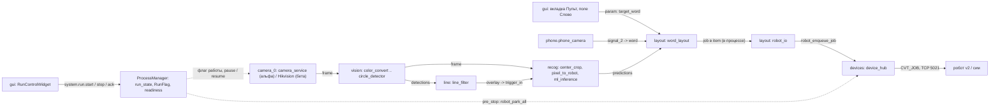

<!-- Отчёт CTO (Fable), заказ владельца 2026-11-20; сохранён координатором без правок из ответа агента. Срез main 40bcd743d. -->

# Ревью CTO на 2026-11-20: идём ли к 1.0 (срез `40bcd743d`)

База: `main` = `40bcd743db1ca9373ca3b46cf75ccbea4b0238c1`, дерево `/Users/twokrai/Project_code/Inspector_bottles/.claude/worktrees/cto-review-1120` (все `path:line` ниже — от его корня). Ничего не менял и не коммитил: `git status --short` среза пуст, в основном дереве те же 4 неотслеживаемых отчёта владельца. memory hits: `search.py release acceptance run-state gate verdict` -> `feedback_gate_signature_lives_on_a_head.md`, `feedback_absence_of_news_is_not_evidence.md`, `project_plugin_paused_is_a_label.md` и ещё 5.

## 1. Вердикт: ДА, С ПОПРАВКАМИ

Цепочка на симе (веха α) в `main` есть и держится тестами: 12 прогонов на срезе, 11 зелёных, 1 с двумя известными красными (C-101). Архитектурные решения последних недель верные: run-state во framework, ядро камер, драйвер v2, «домой» как шаг `pre_stop`. Поправки четыре.
1. **Рецепт β — не топология 1.0.** Он на старом стеке, а путь к его переводу (W4 → R4) остановлен словом «W4 не сейчас».
2. **Требование владельца «рецепт не стартует сам» влито, но выключено**: `multiprocess_prototype/backend/config/system.yaml:10` `run_gate: false`.
3. **Приборы контроля врут.** `plans_progress` на срезе показывает run-state «1 из 30», по git влито 21 из 31. Отсюда «тяжело контролировать».
4. **22.11 — это день с железом №1 (проба контроллера и кадры), не β.** Объём прошивки T4.1–T4.4 неизвестен до T0.3, план распознавания на реальных кадрах не разложен на задачи.

## 2. Звенья сценария 1.0

| Звено | Есть в main | Чем подтверждено (мой прогон на срезе, если не сказано иначе) | Не проверено / чего нет |
|---|---|---|---|
| Слово на пульте | поле «Слово» → `layout.word_layout.target_word`: `letter_robot_sim.yaml:437`, `hikvision_letter_robot.yaml:407` (`40bcd743d`) | отчёт полосы: 15 passed (сам каталог `control_panel/tests` не гонял); моя проба — находка 4 | живой ввод «МИР» в GUI не гонялся (`docs/reports/2026-11-20_pult_6.1.md:22`); 6.1b–6.6 |
| ЗАПУСТИТЬ, гейт | Ф1 `506eea281`, 2.3 `4a73cdc9e`, 2.7+2.9 `85a0521c5`, S5 `b778b9503` | 5 файлов `test_run_state*`: 275 passed; `test_run_control*.py`: 125 passed; стенд Ф на симе (числа в отчёте полосы) | гейт выключен; 2.1 коммит B, 2.4, 2.5, 2.6, 2.8 |
| Камера | α: `CameraServicePlugin` (`letter_robot_sim.yaml:134`); β: старый `HikvisionCameraPlugin` (`hikvision_letter_robot.yaml:114`); ядро W1–W3 + 4c (`3dbb8615d`) | `Services/camera_device/tests`: 462 passed, 10 skipped | ядро не подключено ни к одному рецепту 1.0; W4 не начата; порядок каналов и дебайер на железе не проверены |
| Буквы и угол | `ml_inference`, модель `mobilenet_v3_large_20260616_050828` (`letter_robot_sim.yaml:287`) | стенд α 10.11: ошибка угла > 5° у 6 дисков из 15, максимум 14,2° (`scripts/alpha_sim/STATUS.md:35-42`) | весов в срезе нет, сам не гонял; реальных кадров нет (0.5); letters-retrain 0.4 не сделана, Фаза 1 не разложена |
| word_layout | P3, P4 влиты | `word_layout/tests`: 187 passed; `scripts/alpha_sim/tests`: 219 passed | скрипт α требует окна стенда — не гонял |
| pixel_to_robot, калибровка | `use_linear: true` в обоих рецептах (`:272`, `:248`) | `pixel_to_robot/tests`: 13 passed; `calibration/camera_robot/tests`: 51 passed | F7 ждёт железа; α красная по съёму: `py` −340,9…−341,9 при окне −344…−342 (`STATUS.md:35`) |
| robot_io | читает `place_*_mm`, `place_rz_deg`, шлёт `robot_enqueue_job` (`Plugins/io/robot_io/plugin.py:178-182, 229-233`) | `robot_io/tests`: 15 passed | — |
| hub, драйвер v2 | α: `protocol: delta_v2` (`letter_robot_sim.yaml:74`); β: `delta_universal3` (`hikvision_letter_robot.yaml:58`) | `Plugins/hub/device_hub/tests`: 566 passed; `Services/device_hub/tests`: 1123 passed, 2 failed (`test_no_private_driver_state`, `71 == 64`, C-101) | `Services/robot_comm/tests` не гонял (Р2: 1697 passed, 1 failed) |
| Робот кладёт | — | — | T0.3 BLOCKED, T4.0, T4.1, T4.5, T4.6 PENDING; на железе не проверено ничего |
| Стоп, авария, квитирование, домой | 1.4, 1.7; пауза `8ff4fd151` + правка `097fdaa6e`; `robot_park_all` `9eb384633`; манифест `220bd757a` | стенд Ф на симе: стоп → `ready` 0,844 с, fault → ack 0,069 с (не мой прогон) | L1b «робот дома до `process.stop`» на роботе; `tick_fails_limit`; повтор `pause`; холодный старт hub |
| Рецепт собирает топологию | оба рецепта | `multiprocess_prototype/recipes/tests`: 214 passed, 5 skipped | рецепт β устарел (R4) |
| GUI не запускает сам | автостарт — у PM (`run.py --autostart`); источник пульта `run_gated: false` | hazard-тест `e71678c62` (в зелёном наборе) | вживую не проверял |

**Мои находки запуском (вход → наблюдение):**

1. **HIGH — рецепт β не соберёт слово на роботе v2.** `hikvision_letter_robot.yaml`: `:58` протокол v1, `:114` старая камера, `:248` `use_linear: true` (решение владельца 25.10 для β — `false`, `plans/queue/ORDER.md:55`), `:294` `first_y: -200.0`. Проба на настоящем `geometry.pitch_positions`, слово «ПЕРЕМИРИЕ», шаг 110 мм: в симе ячейки y −440…+440, радиус до 544,1 мм; в β y −200…+680, радиус до **751,5 мм**, три последние ячейки дальше 544 мм (560, 654, 751). Правка P3 (`first_y −440`) дошла только до рецепта сима. Досягаемость настоящего робота не подтверждена.
2. **HIGH — гейт выключен по умолчанию.** `system.yaml:10`. По стенду Ф (`docs/claude/OPEN_QUESTIONS.md:2484`): без ЗАПУСТИТЬ состояние `ready`, кадры идут (152). Сам не воспроизводил.
3. **MEDIUM — П3 сменил чтение по пути узла.** Настоящий `TelemetryReadModel`: `ingest("a.n", {"x": 3})` → `get("a.n")` отдаёт умолчание, `get("a.n.x")` → `3`, `snapshot("a.n")` → `{'a.n.x': 3}`.
4. **MEDIUM — поле «Слово» принимает латиницу и любую длину.** Ввод `MИP` (латинские M, P): `slots_of('М')=[]`, `slots_of('Р')=[]` — диски уйдут «нет в слове». `ПЕРЕМИРИE` с латинской E: последняя ячейка не заполнится никогда. 15 ячеек дают радиус 1251,6 мм, отказа нет. В спеке этого сценария нет.
5. **MEDIUM — осиротевшие семафоры (stdlib, Python 3.12.13, spawn).** Читатель убит в `get(timeout)`: `rlock_free_after_death=False`, новый читатель получает `EMPTY`; контроль с нормальным выходом — `True` и `got`. Новое: ребёнок убит во время `Event.wait(30)` → следующий `set()` висит (> 2 с), после него висит и `is_set()`; контроль чистый.
6. **LOW — три каталога не помещаются в класс medium:** `Services/device_hub/tests` 512 с, `Plugins/sim/pult_web/tests` 387 с, `Plugins/hub/device_hub/tests` 309 с.

## 3. Решения последних дней

| Решение | Оценка | Риск и что делать |
|---|---|---|
| 2.2 влита с открытым major, пауза исправлена позже | итог верный (стоп роботам на каждом вызове), порядок неверный | Дефект «ОСТАНОВИТЬ ответил успехом, роботы стоп не получили» жил в main с 19.11 23:50 (`8ff4fd151`) до 20.11 15:17 (`097fdaa6e`). Железа не было — вреда нет. Правило: major класса стоп/пауза/авария блокирует слияние. Остаток: бюджет 1,5 с без замера на железе, инциденты `scope` (X3) открыты. Инъекций сам не делал |
| П3 с остатками | оставить, не откатывать | Находка 3. Затронут инструмент приёмки: `backend_ctl/conditions.py:484`, `recorder.py:821` (через MCP не гонял). Починить у потребителя с тестами на оба места — до 2.4 и до пульта 6.5 |
| `run_gate: false` при влитом S5 | как шаг (коммит A, потом B) верно; как состояние — главный разрыв | Все стенды, кроме стенда Ф, идут без гейта. Коммит B — сразу после дня №1, до пульта 6.5 и до β |
| 2.7 и 2.9 влиты без стенда | приемлемо: стенд на симе сделан 20.11 и подтвердил | Только на двойниках остались `tick_fails_limit`, повтор `pause`, автостарт до `attach_ready_event`. Допуск `run_stop_timeout_s` 2,0 ± 0,5 выдержан в 4 замерах из 8 — исправить допуск в спеке |
| Отставание ORDER и шапок | системный дефект процесса | Строка статуса — ручной шаг вне слияния («plan.md — лиду отдельно»). Три прибора читают один устаревший источник: `plans_progress` (run-state 1/30, камера 11/39, r2-env 0/2 при влитых `d0994e819` и `477573696`), карточка Атласа `services/camera_device` (числит открытыми влитые 2.3a, 2.3b), ORDER (сверен 03.10). Лечение: `merge-end` отказывает, если задача из `Refs:` не помечена DONE с SHA; разовая сверка шапок по git (haiku, таблица раздела 5) |
| **C-36: A или B** | **A сейчас, с громкой пробой из C; B после тега 1.0** | Механизм воспроизвёл сам (находка 5). A — готовый путь за флагом `restart_reuse_queues`, совпадает с правилом владельца 26.10, у Д2 даёт 0 глухих из 57. B меняет инварианты транспорта (вытеснение и дренаж уходят к читателю) — это Senior+ с матрицей и стендом, не перед железом. Отменит решение: живой тест на настоящем PM, где путь A (`routing.refresh`, relay) не держит поток к перезапущенному потребителю. Слот: после дня №1, на файле PM строго после Ф |
| Аномалия «13/13 висят на SemLock» | слот писателя до железа не тратить | Нашёл механизм шире кандидата Д2 (`Event.wait` + `set()`, находка 5). В продукте по чтению он не достигается: runner опрашивает `is_set()` и спит через `time.sleep(0.1)` (`process_runner.py:191-201`), событие создаётся один раз (`system_launcher.py:115`). Остаётся узкое окно «убит внутри `is_set()`», не измерено. Дёшево: час read-only — найти `.wait(` на общем `Event` в старой редакции харнесса; есть — закрыть как артефакт. Структурно — убрать общий `mp.Event` вместе с B (образец `RunFlag`, `8d534d0f8`) |
| C-93 R3 (`gc.freeze` в conftest) | не до железа | Это тестовая инфраструктура. Сначала R1+R2 с Opus-ревью, затем замер. Бриф C-93 не читал, опираюсь на сводку |
| Холодный старт hub | нового кода не нужно | `Services/device_hub/drivers/base.py:108`: `max_reconnect_attempts` из `params` записи, умолчание 3; `:285` — `<= 0` снимает лимит. Поставить `0` у `robot_main` и `vfd_belt` в рецептах 1.0, поправить ACCEPTANCE 2.2, проверить на сим-стенде. Не подтверждено: доходят ли `params` рецепта до `entry.params` |
| Камера в `stopping` не блокирует START | вариант (б), без кода | Ключ `readiness: {severity: {out_of_spec: check_function}}` в узле камеры при R4, как сделано для модели в 2.9b |
| Ложные «разрыв revision» | вариант (в) сейчас, (а) после 1.0 | Понизить строку и считать ложные и настоящие разрывы раздельно; протокол до β не менять |
| S4b: `tick_fails_limit`, повтор `pause` | юнит-инъекция сейчас, стенд в день №2 | Бросающий `_dispatch` вне `try` драйвера — задача без железа |

## 4. Чего не хватает до 1.0

**Обязательно:**
- **Приёмка:** release-1.0 1.1, 2.1 (список недостающего для β — делать сейчас), 2.2, 3.1; решение по точности α (ORDER #27).
- **Run-state:** 2.1 коммит B, 2.4, 2.5; починка чтения узла после П3; приёмка фазы PM (ORDER 6а).
- **Камера:** 4.2a, 4.2b, 4.3, 4.4, 6.1, 6.3, остаток 0.5 (кадры дисков), R4.
- **Робот:** T0.3, T4.0, T4.1 (внутри T4.1–T4.4), T4.6, T4.5, REVIEW-5, L1b и L4 на роботе; лимит переподключения; C-101.
- **Калибровка:** F7. **Буквы:** 0.4 и неразложенная работа «распознавание на реальных кадрах».
- **Пульт:** 6.1b, 6.2, 6.3, 6.4, 6.5, 6.6, GUI-путь 6.0; проверка алфавита и длины слова (новая).
- **Дефекты:** C-36 (A), C-99, C-93 (R1+R2).

**Можно после 1.0 (рекомендую вынести):** run-state 2.8, 2.6, 3.2, 3.4–3.7; камера 1.2, 1.3, 1.4, 1.7, 4.6a–d, 5.1–5.4, 3.4, 4.5, 6.5, 6.6; C-100; C-93 R3; «водяной знак» StateProxy; робот T6.0–T6.5.

**Блокеры до 1.0:**

| Блокер | Рекомендация | Владелец |
|---|---|---|
| β-рецепт на старом стеке; W4 остановлена | начать 4.2a сейчас или письменно разрешить β на старом пути камеры (меняет решение 23) | владелец → К |
| Объём прошивки неизвестен | дату β не называть до результата T0.3 | владелец, Р2 |
| Точность угла и съёма, реальных кадров нет | в день №1 снять кадры (0.5); окна ±5° и §2.8 не расширять до чисел | владелец, К |
| Гейт выключен | 2.1 коммит B после дня №1 | Ф |
| Два рецепта и снимок `hikvision_letter_robot.build.json` правят три полосы (Пульт 6.4, К R4, Ф) | один писатель: β-рецепт — К, сим — Пульт | координатор |
| Правило отката CTO по 2.8: срок 19.11 прошёл, условия не выполнены | 2.8 вынести из 1.0, П3 оставить (регресса на стенде нет) | владелец; `tasks/2.8.md` я не читал |

## 5. Остаток задач

| Полоса | Задача | Статус по git | Блокер | До 22.11 |
|---|---|---|---|---|
| Ф | починка чтения узла (П3) | нет | — | до |
| Ф | 2.1 коммит B | коммит A `ecf291411` | условия стенда | после |
| Ф | 2.4 | нет | 2.1B, стенд, GUI | после |
| Ф | 2.5 | нет | 2.4 | после |
| Ф | 2.6, 2.8 | нет | вынести из 1.0 | — |
| Ф | приёмка фазы PM (6а) | нет | C-36, S9b, S10, S11, C-82 | после |
| К | 4.2a → 4.2b, 4.3, 4.4 | нет, решения есть | слово «не сейчас» | старт до |
| К | 6.1 (стенд-скрипт) | нет | 4.2a | после |
| К | 0.5 (кадры), 6.3 | 0.5 частично | MVS | день №1 и после |
| К | R4 | нет | W4 | после |
| Р2 | T0.3 | BLOCKED | контроллер | день №1 |
| Р2 | T4.0, T4.1, T4.6, T4.5 | нет | T0.3 | после |
| Р2 | REVIEW-5, L1b/L4 | нет | слово владельца; робот | после |
| Р2 | лимит переподключения; C-101 | нет | рецепты — один писатель | до |
| Пульт | 6.1b, 6.2, 6.3, проверка слова | нет | — | до |
| Пульт | 6.4, 6.5, 6.6, 6.0 GUI | нет | 6.2, 6.3; стенд; qt-mcp не подключился | после |
| Калибровка | F7 | BLOCKED | робот, MVS, лента | день №2 |
| Буквы | 0.4 и план по реальным кадрам | нет | кадры 0.5 | после |
| Приёмка | 1.1, 2.1 / 2.2, 3.1 | нет | — / железо | до / после |
| Д2 | C-99 / C-36 (A), C-93 (R1+R2) | брифы есть | слот; файл PM после Ф | после |

**Итог обязательных до 1.0:** Ф 5, К 8, Р2 9, Пульт 8, Калибровка 1, Буквы 1 + неразложенное, Приёмка 5, Д2 3 — **около 40**. Без железа до 22.11 реально закрыть 8–10. Задача T1.4, которая в картине координатора «ждёт слота», влита 07.11 (`558a7c138`): у Р2 кодовой задачи в очереди нет, слот свободен.

**Ненадёжные числа:** T4.1 — одна строка с неизвестным объёмом; буквы не разложены; у большинства задач камеры принадлежность к 1.0 в плане не записана; в `defects.md` смотрел только 8 ID; план пульта в шапке DRAFT.

## 6. Порядок и слоты

До 22.11:
- **Слот 1 — Ф:** починка чтения узла, затем подготовка условий 2.1B.
- **Слот 2 — Пульт:** 6.1b → 6.2 → 6.3 и проверка слова.
- **Слот 3 — К:** 4.2a (решения по BGR и `run_locked_commands` даны). Это самый длинный шест β после прошивки; без неё камеру на ядре в визит не проверить.

Ждут: Д2 — без кода до дня №1, затем C-99 и C-36 (A) после Ф на файле PM; Р2 — без слота, готовит визит (чек-лист T0.3, перенос `devices.yaml` через `cp`); 2.4, 6.5, R4, F7 — после железа.

Неделя после визита: Ф — 2.1B → 2.4; К — 4.2b, 4.3, 4.4, R4; третий слот — Р2 (T4.0 по результату T0.3) либо Д2 (C-36).

## 7. Что решить владельцу срочно

1. **W4:** начать 4.2a сейчас. Иначе β на ядре камер недостижима, а решение 23 требует ядро.
2. **Гейт:** `run_gate: true` — первая задача Ф после дня №1.
3. **Дата β:** не называть до результата T0.3; 22.11 считать днём №1.
4. **C-36:** подтвердить слот под вариант A после дня №1.
5. **Срез 1.0:** вынести 2.8, 2.6 и камерные 1.3, 1.4, 1.7.
6. **Переподключение hub:** без лимита для устройств рецепта (`max_reconnect_attempts: 0`).
7. **Дисциплина слияния:** статус задачи с SHA — условие `merge-end`; major по стопу и аварии блокирует слияние; разовая сверка шапок по git сейчас.

## Схема сценария 1.0 по рёбрам рецепта сима и диаграммы

Рёбра: провода `letter_robot_sim.yaml:450-498`, привязка пульта `:437`, `robot_io/plugin.py:229-233`. Порядок плагинов внутри `recog` и `layout` — по списку рецепта, не прослежен запуском.

- **Устарели (по дате последнего коммита, содержимое не открывал):** `docs/diagrams/architecture.mmd` (14.05), пять `.mmd` в `foundation-audit/` и `modules-overview.mmd` (26.10), `docs/maps/pm-lifecycle-commands.md` и `framework-core.md` (26.10), `transport.md` (02.10).
- **Нет совсем:** в `docs/diagrams` и `docs/maps` 0 файлов со словами `run_state`, `run_gate`, `system.run`, `RunFlag`, `robot_driver_v2`. `camera_device` и `control_panel` есть только в `system-map/index.html` (12.11). Нет диаграмм машины run-state, сеанса камеры, пути «пульт → регистр» и сквозного сценария 1.0.
- **Атлас:** `docs/atlas/INDEX.md` от 11.11. Карточка `services/control_panel`: «Открытые задачи: нет» при шести открытых задачах фазы 6.

## 8. Что я оставил открытым / ненадёжным

- **Живую систему не запускал:** стенд и скрипт α — класс heavy, запрещён брифом. Все числа стенда — из отчётов полос.
- **Break-injection не делал** (срез только для чтения): честность тестов 2.2, S5, 2.9b — по ревью полос плюс зелёный прогон на срезе.
- **Тесты запускал помощник haiku** теми командами через `machine_gate.sh medium`; я читал его таблицу, не сырой вывод. Не гонялись: `Services/robot_comm/tests`, `control_panel/tests`, `backend_ctl`, полный suite, `sentrux check`. Причины 21 пропуска не читал.
- **Находка 1:** досягаемость настоящего робота для радиуса 751,5 мм не знаю; то, что `delta_universal3` попадает на драйвер v1, — вывод помощника по `Services/device_hub/kinds.py:164`, не прослежен.
- **Находка 4:** проверены настоящие `_norm`, `parse_word`, `WordAssembler`; не проверены виджет пульта и регистр — валидации там может быть больше.
- **Находка 5:** только stdlib. На настоящем PM ни C-36, ни зависание `Event` не воспроизводил. Проба «ребёнок умер, держа `ev._cond`» и замер `is_set()` не напечатались — данных нет. Вероятность узкого окна в продукте не измерена. Скрипты: `/private/tmp/claude-501/-Users-twokrai-Project-code-Inspector-bottles/689c323b-ccef-4dd2-82d5-06c66f010f78/scratchpad/cto_repro/sem_orphan.py` и `/private/tmp/claude-501/-Users-twokrai-Project-code-Inspector-bottles/689c323b-ccef-4dd2-82d5-06c66f010f78/scratchpad/cto_repro/probe2.py`.
- **Опора на чтение:** состав W4, задачи пульта, статусы робота, решения 23–25 — по инвентарю трёх помощников haiku; сам сверил строки рецептов, `base.py:106-109, 284-290`, `process_runner.py:186-203`, предков слияний run-state. Не читал: `tasks/2.8.md`, `release-1.0/design.md` и `amendments.md`, брифы C-93, C-99, C-100, планы камеры и робота целиком.
- **Счёт остатка (около 40)** собран по git и шапкам вместе; принадлежность задач камеры к 1.0 — моя трактовка ORDER строк 18–23.
- **Атлас и диаграммы:** выполнил `card` для трёх модулей и прочёл строки `INDEX.md`; `index`, `ref`, `map`, `check` не запускал; диаграммы оценены по датам и grep.
- **Урок в память не оформлен:** «ребёнок убит в `Event.wait()` → следующий `set()` виснет» — кандидат; дубликаты и словари тегов не проверял.
- **В `OPEN_QUESTIONS.md` ничего не писал** (запрещено брифом). Кандидаты: находки 1 и 4, срок правила отката 2.8.
