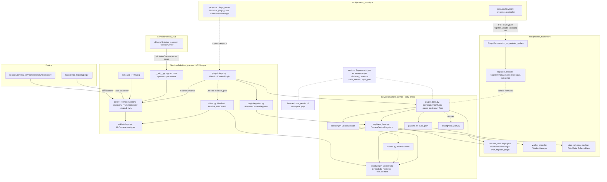
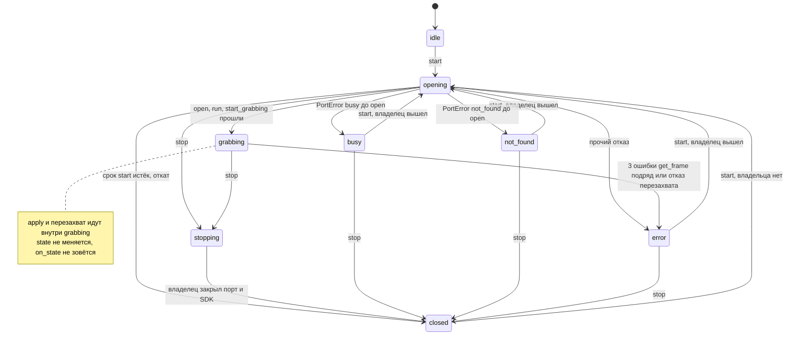
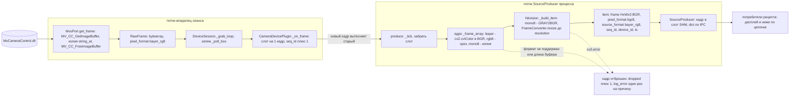
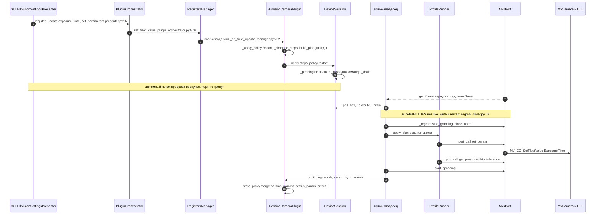
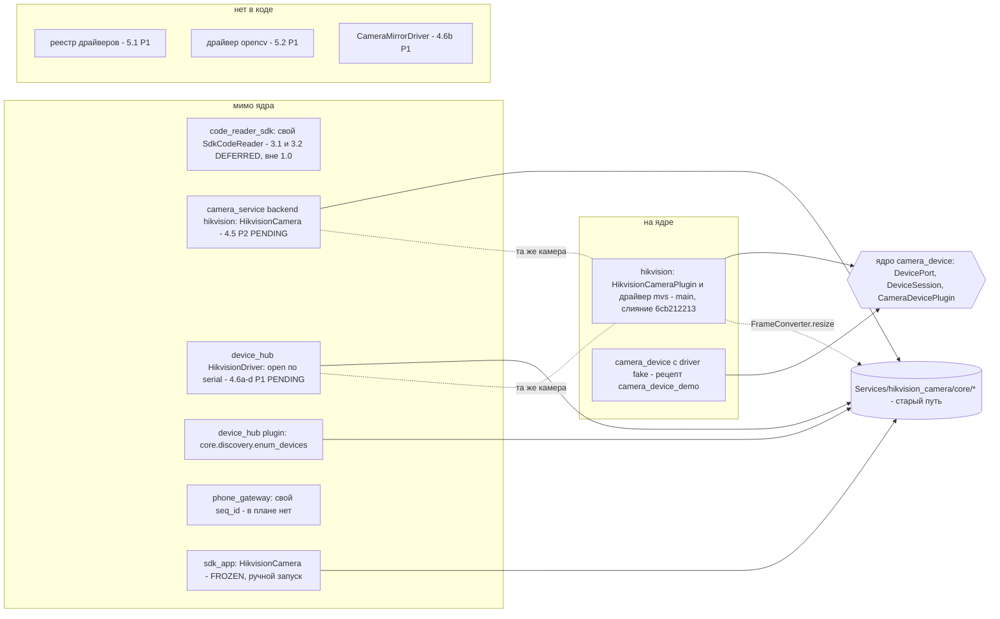
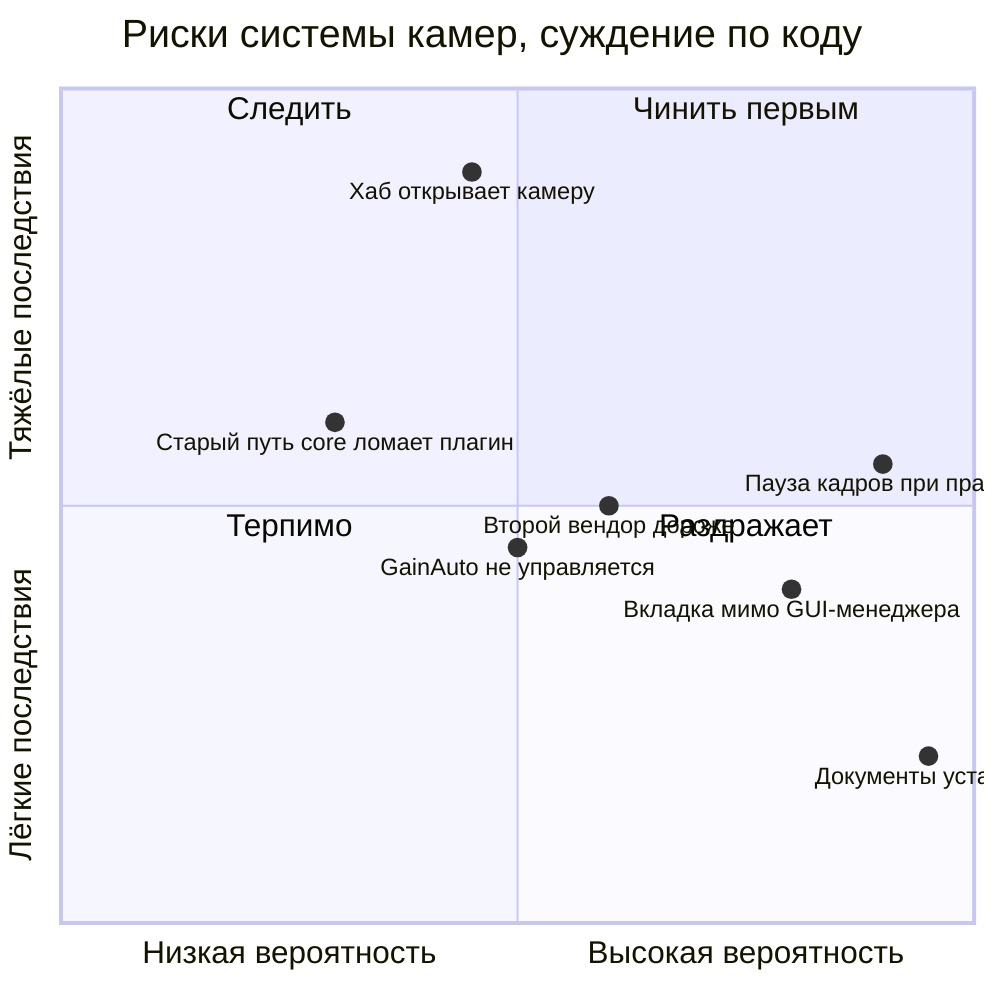

# Диаграммы системы камер

Часть отчёта [README.md](README.md). Все шесть диаграмм прошли рендер Mermaid Chart: `valid: true` у каждой. Картинки глазами я не смотрел.

## 1. Слои и зависимости по фактическим импортам

Сплошная стрелка — импорт. Пунктир — ленивый импорт, колбэк, IPC или строка рецепта.

Что видно: ядро зависит только от framework, вендор зависит от ядра, обратных импортов нет. Старый путь `core/*` — узел, к которому сходятся 5 потребителей, в том числе новый плагин.
Что скрыто: импорты тестов (`camera_device` импортируют ещё 2 теста рецептов); связь хаба с процессом камеры через IPC; `code_reader` и `phone_gateway` изнутри.
Источник импортов: `git grep` по `Services.camera_device` (14 строк вне ядра: 12 в `hikvision_camera`, 2 в тестах prototype) и по `hikvision_camera.core` (48 строк).

## 2. Жизненный цикл сеанса `DeviceSession`

Что видно: 8 состояний и все переходы из `session.py`. Переходы — compare-and-set под `self._lock` (`session.py:402-416`).
- Из отказа `start()` работает, только когда владелец уже вышел (`session.py:268-269`). Пока владелец жив, `start()` возвращает `False`; автопереподключения нет.
- `opening -> closed` — откат по сроку `start(timeout)`: владелец видит `cancelled` в `_commit` и не зовёт `start_grabbing` (`session.py:294-296`, `:512-518`).
- `stop()` из отказа ставит `closed` сразу, порт закрывает сам владелец (`session.py:314-315`). Пара `closed` + `device_held=True` поэтому возможна.

Что скрыто: флаг `device_held`; сторож (`on_stall` после `watchdog_s`, `session.py:804-817`); ящик владельца. Зависший `open` держит `opening`, пока не вернётся: перехода по таймауту нет.

## 3. Путь кадра от порта до потребителя

Что видно: буфер SDK освобождается до возврата `get_frame` (`driver.py:391-407`). Между потоками кадр передаёт слот на 1 кадр (`plugin_base.py:402-406`).
Цвет приводит ядро (`plugin_base.py:558-583`), размер слота SHM — вендор (`plugin.py:50-65`). `source_format` хранит формат прибора, `pixel_format` всегда `bgr8` у Hikvision.
`bayer_rg8` на прибор — из `OPEN_QUESTIONS.md:2622` (бриф лида), в коде формат приходит из `enPixelType`.
Что скрыто: запись в SHM и IPC внутри `SourceProducer` framework — я их не читал. Состав потребителей по рецептам я не сверял.

## 4. Путь живой правки поля

Счёт уровней от `_on_register_update` до DLL (критерий 2):
1. `PluginOrchestrator._on_register_update` (`plugin_orchestrator.py:855`).
2. `RegistersManager.set_field_value` (`plugin_orchestrator.py:879`; колбэки — `manager.py:252`).
3. `CameraDevicePlugin._on_field_update` (`plugin_base.py:288`); внутри `_changed_steps` дважды строит `build_plan` (`:251-273`).
4. `DeviceSession.apply` -> ящик (`session.py:363-384`). Здесь очередь и переход в поток-владелец.
5. `_poll_box` -> `_execute` (`session.py:664-694`).
6. `_drain` (`session.py:708-732`).
7. `_regrab` (`session.py:741-776`).
8. `ProfileRunner.apply_plan` (`profiles.py:83`).
9. `ProfileRunner.apply_step` (`profiles.py:98`).
10. `DeviceSession._port_call` — запись для сторожа (`session.py:438-447`).
11. `MvsPort.set_param` (`driver.py:304`).
12. `MvCamera.MV_CC_SetFloatValue` -> ctypes DLL (`sdk/bindings.py:338`).

Каждый уровень несёт гарантию: один владелец, слияние правок, проверка чтением, сторож. Лишних по функции уровней я не нашёл.
Два кандидата на сокращение: двойной `build_plan` в `_changed_steps` и перезахват `close`/`open` у MVS вместо записи на ходу. Второй кандидат зависит от опыта H1 на приборе.
Что скрыто: путь команды `apply_params`. Он делает тот же `set_field_value` на каждое поле (`plugin_base.py:772-777`) и дальше идёт по этой же диаграмме.

## 5. Что на ядре и что мимо ядра

Статусы из кода и `plan.md`:
- `hikvision` на ядре: `plugin.py:26` наследует `CameraDevicePlugin`. Пять рецептов указывают `plugin_name: hikvision`.
- `code_reader`: 0 строк `camera_device` (`git grep -n camera_device -- Services/code_reader`). План — `plan.md:101-102`, DEFERRED.
- `camera_service`: `backends/hikvision.py:17-20` импортирует `HikvisionCamera`, `:67` создаёт её. План — `plan.md:140`.
- `device_hub`: `HikvisionDriver.connect` создаёт `HikvisionCamera()` и зовёт `open` (`hikvision_driver.py:67-79`); kind `hikvision` — `kinds.py:170`. План — `plan.md:120-124`.
- `phone_gateway`: свой `seq_id` (`plugin/plugin.py:163`); импортов ядра 0. В плане нет: это другой источник, не камера SDK.

Что скрыто: включён ли kind `hikvision` в `devices.yaml` стенда и подключает ли хаб его сам. Файл данных вне git, я его не читал.

## 6. Риски

Координаты — моё суждение, не замер. Вероятность «хаб открывает камеру» зависит от данных `devices.yaml`, которые я не читал.
Слабые места по этим рискам — в [02-weaknesses.md](02-weaknesses.md).
