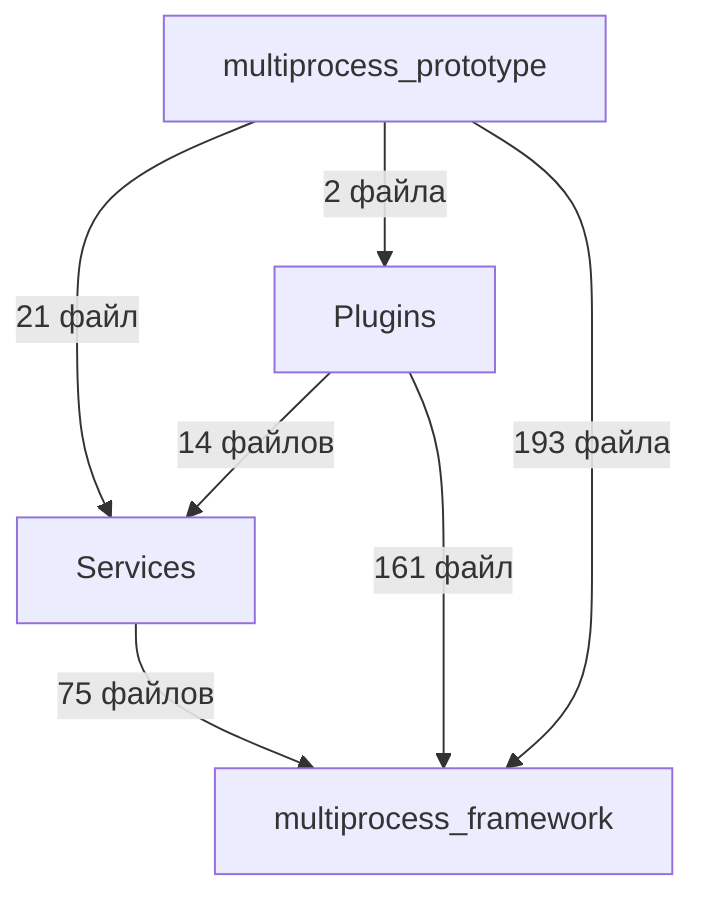
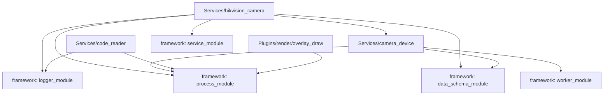
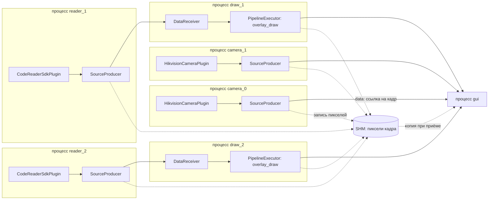
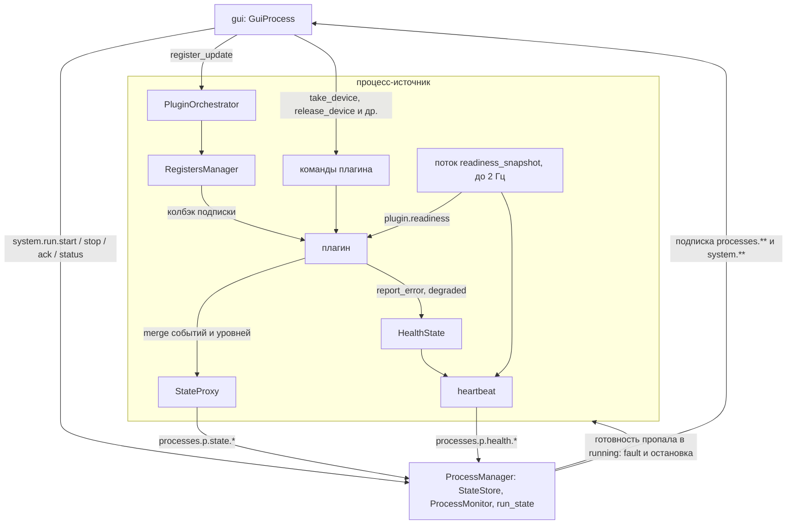
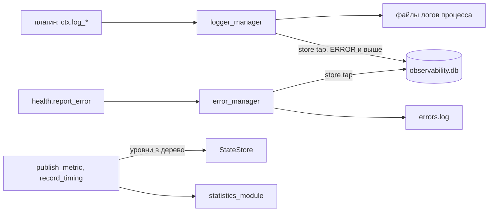
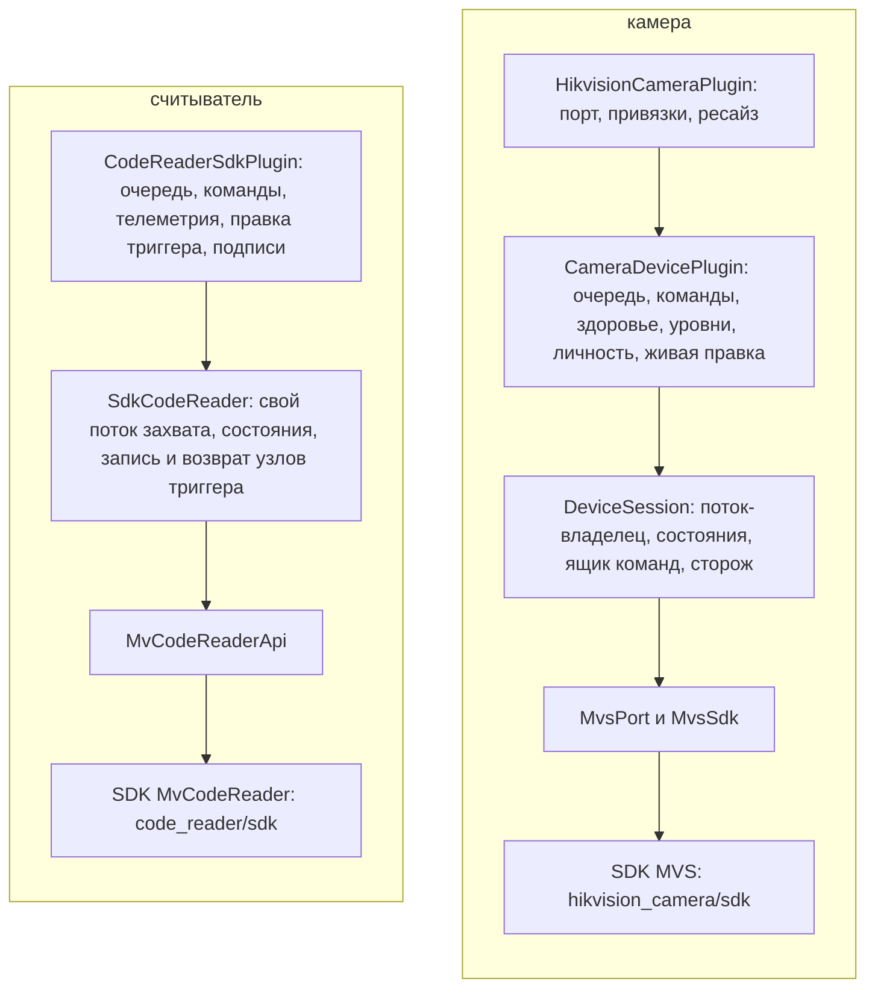

# Диаграммы по коду (`ea65a3334`)

Нарисовано по коду дерева `mco-stand` (код равен `integ/multicam-obs` `ab615c933`), не по старым документам.
Пути в таблицах — от корня репозитория. Запуска не было: всё получено чтением кода и `git grep`.
То, что по коду не проверено, помечено «**не проверено**».

Сокращения в таблицах: `F/` = `multiprocess_framework/modules/`, `S/` = `Services/`, `P/` = `multiprocess_prototype/`.

## (a) Слои и зависимости модулей

### Слои целиком



Числа — файлы вне тестов с оператором `import` / `from` в сторону слоя (`git grep -l`, каталоги `tests/`,
`testing/`, `conftest` отброшены).

| Ребро | Пример (`путь:строка`) |
|---|---|
| prototype → Services | `P/frontend/actions/bus_factory.py:28` |
| prototype → Plugins | `P/frontend/widgets/tabs/plugins/sandbox.py:524` |
| prototype → framework | `P/adapters/catalogs/display_catalog.py:25` |
| Plugins → Services | `Plugins/control/robot_control/plugin.py:54` |
| Plugins → framework | `Plugins/_shared/fanin/factory.py:19` |
| Services → framework | `Services/auth/audit_writer.py:35` |

### Модули рецепта quad



| Ребро | `путь:строка` |
|---|---|
| hikvision_camera → camera_device | `S/hikvision_camera/driver.py:24`, `S/hikvision_camera/plugin/plugin.py:15` |
| hikvision_camera → process_module | `S/hikvision_camera/plugin/config.py:9`, `plugin/plugin.py:12` |
| hikvision_camera → data_schema_module | `S/hikvision_camera/plugin/config.py:7` |
| hikvision_camera → logger_module | `S/hikvision_camera/sdk/bindings.py:12` |
| hikvision_camera → service_module | `S/hikvision_camera/service.py:10` |
| camera_device → process_module | `S/camera_device/plugin_base.py:69` |
| camera_device → worker_module | `S/camera_device/session.py:42` |
| camera_device → data_schema_module | `S/camera_device/params.py:23` |
| code_reader → process_module | `S/code_reader/plugin/config.py:12` |
| code_reader → logger_module | `S/code_reader/core/sdk_reader.py:28` |
| overlay_draw → process_module | `Plugins/render/overlay_draw/config.py:7` |

Ребра `code_reader → camera_device` **нет**: считыватель не стоит на основе камеры.
Прямого импорта `data_schema_module` у `code_reader` нет: register берёт базовые типы через
`process_module.plugins` (`S/code_reader/plugin/sdk_registers.py:13`). В выборку не входили `tools/`, `sdk_app/`,
`testing/`.

### Нарушения направления импортов

* **В рабочем коде (не тесты): не найдено** по трём правилам: framework → Services/Plugins/prototype/backend_ctl;
  Services → Plugins/prototype/backend_ctl; Plugins → prototype/backend_ctl. Строковых `import_module("...")`
  с такими именами тоже нет.
* Единственное упоминание верхнего слоя строкой в framework — текст сообщения об ошибке
  `F/process_module/generic/collector_registry.py:134` (не импорт).
* **В тестах нарушения есть.** Строк: framework 15, Services 41, Plugins 1. Формат: `файл:первая строка (число строк)`.

framework → верхние слои (10 файлов):

```
F/app_module/tests/test_f1_task10_acceptance.py:36 (1)
F/channel_routing_module/tests/test_task_3_1_hazards.py:480 (4)
F/process_manager_module/tests/test_backend_ctl_endpoint.py:197 (1)
F/process_manager_module/tests/test_dotted_process_name.py:169 (2)
F/process_manager_module/tests/test_lifecycle_command_classes.py:119 (1)
F/process_manager_module/tests/test_stop_outcome_acceptance.py:29 (1)
F/process_manager_module/tests/test_stop_wave_last.py:338 (1)
F/process_manager_module/tests/test_unapplied_metadata_check.py:380 (2)
F/process_module/tests/test_error_plane_one_connector_capture_acceptance.py:56 (1)
F/process_module/tests/test_observation_namespace_acceptance.py:534 (1)
```

Services → Plugins / prototype / backend_ctl и Plugins → prototype / backend_ctl:

```
Services/auth/tests/test_role_update_handler.py:14 (1)
Services/device_hub/tests/test_c29_disconnect_acceptance.py:37 (2)
Services/device_hub/tests/test_c29_probe.py:55 (2)
Services/device_hub/tests/test_exchange_log.py:444 (4)
Services/device_hub/tests/test_robot_driver_v2.py:812 (2)
Services/device_hub/tests/test_robot_v2_draw.py:34 (1)
Services/device_hub/tests/test_robot_v2_live_backend.py:47 (3)
Services/device_hub/tests/test_spi_contract.py:310 (5)
Services/device_hub/tests/test_t56_exchange_log_acceptance.py:890 (2)
Services/layer_render/tests/test_acceptance_6_1_crop.py:94 (1)
Services/layer_render/tests/test_hazards_6_1_crop.py:138 (1)
Services/ml_train/tests/test_acceptance_6_4_holdout_crop.py:45 (2)
Services/otel_export/tests/test_contract.py:246 (2)
Services/otel_export/tests/test_endpoint_signal_path_hazard.py:175 (1)
Services/otel_export/tests/test_f2_task22_acceptance.py:380 (3)
Services/otel_export/tests/test_f2_task22_hazards.py:521 (6)
Services/robot_comm/tests/_t38_line_host.py:33 (2)
Services/robot_comm/tests/test_t38_line_view_acceptance.py:43 (1)
Plugins/sim/scene_source/tests/test_acceptance_c87_live_step.py:53 (1)
```

Это проверка по тексту `import`, а не вердикт `sentrux check .` (он не запускался — **не проверено**).

## (b) Топология рецепта `hikvision_id3013_quad`

### Процессы и путь кадра



Процесс `ProcessManager` (оркестратор) в рецепте не перечислен, он есть всегда и на схеме (b) ниже.
В рецепте класс `gui` — `HeadlessGuiProcess` (принимает и выбрасывает); при запуске с окном презентационный
overlay подменяет его на `GuiProcess`.

| Узел / ребро | `путь:строка` |
|---|---|
| 7 процессов рецепта и их классы | `P/recipes/hikvision_id3013_quad.yaml:94-273` |
| `camera_0/1 → gui`, `source_target_fps: 25` | `...quad.yaml:106-111`, `138-143` |
| `reader_N → draw_N`, 20 Гц | `...quad.yaml:173-179`, `224-229`, `275-279` |
| `draw_N → gui` | `...quad.yaml:204-208`, `257-261` |
| привязка узлов к дисплеям | `...quad.yaml:282-290` |
| `GenericProcessApp` = `GenericProcess` | `P/generic_process_app.py:15-22` |
| сборка `FrameShmMiddleware`, send-middleware | `F/process_module/generic/generic_process.py:231-245` |
| `DataReceiver`, `PipelineExecutor`, `SourceProducer` | `generic_process.py:276`, `295`, `343` |
| `SourceProducer` шлёт `type="data"` в `chain_targets` | `F/process_module/generic/source_producer.py:307-328` |
| `PipelineExecutor` шлёт так же | `F/process_module/generic/pipeline_executor.py:501-525` |
| пиксели уходят в SHM при отправке | `F/router_module/middleware/frame_shm_middleware.py:1105`, `1184` |
| восстановление кадра у потребителя | `frame_shm_middleware.py:948`, `1315` |
| `gui`: свой middleware, отдаёт копию | `P/frontend/process.py:56-68` |
| headless-класс `gui` | `P/frontend/headless_process.py:53` |
| подмена класса при запуске с окном | `P/frontend/presentation.yaml:10` |
| кадр камеры: SDK → очередь → item | `S/camera_device/session.py:629-658`, `plugin_base.py:470-494`, `689-716` |
| кадр считывателя: поток захвата → очередь → item | `S/code_reader/core/sdk_reader.py:254`, `plugin/sdk_plugin.py:293-333`, `234-259` |

**Не проверено:** как `gui` раскладывает пришедший кадр по четырём дисплеям (код между приёмом и виджетом не
читался); значения `ring_buffer_blocks`, политика переполнения очередей на этом рецепте.

### Команды и регистры; состояние, здоровье, готовность, авария



| Ребро | `путь:строка` |
|---|---|
| обработчик `register_update` | `F/process_module/generic/plugin_orchestrator.py:792-814`, `855-888` |
| запись в register | `plugin_orchestrator.py:879` → `F/registers_module/core/manager.py:190` |
| подписка плагина камеры на поля | `S/camera_device/plugin_base.py:301-317`, `356-372` |
| подписка считывателя (только триггер) | `S/code_reader/plugin/sdk_plugin.py:429-447` |
| команды камеры / считывателя | `plugin_base.py:216-226` / `sdk_plugin.py:131-136` |
| `system.run.*` из GUI | `P/frontend/bridge/process_manager_proxy.py:141-154` |
| `StateProxy` в процессе | `F/process_module/generic/generic_process.py:93-97` |
| health процесса в дерево на такте heartbeat | `F/process_module/heartbeat/process_heartbeat.py:1773-1806` |
| один `HealthState` на процесс | `generic_process.py:334-354` |
| снимок готовности, внеочередной heartbeat | `F/process_module/core/process_module.py:1083-1191` |
| причины `plugin.readiness(ctx)` | `F/process_module/generic/plugin_orchestrator.py:346`, `555-558` |
| оценка готовности системы | `F/process_manager_module/process/run_state.py:108-171` |
| `running` + не готов → `fault` | `run_state.py:317-323` |
| на такте: оценка, `fault` → остановка | `F/process_manager_module/process/process_manager_process.py:1615-1627` |
| `system.health.*` (в т.ч. `avg_fps`) | `F/process_manager_module/monitor/process_monitor.py:716-754` |
| `state.fps` = частота самого медленного воркера | `process_heartbeat.py:1453-1457` |
| `gui` подписан на дерево | `P/frontend/process.py:141-142` |
| пульт рисует `system.run.*` | `P/frontend/widgets/chrome/run_control.py:40` |

Два разных `fps`:

* `processes.<p>.state.plugins.hikvision.fps` — кадры за секунду, считает плагин (`plugin_base.py:581-592`);
* `processes.<p>.state.fps` — частота цикла самого медленного воркера, не кадры
  (`process_heartbeat.py:1453-1457`). Из него же складывается `system.health.avg_fps`.

Считыватель пишет в другой раздел: `processes.<p>.state.code_reader_sdk`, без `plugins`
(`sdk_plugin.py:420`).

**Не проверено:** транспорт команд от `gui` до процесса (прямая очередь или через ProcessManager); фильтры и
троттлинг StateStore.

### Плоскости логов, ошибок, статистики



| Ребро | `путь:строка` |
|---|---|
| лог сеанса камеры переливается в `ctx.log_*` | `S/camera_device/plugin_base.py:123-140`, `810-818` |
| `report_error` процесса — делегат в `HealthState` | `F/process_module/core/process_module.py:641-665` |
| плоскость ошибок из `report_error` | `F/process_module/health/state.py:252` (описание в докстринге) |
| store tap на **оба** менеджера, уровень ERROR | `F/process_module/managers/observability_wiring.py:1700-1750` |
| путь `observability.db` | `F/channel_routing_module/observability/observability_store.py:137` |
| путь `errors.log` по умолчанию | `F/error_module/configs/error_manager_config.py:44` |
| уровни камеры | `plugin_base.py:281-294`, `590-606` |

Отсюда следует (по коду): `ctx.log_error` идёт в `logger_manager`, а не в `error_manager`, поэтому строка
может быть в `observability.db` и отсутствовать в `errors.log` (`observability_wiring.py:1706-1708`). Это
вопрос з) задания.

**Не проверено:** внутренности `statistics_module` (куда пишутся тайминги), раскладка файлов логов по
процессам, пересылка записей в `gui` (приёмник виден в `P/frontend/process.py:213-240`, отправитель не читался).

## (c) Стек камеры и стек считывателя рядом



| Узел | `путь:строка` |
|---|---|
| `HikvisionCameraPlugin(CameraDevicePlugin)` | `S/hikvision_camera/plugin/plugin.py:26` |
| `CameraDevicePlugin` | `S/camera_device/plugin_base.py:188` |
| `DeviceSession` | `S/camera_device/session.py:127` |
| `MvsSdk`, `MvsPort` | `S/hikvision_camera/driver.py:192`, `224` |
| `CodeReaderSdkPlugin(ProcessModulePlugin)` | `S/code_reader/plugin/sdk_plugin.py:92` |
| `SdkCodeReader` | `S/code_reader/core/sdk_reader.py:69` |
| `MvCodeReaderApi` | `S/code_reader/sdk/api.py:80` |

### Где живёт обязанность

| Обязанность | Камера | Считыватель | Итог |
|---|---|---|---|
| Поток захвата | воркер `WorkerManager` (`session.py:490-510`) | свой `threading.Thread` (`sdk_reader.py:254`) | две реализации |
| Состояния связи | `idle/opening/grabbing/stopping/closed/busy/not_found/error` (`session.py:8-10`) | `stopped/running/busy/error` (`sdk_reader.py:73`, `105`, `201-252`) | две реализации, разные слова |
| 3 ошибки кадра подряд → `error` | `session.py:51`, `641-647` | `sdk_reader.py:36`, `356-375` | дубль |
| Обнаружение тишины (нет кадров) | нет: `None` не ошибка (`session.py:649-653`) | нет: `E_NODATA` — успех (`sdk_reader.py:375`) | нет у обоих |
| Событие обрыва из SDK | колбэк кладёт код в `port.exceptions` (`driver.py:243-245`, `291-299`), **читателя вне тестов нет** | **не проверено**, есть ли в SDK; в коде не регистрируется | у камеры есть, но не подключено |
| Переподключение | нет (`session.py:10`, `268`) | нет (`sdk_reader.py:16-17`) | нет у обоих (решение ADR-CR-009) |
| Сторож зависшего вызова SDK | `session.py:788-817`, `plugin_base.py:558-563` | нет (только `join` с дедлайном в `stop`, `sdk_reader.py:157-181`) | нет у считывателя |
| Здоровье: `report_error` / `degraded` | переход в отказ и ошибки параметров (`plugin_base.py:658-671`) | только отказ режима триггера (`sdk_plugin.py:602`, `644`); ошибка захвата здоровье не меняет (`335-344`) | неполно у считывателя |
| Готовность `readiness` | есть (`plugin_base.py:437-464`) | **метода нет** | нет у считывателя |
| Метрики `publish_metric` | 11 уровней (`plugin_base.py:281-294`) | **нет**; счётчики в register и дереве | нет у считывателя |
| Замеры времени | `plugin_base.py:565-579` | **нет** | нет у считывателя |
| Потери кадров по номеру | `incomplete`, `lost_packets`, `lost_frames`, `trigger_lost` (`plugin_base.py:476-492`) | `frame_num` и `trigger_index` только передаются в item (`sdk_plugin.py:270-271`); `dropped` = переполнение очереди (`313-318`) | нет у считывателя |
| Личность прибора | событие `identity`: серийник, модель, IP, маска, MAC, формат (`plugin_base.py:157-171`, `636-653`) | `{ip, model, serial}` внутри читателя (`sdk_reader.py:251`); выбор только по IP (`217`) | разный объём и разный ключ выбора |
| Выбор прибора | `serial` / `ip` / `index` / `first` (`plugin_base.py:392-407`) | `device_ip` или первый найденный (`sdk_plugin.py:181-184`) | разное |
| Живая правка параметров | все поля привязки, политики `live`/`restart` (`plugin_base.py:301-372`, `session.py:708-776`) | только 3 поля триггера, с откатом на старое (`sdk_plugin.py:429-531`) | две реализации; откат есть только у считывателя |
| Возврат режима прибора при остановке | профиль `rest` из рецепта (`session.py:541-546`, `plugin_base.py:409-422`) | возврат исходных значений узлов (`sdk_reader.py:294-318`) | разный принцип |
| Чтение узлов прибора на ходу | `describe_params`, `list_devices` (`plugin_base.py:992-1077`); `read_params` — снимок цикла, не живое чтение (`903-908`) | команд нет; узлы читаются при записи режима (`sdk_reader.py:258-292`) и инструментом `S/code_reader/tools/cam_cfg.py` | нет у считывателя |
| Команды | 9 (`plugin_base.py:216-226`) | 4 (`sdk_plugin.py:131-136`) | `take/release/get_status/reset_stats` дублируются |
| Очередь кадров и `seq` | `plugin_base.py:239`, `470-494` | `sdk_plugin.py:155`, `293-333` | дубль |
| Подписка/отписка на register | `plugin_base.py:301-317` | `sdk_plugin.py:429-447` | дубль почти дословный |
| Привязки SDK и структуры | `S/hikvision_camera/sdk/` | `S/code_reader/sdk/` | разные DLL; общий слой отсутствует |
| Коды, надписи, overlay | нет | `sdk_plugin.py:261-291`, `707-880` | только считыватель (специфика) |

Проверка «нет» у считывателя: `grep -c -F` по `plugin/sdk_plugin.py` дал 0 для `def readiness`, `report_error`,
`publish_metric`, `declare_metric`, `worker_manager`, `flight_dump`, `record_timing`, `REQUIRES`, `identity`
(в `camera_device/plugin_base.py` все они есть).

## (d) Обрыв кабеля камеры: поведение волны 1

```mermaid
sequenceDiagram
  participant SDK as SDK MVS
  participant PORT as MvsPort
  participant OWN as поток-владелец сеанса
  participant PL as HikvisionCameraPlugin
  participant TREE as StateStore в ProcessManager
  participant GUI as gui
  Note over SDK,PORT: кабель выдернут
  SDK->>PORT: колбэк исключения, поток SDK
  PORT->>PORT: exceptions.put(код)
  Note over PORT,OWN: очередь exceptions никто не читает
  loop каждые timeout_ms
    OWN->>PORT: get_frame(500 мс)
    PORT->>SDK: MV_CC_GetImageBuffer
    SDK-->>PORT: нет кадра (код таймаута)
    PORT-->>OWN: None
    Note over OWN: None не ошибка, счётчик подряд сброшен, state остаётся grabbing
  end
  loop SourceProducer
    PL->>PL: produce(), очередь пуста
    PL->>TREE: раз в 1 с уровни, plugins.hikvision.fps = 0, frames стоит
  end
  Note over PL: readiness() = пусто, health = ok, report_error не зовётся
  Note over TREE: run_state остаётся running; state.fps = частота цикла, около 25
  TREE-->>GUI: дельты дерева
  Note over GUI: последний кадр замер, надпись «Работает»
  Note over SDK,PL: кабель вставлен: порт тот же, переоткрытия нет, кадры не возвращаются
```

| Шаг | `путь:строка` |
|---|---|
| регистрация колбэка исключений | `S/hikvision_camera/driver.py:291-299` |
| колбэк кладёт код в очередь | `driver.py:232`, `243-245` |
| у очереди нет читателя вне тестов | `git grep -F ".exceptions"` по `S/camera_device` и `S/hikvision_camera/plugin` пусто; читает только `S/hikvision_camera/tests/test_driver_mvs.py:271` |
| `NODATA` / `GC_TIMEOUT` → `None` | `driver.py:121`, `426-428` |
| `None` не ошибка | `S/camera_device/session.py:637-653` |
| уровни из `produce()` | `plugin_base.py:581-612`, `689-696` |
| `readiness` в `grabbing` пустая | `plugin_base.py:446-449` |
| инциденты только по смене состояния | `plugin_base.py:658-671` |
| `state.fps` не про кадры | `process_heartbeat.py:1453-1457` |

Наблюдение стенда (не этот пакет, а `docs/reviews/2026-11-25_stand-wave1.md:147-160`, проверка 10): без кабеля
`state=grabbing`, `fps=0.0`, `frames` стоит, `health ok`, `system.run=running`, `processes.camera_1.state.fps=25.02`,
в логах camera_1 ноль строк, после вставки камера за ~60 с не восстановилась. Совпадает с кодом.

**Не проверено:** какой именно код возвращает SDK при выдернутом кабеле (из поведения следует, что это таймаут,
а не ошибка: иначе после трёх подряд было бы `error`); вызывается ли колбэк исключений на этой камере вообще
(на стенде «событие 0x8001 не читается», строк с `0x8001` в логах нет).

Если SDK вместо таймаута вернёт ошибку (например `NETER`), ветка другая: три `PortError` подряд → `state=error`
→ `report_error`, `degraded`, `readiness failure` → `fault` системы (`session.py:641-647`,
`plugin_base.py:454-459`, `662-665`, `run_state.py:322-323`). На стенде волны 1 она не наблюдалась.

Волна 2 (`dev/w2-a`, переподключение по тишине) в этом коде **отсутствует**.
