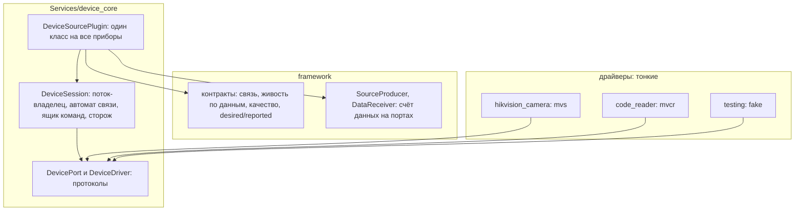
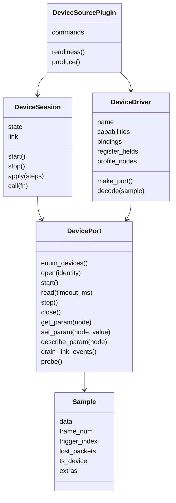
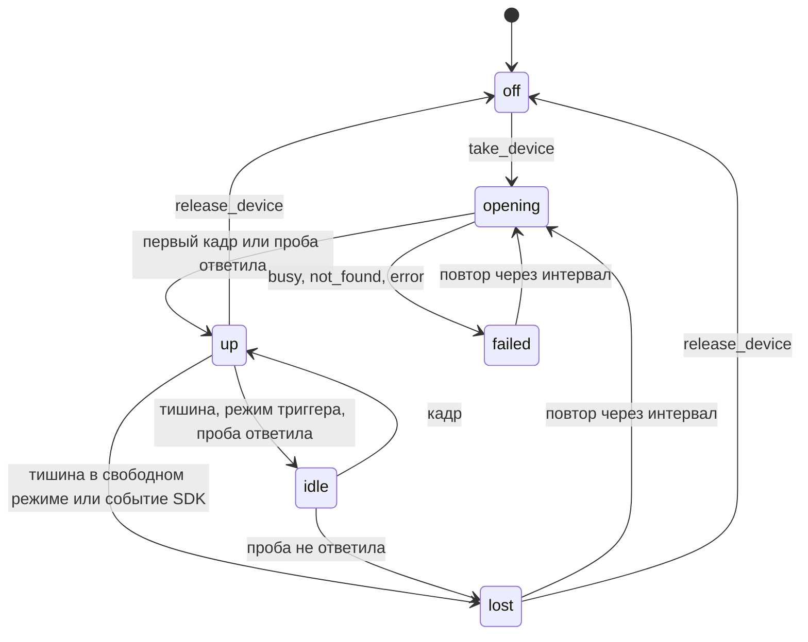
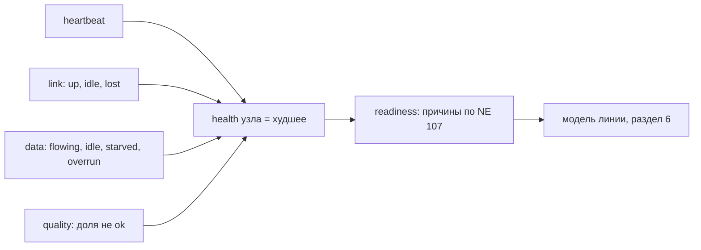
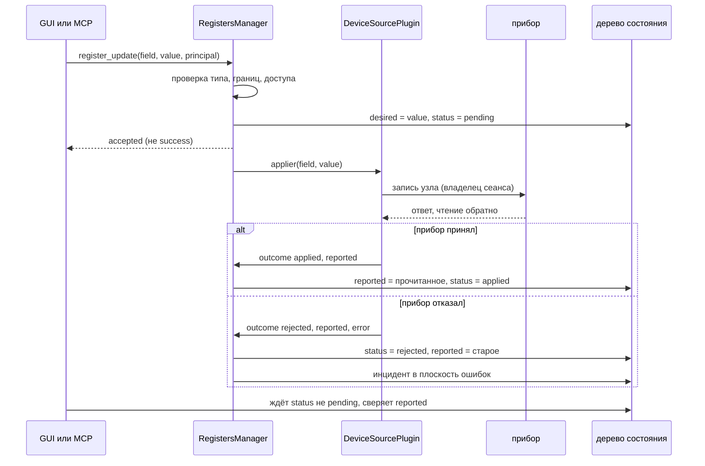
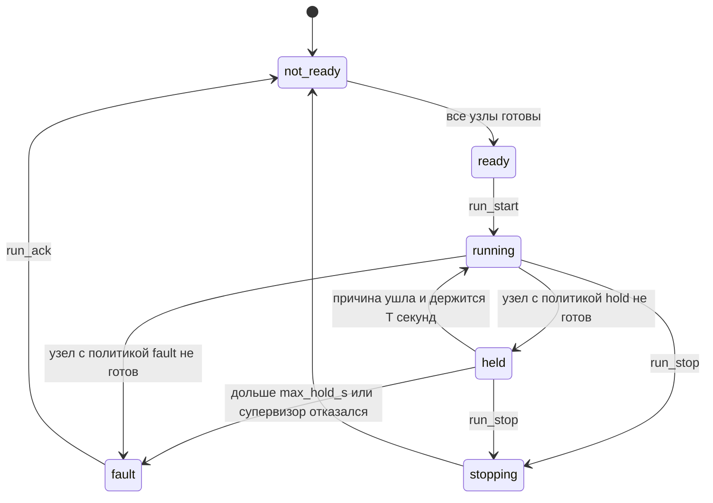

# Целевая архитектура: надёжная многокамерная инспекция (2026-11-25)

Продолжение `10-verdict.md`. Здесь — как должно быть. Порядок перехода — `12-migration.md`.
Метки те же: **[сам]**, **[помощник]**, **[стенд]**. Числа с пометкой «оценка» не измерены.
Диаграммы Mermaid не отрисовывались — синтаксис не проверен.

## 1. Пять правил цели

1. **`ok` доказывают, а не объявляют.** У каждого доказательства есть срок годности. Нет свежего — узел не готов.
2. **Единица решения — продукт, а не кадр.** Продукт без результата в срок — «не проверен».
3. **Метка качества только ухудшается.** Ни один узел не может сделать из плохого кадра хороший.
4. **Истина о приборе — то, что прибор подтвердил.** Регистр хранит и желаемое, и подтверждённое.
5. **Граница процесса — граница отказа или владелец ресурса.** Не каждая операция.

Все пять правил опираются на то, что во фреймворке уже есть (см. `10`, раздел 1). Новых слоёв цель не добавляет:
два слоя убирает (вендорский плагин-наследник, отдельный плагин считывателя).

## 2. Одна основа приборов

### 2.1 Годится ли основа камеры

**Да, по устройству. Нет — в нынешнем виде.** Сеанс `DeviceSession` (поток-владелец, ящик команд, состояния,
сторож, профили run / rest, план записи с чтением обратно) ничего не знает про пиксели **[сам]**
`Services/camera_device/session.py:1-30`. Считыватель MV-ID3013 — та же камера с добавкой: кадр плюс коды плюс
триггер. Его SDK делает то же: перечислить, открыть, начать захват, взять кадр с таймаутом, читать и писать узлы.

Что мешает сегодня и что поменять:

| Сейчас | Цель |
|---|---|
| `RawFrame` несёт только поля кадра | `Sample`: те же поля плюс `extras` (коды, `no_read_num` и другое) |
| Вендор наследует плагин: `HikvisionCameraPlugin(CameraDevicePlugin)` | Наследника нет. Вендор даёт **описание драйвера** — данные, не класс плагина |
| Хуки `create_port`, `bindings`, `software_trigger_binding` в плагине **[сам]** `plugin_base.py:378-390` | Это и есть описание драйвера; переезжает в драйвер |
| Состояние в дереве: камера `state.plugins.hikvision`, считыватель `state.code_reader_sdk` **[сам]** `sdk_plugin.py:420` | Один путь: `processes.<p>.state.device.*` |
| Остановка: камера пишет профиль `rest`, считыватель возвращает «как было» | Только профиль `rest` из рецепта. «Как было» — это неизвестная история |
| Обнаружения тишины и переподключения нет (ADR-CR-009) | Автомат связи в сеансе (код `dev/w2-a`), один на все приборы |
| Имя модуля `camera_device` | `device_core`. Старое имя остаётся псевдонимом импорта (FREEZE) |

### 2.2 Состав





**Новый прибор = четыре вещи в одном пакете драйвера:** порт (обёртка SDK), таблица привязки полей к узлам,
поля регистра сверх общих, функция `decode(sample)` — что положить в item сверх общего. Плагина, потоков,
очередей, команд, здоровья, счётчиков и правки на ходу драйвер не содержит.

Специфика считывателя (коды, надписи, overlay) — это `decode()` и уже существующий отдельный узел `overlay_draw`.
Проверки надписей остаются чистыми функциями в пакете `code_reader`.

### 2.3 Автомат связи — один на все приборы



Слова состояний — из ветки `dev/w2-a` (`up`, `idle`, `silent`, `lost`, `off`) **[помощник]**: переименования нет.
Интервал повтора, порог тишины и выключатель `reconnect` — поля общего регистра. Умолчание — раздел 6.

### 2.4 Что во фреймворке, что в сервисах (ответ на вопрос е)

- **Фреймворк:** словарь состояний связи как часть контракта здоровья; счёт данных на портах; desired / reported;
  конверт item с качеством. Это нужно любому узлу, не только прибору.
- **`Services/device_core`:** сеанс, поток SDK, переподключение, профили узлов. Фреймворку незачем знать, что
  такое узел GenICam.
- **`Services/device_hub`** (Modbus, робот, частотник): приборы «запрос — ответ», не потоковые. Сеанс им не
  подходит без доказательства. Требование к ним одно: тот же словарь связи и тот же путь в дереве. Код не читал —
  это гипотеза, решать после этапа M2.

## 3. Контракт здоровья: живость по данным

### 3.1 Четыре доказательства

| Доказательство | Кто даёт | Где считается | Срок годности |
|---|---|---|---|
| процесс жив | heartbeat (есть) | фреймворк | как сегодня |
| связь с прибором | автомат связи сеанса | `device_core` | `link_silence_s` |
| данные идут | счётчик items на порту | фреймворк: `SourceProducer` (выход), `DataReceiver` (вход) | окно ожидания из рецепта |
| качество в норме | доля items не `ok` за окно | фреймворк, там же | окно ожидания |

Здоровье узла = худшее из четырёх. Узел не может ответить `ok`, если хотя бы одно доказательство просрочено.
Это то же правило «молчание = не готов», что уже действует для процесса **[сам]** `run_state.py:112`,
распространённое на данные.

### 3.2 Ожидание объявляет рецепт

```yaml
expect:
  mode: free_run        # free_run | triggered | on_demand
  min_hz: 20            # ниже — degraded
  silence_s: 3.0        # тишина дольше — starved
  max_not_ok_share: 0.02
  window_s: 10
```

- `free_run`: тишина дольше `silence_s` — `starved`. Проба не нужна.
- `triggered`: тишина законна, **если** связь подтверждена пробой прибора. Нет пробы — не `ok`.
- `on_demand`: данных никто не обещал; доказательство «данные» не участвует.

Для приёмника ожидание наследуется по проводу: источник `idle` — приёмник `idle`; источник `flowing`, а на входе
пусто — приёмник `starved` (потеря в транспорте). Выброс на входе (`lag_drop`, `stale_shm`) — состояние `overrun`
и вклад в долю качества. Так считыватель без кабеля становится виден **без единой строки кода считывателя**.



### 3.3 Ключи дерева состояния

- `processes.<p>.state.data.<порт>.{hz, state, last_item_age_s, dropped, not_ok_share}`;
- `processes.<p>.state.device.{link, identity, profile}` — одинаково для камеры и считывателя;
- `processes.<p>.health.evidence.<вид>.{state, at}` — что именно просрочено.

`processes.<p>.state.fps` сегодня — частота цикла **[сам]** `process_heartbeat.py:1453-1457`. Цель: у узла с
портами данных в `state.fps` пишется частота данных, частота цикла уходит в `state.loop_hz`. Ключ не удаляется, он
начинает значить то, что написано в его имени. `system.health.avg_fps` считается из частоты данных.

## 4. Метка качества от источника до решения

### 4.1 Конверт item

```yaml
capture_ts: 1764070000.123      # есть сегодня
deadline_ts: 1764070000.223     # новое: capture_ts + бюджет из рецепта
product: {trigger_index: 1042}  # новое: к какому продукту относится
quality:
  status: ok                    # ok | suspect | not_inspected
  reasons: []                   # [{node, code}]
```

Закрытый словарь причин: `incomplete_frame`, `link_gap`, `queue_evicted`, `stale_shm`, `lag_drop`, `plugin_error`,
`deadline_missed`, `model_unavailable`, `param_mismatch`.

| Кто ставит | Когда | Сегодня |
|---|---|---|
| источник (`device_core`) | `lost_packets > 0`; разрыв `frame_num`; кадры за время потери связи — маркером | только счётчики **[сам]** `plugin_base.py:482-494` |
| транспорт | вытеснение из очереди; перезапись слота SHM | маркер есть при `overflow: every` **[помощник]** `data_receiver.py:480-486` |
| приёмник | выброс при отставании | строка лога **[помощник]** |
| шаг плагина | исключение | есть: `inspection_status = not_inspected` **[сам]** `plugin_operation_step.py:84-90` |
| нейросеть | срок истёк до инференса; модель не загружена; молчаливый переход на CPU при `device: cuda` | переход на CPU только показан в регистре **[помощник]** |
| прибор | значимое поле `rejected` (экспозиция, триггер) | нет |

Правило слияния: `not_inspected` сильнее `suspect`, `suspect` сильнее `ok`. `inspection_status` остаётся
псевдонимом `quality.status` (FREEZE).

### 4.2 Узел решения ведёт журнал продуктов

Узел решения — единственный владелец ответа «что стало с продуктом»:

1. событие «продукт пришёл» (индекс триггера от датчика или ПЛК, **независимо от камеры**);
2. ожидаемые результаты: по одному от каждой камеры поста;
3. к сроку `deadline_ts`: все `ok` и без дефектов — `pass`; есть дефект — `reject`; нет результата или метка не
   `ok` — `not_inspected`, действие по политике (умолчание `reject` уже в коде **[сам]**
   `robot_control/plugin.py:279`).

Счётчики наружу: проверено, брак, не проверено по причинам, **покрытие** (доля продуктов с полным набором
результатов). Покрытие — главное число инспекции. Сегодня его нет.

Без независимого события продукта слепая камера не может знать, что продукт прошёл. В свободном режиме
(рецепт quad) продуктов нет вообще — есть только кадры. Поэтому для производства режим камер — аппаратный триггер.

## 5. Desired / reported



- Поле без исполнителя (не привязано к прибору): `reported = desired` сразу. Для остального кода ничего не меняется.
- `set_register_verified` сверяет `reported`, а не регистр **[помощник]** `backend_ctl/registers.py:185-199`.
- **Один путь записи.** `set_config` остаётся командой, но идёт через тот же `set_field_value` (сегодня мимо
  подписчиков **[сам]** `plugins/base.py:1917`). Ответ на Р2 плана: да.
- Значимое для инспекции поле в `rejected` → `param_mismatch` в качестве кадров этого источника.

### 5.1 Известное состояние прибора (вопрос в)

При открытии драйвер пишет **полный профиль** — все узлы, влияющие на картинку и транспорт (`profile_nodes`:
формат пикселя, размер и смещение, биннинг, размер и задержка пакета, гамма, уровень чёрного, тестовый образ,
триггер, экспозиция, усиление, частота). Потом читает обратно и публикует `device.profile.{status, fingerprint}`.
Отпечаток не совпал с ожидаемым — `out_of_spec`, линия не стартует. Сегодня при открытии не пишется ничего, привязано
10 узлов **[помощник]** `driver.py:70-79,273-300`.

### 5.2 Рецепт и правки на ходу (вопрос м)

| Слой | Что | Кто пишет | Переживает перезапуск |
|---|---|---|---|
| рецепт | утверждённая база | только явное «сохранить в рецепт» | да |
| правки | файл-спутник рядом с рецептом: поле, значение, автор, время | любая принятая правка на ходу | да, процесса и системы |

Побеждает слой правок. GUI показывает «рецепт изменён: N полей» с кнопками «принять в рецепт» и «сбросить».
Механизм спутника во фреймворке уже есть для наблюдаемости **[помощник]** `observability_companion.py` — берётся
он же, а не новый. Отказ плана волны 2 от автозаписи в рецепт верен; но без слоя правок настройка оператора
пропадает при перезапуске процесса.

## 6. Линия и авария



Политика узла в рецепте (расширение уже существующего `readiness: {hold_s, severity}`, ADR-PM-061):

| `on_fail` | Что делает линия | Для чего |
|---|---|---|
| `hold` | `held`; возврат сам, без квитирования | потеря связи с прибором, перезапуск узла оператором |
| `degrade` | остаётся `running`, покрытие падает, продукты слепого потока — «не проверено» | пост из нескольких камер с приводом отбраковки |
| `fault` | защёлка до `run_ack` | узел решения, привод, неизвестная причина |
| `ignore` | ничего | узлы показа (`draw_N`, дисплей) |

- `held` — это PackML Held: причина внутренняя, возврат допустим без оператора. `fault` — Aborted.
- Перезапуск по команде несёт `origin: operator` и даёт `held` с причиной «обслуживание» (NE 107 check function),
  а не «перезапускается супервизором».
- `degrade` разрешён только там, где есть узел решения с журналом продуктов. Иначе «не проверено» некому исполнить.

**Открыто:** что физически делает конвейер при `fault` и `held`. Если конвейер не останавливается, остановка
всех источников **увеличивает** число непроверенных продуктов. Это решает владелец, не архитектура.

## 7. Авторизация и аудит

- Роль привязана к **соединению**, а не к полю сообщения. ProcessManager выдаёт сессию с ролью при `hello`
  (совпадает с задачами 2.2 / 2.3 плана observability-signal-contracts).
- Каждое сообщение-команда несёт `principal {id, role, origin: gui | mcp | system}`. Ставит транспорт. Значение
  из данных игнорируется (сегодня `_sender` берётся из данных **[помощник]**).
- Проверка — в одной точке: диспетчер команд процесса. Команда и поле объявляют класс доступа: `read`,
  `operate`, `configure`, `service`. `run_locked` — не отдельный механизм, а условие класса: «в `running` — только
  `service`».
- `admin` проходит все классы, включая обход запрета прогона. Каждое такое действие — строка аудита.
- Аудит на бэкенде: кто, откуда, команда, старое → новое, исход (`applied` / `rejected`).
- GUI остаётся со своим `Services/auth` для входа пользователя; роль пользователя становится ролью сессии.

## 8. Конвейер по процессам: нейросеть и операции отдельно

Вынесено в `11b-pipeline-processes.md`: как сегодня, целевая схема процессов, что идёт через каждую границу
(кадр, метка качества, результат, отказ; цена задержки и памяти; переполнение; медленный и умерший приёмник),
где я не согласен с правилом «каждая операция — свой процесс», рост до N камер (сеть, GPU, память, задержка).

## 9. Что куда кладётся

| Слой | Что добавить или изменить |
|---|---|
| framework `process_module` | конверт item (`quality`, `deadline_ts`, `product`); счёт данных и доля качества на портах; здоровье из четырёх доказательств; проверка рецепта до запуска (хук `preflight` плагина) |
| framework `registers_module` | desired / reported / status на поле; один путь записи; слой правок через спутник |
| framework `process_manager_module` | `held`, политика узла `on_fail`, происхождение команды, стеки при пропуске срока остановки |
| framework команды и транспорт | `principal` в конверте, проверка класса доступа в одной точке, аудит |
| framework ошибки | ERROR-запись = инцидент, один путь |
| `Services/device_core` | сеанс с автоматом связи, один плагин-источник, протоколы порта и драйвера, полный профиль узлов |
| `Services/hikvision_camera`, `Services/code_reader` | тонкие драйверы `mvs`, `mvcr` |
| `Services/ml_inference` | общий процесс, пакет, приём по сроку, честная готовность |
| `Plugins` | узел решения с журналом продуктов; операции обработки |
| `multiprocess_prototype` | рецепты (ожидания, политики, размещение, бюджеты), плашка «нет связи», «рецепт изменён» |

## 10. Что оставил открытым и что ненадёжно

- Все диаграммы и контракты — проект. Ни один не проверен кодом или стендом.
- Годность основы камеры для считывателя — вывод из чтения `session.py` и таблицы (c) пакета. SDK считывателя
  (`MvCodeReaderApi`) я не читал: совпадение его вызовов с `DevicePort` — гипотеза до первой попытки драйвера.
- Есть ли в SDK считывателя событие обрыва и приходит ли `0x8001` у камеры — не проверено **[стенд]**.
- Пересылка принятого кадра дальше без новой копии — не проверял. От этого зависит цена хопа «стадия → нейросеть».
- Цена хопа на 2 Мп, память процесса, время инференса — не измерены.
- Нужен ли `device_hub` на том же сеансе — не решено, код не читал.
- Имена ключей дерева и словарь причин — предложение; согласовать с планом observability-signal-contracts.
- Поведение `on_evict` только при активном loan **[помощник]** `router_manager.py:786-792` — если так, вытеснение
  без loan сегодня маркера не даёт. Не перечитывал.
