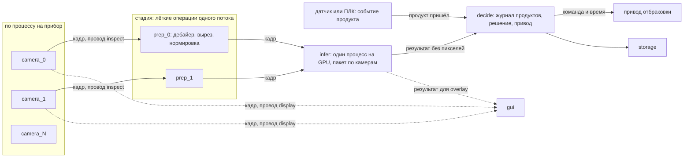

# Целевая архитектура, часть 2: конвейер по процессам, рост до N камер (2026-11-25)

Вынесено из `11-target-architecture.md` (раздел 8) из-за предела размера файла. Нумерация разделов сохранена.
Метки: **[сам]** — прочитал сам, **[помощник]** — нашёл агент-помощник, **[стенд]** — замер другой сессии.
Числа с пометкой «оценка» не измерены. Диаграмма Mermaid не отрисовывалась.

## 8. Конвейер по процессам: нейросеть и операции отдельно

Требование владельца: нейросеть — в отдельном процессе, другие операции — тоже в других.

### 8.1 Как сегодня

- `hikvision_letter_robot.yaml`: процесс `recog` держит `center_crop`, `pixel_to_robot` и `ml_inference` вместе
  **[помощник]** `:242-281`. Нейросеть делит процесс с лёгкими операциями. Требованию не отвечает.
- `backend/topology/inspection_full.yaml`: `processor` (`color_mask` + `blob_detector`) → `inspector`
  (`robot_control`) → `storage` **[помощник]**. Нейросети нет.
- `hikvision_id3013_quad.yaml`: обработки и решения нет, источники идут на показ **[помощник]**.
- У инференса нет ни пакета, ни срока, ни таймаута **[помощник]** (0 совпадений в `Services/ml_inference/plugin`).

### 8.2 Цель

Главное решение: **путь результата отделён от пути пикселей.** Узлу решения пиксели не нужны. На критическом
пути пиксели пересекают границу процесса один–два раза (камера → стадия → нейросеть). Показ получает кадр
напрямую от камеры по своему проводу.

### 8.3 Что идёт через каждую границу

| Граница | Что едет | Цена задержки | Цена памяти | Переполнение | Приёмник медленный | Приёмник умер |
|---|---|---|---|---|---|---|
| камера → стадия / нейросеть (`inspect`) | ссылка на кадр в SHM + конверт | одна копия пикселей у отправителя; читатель получает вид без копии **[помощник]** `frame_shm_middleware.py:963-994`. Оценка: меньше 1 мс на 2 МБ | кольцо 8 слотов × кадр **[помощник]** `qos.py:101`: 16 МБ на моно 2 Мп, 48 МБ на BGR | вытеснить старый **и выдать маркер** `queue_evicted` | маркеры → «не проверено»; узел `overrun` | супервизор поднимает; продукты за время простоя — «не проверено» по сроку |
| стадия → нейросеть | то же, если кадр изменён | ещё одна копия | ещё одно кольцо | то же | то же | то же |
| нейросеть → решение | словарь результата, килобайты | запись замера проекта: около 0,3 мс на хоп при 640×480 (вердикт 11-22, по записи) | пренебрежимо | **не выбрасывать**: очередь на худший случай | `overrun` нейросети | `fault` линии: решение — узел с политикой `fault` |
| камера → показ (`display`) | ссылка на кадр | не на критическом пути | кольцо показа | последний кадр, без маркера | картинка реже | плашка «нет связи» по дереву |
| решение → привод | команда + время срабатывания | — | — | не выбрасывать | — | `fault` |

Отказ на границе всегда один и тот же: потерянный item превращается в маркер, маркер — в «не проверено». Отказ
узла — в его здоровье по разделу 3. Отдельного «канала отказов» нет.

Поведение при нехватке времени: нейросеть перед инференсом сверяет `deadline_ts`. Срок прошёл — инференс
не выполняется, сразу уходит результат `not_inspected (deadline_missed)`. GPU не тратится на опоздавшие кадры.

### 8.4 Где я не согласен с «каждая операция — свой процесс»

Согласен: прибор, нейросеть, решение, показ — отдельные процессы. Не согласен делать это правилом для **каждой**
операции. Причины:

1. **Лёгкие операции одного кадра** (дебайер, вырез, масштаб, пересчёт координат). Отдельный процесс на каждую
   даёт: ещё одну копию кадра на границе; ещё одно кольцо памяти; ещё один процесс Python с OpenCV (оценка
   150–300 МБ, не измерено); ещё одного участника остановки в общем бюджете; ещё одну точку отказа. Надёжность
   цепочки — произведение надёжностей звеньев. Изоляция при этом ничего не даёт: это чистые функции без своего
   ресурса и без нативного SDK. 8 камер × 5 операций = 40 процессов на 16 логических ядрах стенда.
2. **Решение, журнал продуктов и привод** — один процесс. Это самый ответственный путь. Каждый лишний хоп на нём —
   лишний способ потерять вердикт.
3. **Нейросеть на камеру** при одном GPU: память GPU × N и переключение контекстов. Один процесс на GPU с пакетом.

**Правило:** отдельный процесс получает то, что является границей отказа (прибор с нативным SDK, нативная
библиотека, которая может упасть или зависнуть) или владельцем ресурса (GPU, прибор, привод, окно). Остальное —
цепочка плагинов в процессе-стадии. Фреймворк это уже умеет.

**Как при этом выполнить требование владельца.** Размещение — это строка рецепта, не код. Конверт и контракт
здоровья одинаковы внутри цепочки и через границу процесса. Значит, любую операцию можно вынести в свой процесс
правкой рецепта, когда появится причина (тяжёлая, падает, нужна отдельно). Проверка рецепта до запуска печатает
цену: число процессов, память колец, число копий на критическом пути, бюджет времени.

### 8.5 Рост до N камер

**Сеть.** Поток камеры = ширина × высота × бит × частота. MV-CS020: 1624 × 1240 × 8 × 25 = 403 Мбит/с; на стенде
MVS показал 400 **[стенд]**. Две камеры — 81 % гигабита, запаса на повтор пакетов нет. Правило бюджета: сумма
потоков на порт карты ≤ 70 % линка. Варианты по порядку пользы:

1. аппаратный триггер и область интереса в камере — данных меньше у источника;
2. порт сетевой карты на камеру (многопортовая карта) — обычная практика GigE Vision;
3. коммутатор с каналом 10 Гбит/с и карта 10 Гбит/с;
4. пакеты 9000 байт, если карта и коммутатор умеют (сейчас 1500 **[стенд]**) — гипотеза, не замер.

Проверка рецепта до запуска считает бюджет на каждую карту (`device_host_ip`) и отказывает в старте при превышении.

**GPU.** Один процесс `infer` на GPU. Пакет — кадры, пришедшие за короткое окно (несколько миллисекунд).
Готовность: «модель загружается» — `check_function`; `device: cuda`, а работает CPU — `failure`.

**Память и CPU.** Кадр идёт по конвейеру в исходном формате (Bayer 8 бит), в BGR превращается как можно позже:
кольцо BGR втрое больше. Число процессов при N = 8: 8 приборов + стадии + 1–2 `infer` + `decide` + `gui` + PM.

**Задержка.** Бюджет «кадр → решение» задаёт геометрия: расстояние от камеры до привода и скорость ленты.
Он пишется в рецепт и становится `deadline_ts`. Гипотеза для проверки: циклы с опросом через `sleep` на Windows
квантуются по 15,6 мс; приёмник должен ждать очередь, а не опрашивать её.
