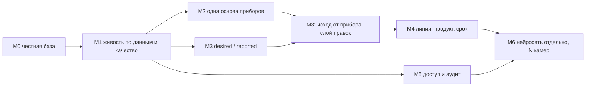

# Переход к целевой архитектуре: этапы и приёмка (2026-11-25)

Продолжение `10-verdict.md` и `11-target-architecture.md` (+ `11b-pipeline-processes.md`).
Вердикт по каждой задаче волны 2 и рекомендации по четырём открытым решениям владельца — `12b-wave2-and-decisions.md`.
Сроки — моя оценка, `manager` не подтверждал. Каждый этап — отдельный план по правилам проекта: слепой тестер до
кода, инъекции на каждое свойство, ревью запуском, стенд перед слиянием.

## Порядок

Первым идёт M1: он убирает ложное «ok». Пока система врёт о здоровье, любая приёмка остальных этапов ненадёжна.
M2 и начало M3 идут параллельно: файлы не пересекаются (`Services/*` против `registers_module`, `backend_ctl`).
M5 можно вести отдельной дорожкой с M1.

Чего **не делать** на всём пути:
- не менять транспорт и SHM-кольцо (потери запуска 1 транспортом не объяснены);
- не писать переподключение и здоровье в плагине конкретного прибора;
- не вводить отдельные флаги доступа до проекта M5;
- не записывать правки на ходу в рецепт автоматически;
- не заводить новые классы-наследники плагина на прибор;
- ничего не удалять: старые пути замораживаются (FREEZE), рецепты переводятся правкой рецепта.

## M0. Честная база (2–4 дня)

Зачем: приёмка следующих этапов опирается на гейт и на улики.

| Что сделать | Где |
|---|---|
| Остановить дописывание W2-b / W2-b1; незакоммиченный код сохранить патчем, тесты оставить | дерево `mco-d-w2-b` |
| Ревью всей ветки `integ/multicam-obs` перед `main` (его не было) | ведущий, `reviewer` opus |
| Поставить `pytest-timeout`: метки таймаута сейчас не действуют. Причина новой зависимости — зависший тест не должен держать окно машины | `pyproject` |
| Пять красных тестов: починить или карантин с номером дефекта | framework, Plugins, prototype |
| Процесс, получивший запрос остановки, взводит `faulthandler.dump_traceback_later` на срок остановки и пишет стеки в свой каталог логов | framework `process_module` |
| Пересобрать `docs/atlas/INDEX.md`; `validate.py` ловит расхождение индекса с кодом | `scripts/atlas`, `scripts/validate.py` |

Приёмка:
- гейт зелёный три прогона подряд; зависший тест-образец снимается по таймауту;
- стенд: `system_shutdown`; если `gui` снова убит — в каталоге логов `gui` лежит файл со стеками всех потоков.
  По нему заводится задача с причиной, а не с гипотезой;
- `validate.py` краснеет, если из индекса убрать строку модуля.

## M1. Живость по данным и метка качества во фреймворке (1,5–2 недели)

Цель — `11`, разделы 3 и 4.1. Новых слоёв нет: всё ложится в `SourceProducer`, `DataReceiver`,
`PluginOperationStep`, маркер `not_inspected` и здоровье.

| № | Задача | Файлы (ориентир) |
|---|---|---|
| 1.1 | Конверт: `quality {status, reasons}`, закрытый словарь причин, правило слияния; `inspection_status` — псевдоним | `process_module/generic/*`, `router_module/middleware/not_inspected_marker.py` |
| 1.2 | Счёт на портах: частота, возраст последнего item, выброшено, доля не `ok` → `state.data.<порт>` | `source_producer.py`, `data_receiver.py`, `heartbeat/telemetry.py` |
| 1.3 | Ожидание `expect` из рецепта → доказательства → здоровье и причины готовности; `state.fps` = частота данных, `state.loop_hz` = частота цикла | `process_module/health/*`, `process_heartbeat.py`, `process_monitor.py` |
| 1.4 | На проводах `inspect` каждое вытеснение даёт маркер (очередь, слот SHM, отставание); политика переполнения — свойство провода | `shared_resources_module/queues`, `router_manager.py`, `data_receiver.py` |
| 1.5 | ERROR-запись = инцидент: один путь, имя процесса ставит фреймворк | `plugins/base.py`, `observability_wiring.py`, `error_module` |

Приёмка на фейке (литералы — в брифах): источник с `free_run`, `silence_s: 3`, который перестал выдавать items,
через 3 с даёт `data.state = starved`, здоровье не `ok`, причину готовности `failure`. Инъекции: счёт по такту
вместо items; ожидание не читается; маркер не выдаётся при вытеснении; метка улучшается при слиянии.

Приёмка на стенде (код приборов волны 1, **без правок `Services/code_reader`**):
1. вынуть кабель считывателя: за ≤ 4 с `reader_1` — `starved`, не готов; сегодня — `ok` **[стенд]**;
2. вынуть кабель камеры при выключенном `reconnect`: то же; `state.fps` камеры = 0, а не 25;
3. перегрузить `draw_1`: `overrun`, растёт счётчик выброса, здоровье `degraded`, `errors.log` не пуст;
4. соседние источники: частота ±2 %, ошибок 0.

Заменяет из волны 2: W2-m, W2-o, половину W2-l, имена ключей для W2-d.

## M2. Одна основа приборов (2–3 недели)

Цель — `11`, раздел 2.

| № | Задача |
|---|---|
| 2.1 | Набор соответствия порта (`port_contract`) расширить: события связи, проба, `Sample.extras`. Его проходят `fake`, `mvs`, позже `mvcr` |
| 2.2 | `camera_device` → `device_core` (старое имя — псевдоним импорта). Автомат связи и переподключение из `dev/w2-a` — в сеансе; события SDK (W2-a2) |
| 2.3 | Описание драйвера; один `DeviceSourcePlugin`, драйвер выбирается полем `driver` рецепта. `HikvisionCameraPlugin` остаётся тонким псевдонимом (FREEZE). Путь в дереве `state.device.*` |
| 2.4 | Драйвер `mvcr` для MV-ID3013: порт над `MvCodeReaderApi`, привязки узлов триггера, `decode()` с кодами. Слепые тесты W2-b (`test_reader_link_contract.py`) — приёмка драйвера. `CodeReaderSdkPlugin` заморожен |
| 2.5 | Качество в источнике: неполный кадр и разрыв номера → метка; кадры за время потери связи → маркер `link_gap` |
| 2.6 | Полный профиль узлов при открытии, чтение обратно, отпечаток (W2-p); выбор прибора по ip / index (W2-g); рецепт quad (W2-h) |

**Условие остановки.** Если SDK считывателя не укладывается в `DevicePort` (например, захват только колбэком или
узлы нельзя читать), исполнитель останавливается и сообщает. Тогда правится **контракт порта** для всех приборов.
Отдельная ветка кода для считывателя не заводится.

Приёмка на стенде, рецепт quad:
1. четыре прибора идут через один класс плагина; ключи `state.device.*` у камеры и считывателя одинаковы;
2. кабель каждого из четырёх приборов по очереди, 10 с и 80 с: потеря замечена за ≤ `link_silence_s` + проба,
   прибор возвращается сам, строки WARNING и INFO одинаковы для обоих видов;
3. правка триггера считывателя на ходу: ответ команды < 50 мс (системный поток не держится; сегодня 4,75 с);
   время перезапуска захвата записано;
4. два запуска подряд, между ними прибор открыт в MVS и изменён: отпечаток профиля после открытия тот же;
5. таблица (c) из `03-diagrams.md`: в каждой строке — «одна реализация»;
6. в интроспекции `driver` = `mvs` / `mvcr`, не `fake`.

Известные долги закрываются здесь без отдельных задач: повторный `configure` считывателя, колбэк 4,75 с,
`driver="fake"`, счётчики прежней копии после перезапуска (счётчики принадлежат сеансу нового процесса).

## M3. Desired / reported и слой правок (1,5–2 недели)

Цель — `11`, раздел 5. Части 3.1–3.3 не зависят от M2.

| № | Задача |
|---|---|
| 3.1 | `registers_module`: на поле `desired`, `reported`, `status`, `error`, `origin`, `at`; регистрация исполнителя; поле без исполнителя — `applied` сразу |
| 3.2 | Один путь записи: `set_config` идёт через `set_field_value` (W2-i) |
| 3.3 | Ответ `accepted`; `set_register_verified` ждёт `status` и сверяет `reported` (W2-n) |
| 3.4 | Исполнитель в `device_core`: исход записи узла из потока-владельца → регистр. Один для всех приборов (W2-n1 отдельно не нужна) |
| 3.5 | Слой правок: спутник рецепта (тот же механизм, что у наблюдаемости), повторное применение при старте, «рецепт изменён» в GUI |

Приёмка на стенде (повтор проверки 4 от 2026-11-25):
1. считывателю период триггера 10 мс (прибор принимает от 32): ответ `accepted`; затем `status = rejected`,
   `reported` = прежнее значение; `set_register_verified` → `failed`; инцидент в плоскости ошибок. Сегодня —
   `confirmed` **[стенд]**;
2. камере усиление 23: `applied`, `reported` = прочитанное из прибора;
3. перезапуск процесса камеры: правка применена снова, в дереве виден автор и время;
4. перезапуск системы: правка действует, GUI показывает «рецепт изменён: 1 поле»; «сбросить» возвращает рецепт.

## M4. Линия, продукт, срок (2 недели)

Цель — `11`, разделы 4.2 и 6.

| № | Задача |
|---|---|
| 4.1 | `run_state`: состояние `held`, политика узла `on_fail` (`hold` / `degrade` / `fault` / `ignore`), `max_hold_s`, время устойчивости; происхождение перезапуска (W2-e) |
| 4.2 | Узел решения: журнал продуктов по событию триггера, срок, покрытие, счётчики «не проверено» по причинам |
| 4.3 | `deadline_ts` в конверте; гистограмма «кадр → решение» всегда включена (одно вычитание на item) |
| 4.4 | GUI: плашка «нет связи» по состоянию из дерева (W2-c2), состояние линии, покрытие; обзор аномалий (W2-d) |

Приёмка на стенде:
1. кабель камеры на 10 с: линия `held`; после возврата и выдержки — `running` **без квитирования**. Сегодня —
   83 с и ручные `run_ack` + `run_start` **[стенд]**;
2. кабель дольше `max_hold_s`: `fault`, причина названа;
3. ручной `process_restart_verified`: `held` с причиной «обслуживание», затем `running` сам;
4. аппаратный триггер и 100 событий продукта при вынутом кабеле одной камеры: 100 продуктов «не проверено»,
   100 постановок на отбраковку; покрытие поста 0 %; у соседнего поста 100 %;
5. p50 и p99 «кадр → решение» видны в обзоре.

Перед стартом M4 нужен ответ владельца: что делает конвейер при `held` и `fault` (`11`, раздел 6).

## M5. Доступ и аудит (1,5 недели, можно параллельно с M2–M4)

Цель — `11`, раздел 7. Согласовать с задачами 2.2 / 2.3 плана observability-signal-contracts: один владелец роли.

| № | Задача |
|---|---|
| 5.1 | Роль в `hello`; сессия на хосте; `principal` в конверте ставит транспорт |
| 5.2 | Класс доступа у команд и полей; проверка в диспетчере команд; запрет прогона — условие класса (W2-j) |
| 5.3 | Аудит на бэкенде; роль пользователя GUI = роль сессии |

Приёмка: сессия MCP с ролью `operate` пишет поле класса `configure` — отказ с причиной; роль `admin` — принято,
строка аудита с автором; сообщение с подделанным `_sender` в данных — в аудите автор из соединения.

## M6. Нейросеть отдельно, рост до N (2–3 недели и выдержка)

Цель — `11b`.

| № | Задача |
|---|---|
| 6.1 | Проверка рецепта до запуска: бюджет сети на карту, число процессов, память колец, копии на критическом пути, бюджет времени |
| 6.2 | `ml_inference` — свой процесс в рецептах; пакет по камерам; приём по сроку; готовность «модель загружается»; CPU вместо заказанного GPU — `failure` |
| 6.3 | В рецептах путь результата отделён от пути пикселей; провода `inspect` и `display` |
| 6.4 | Замеры: цена хопа на 2 Мп, память процесса, время инференса; выдержка 8 часов |

Приёмка на стенде:
1. рецепт с третьей камерой на той же карте при 25 к/с: запуск отказан с расчётом бюджета;
2. убить `infer` в работе: продукты за время простоя — «не проверено»; `infer` вернулся; покрытие восстановилось;
3. перегрузить `infer`: метки `deadline_missed`, очередь не растёт, p99 «кадр → решение» ограничен сроком;
4. 8 часов, четыре прибора: ноль необъяснённых «не проверено»; память `gui` не растёт (сегодня 1 ГБ за 6 минут
   **[стенд]** — разобрать до выдержки); остановка без убитых процессов.

## Что оставил открытым и что ненадёжно

- Сроки и разбиение на задачи — оценка без `manager`; файлы в таблицах — ориентир, не проверенный список.
- M2.4 зависит от непрочитанного мной SDK считывателя; условие остановки написано именно поэтому.
- M1.4: как сегодня устроено вытеснение без loan — по отчёту помощника, не перечитывал.
- Приёмка M4, пункт 4, требует источника событий продукта. Есть ли он на стенде — не знаю.
- Пороги (`silence_s`, доля 2 %, `max_hold_s`, 50 мс) — стартовые значения; подбираются на стенде.
- Причина потерь и чёрного кадра запуска 1 остаётся неизвестной; M2.6 убирает зависимость от истории прибора,
  но не доказывает, что причина была в ней.
- Причина убийства `gui` при остановке неизвестна; M0 даёт улики, а не исправление.
