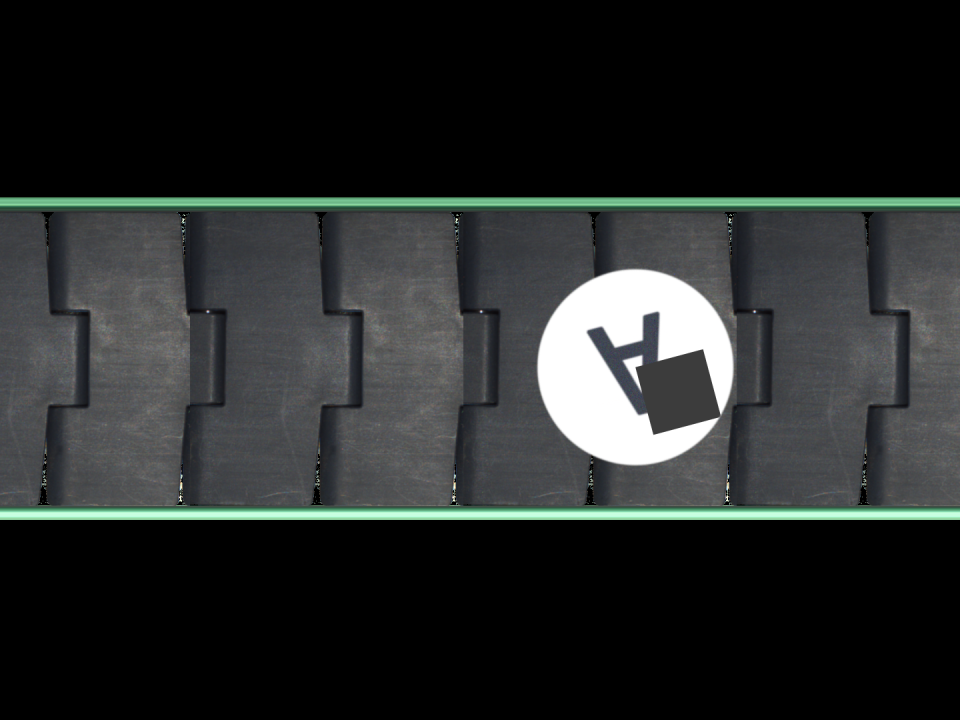
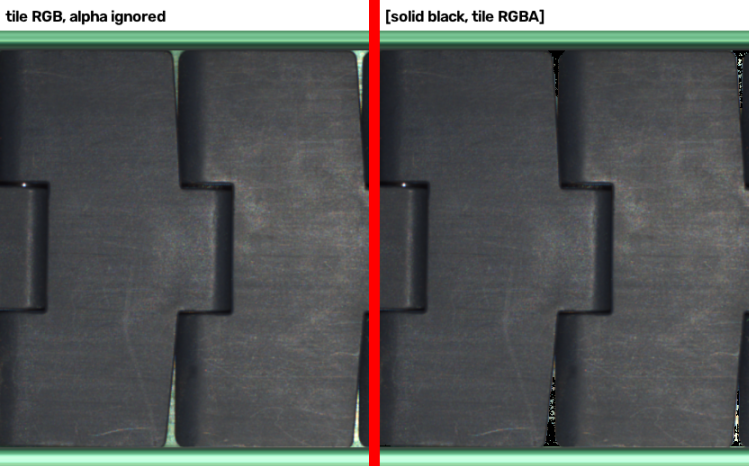
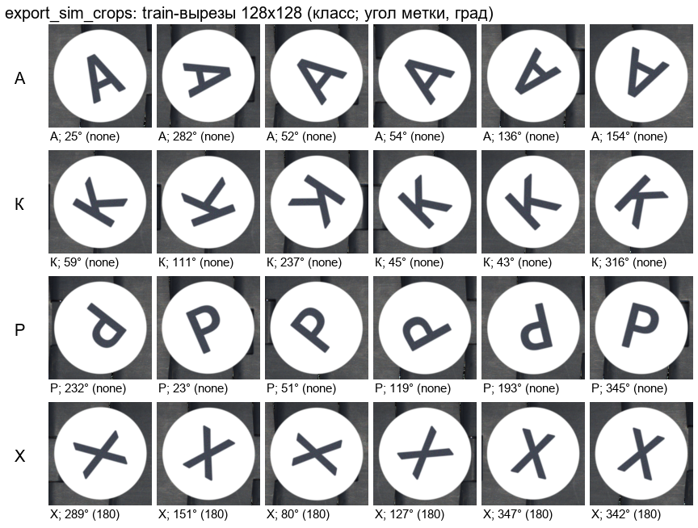
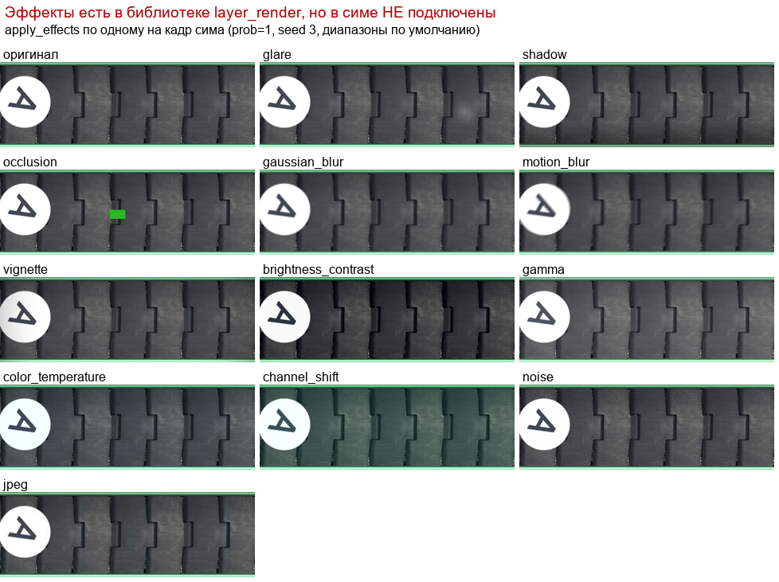

# layer-render: что готово, а что нет (2026-11-26, `main` 53efe24b9)

## Короткий отчёт полосы

- **ОТЧЁТ:** полоса С, разбор `layer-render`, сессия `inspector-bottles-ff`.
- **Суть:** кода не меняли; статусы проверены по git и запуском.
- **Итог:** из 22 задач готовы 13, частично 2 (2.2, 5.3), не начаты 7; фазы Ф7–Ф9 не начаты.
- **Проверка:** `layer_render` 1652 passed, `dataset_gen` 321 + 1 skip, `ml_train` 141, `center_crop` 24; отдельные файлы `line_sim` 197 + 1 skip, `Plugins/sim` 85, `apps/line_sim` 13; красных нет.
- **Открыто:** полные папки `line_sim` и `Plugins/sim` не гонялись (нужно окно); живого стенда и браузера не было.
- **Ревью:** одно (sonnet), итерация 1 — CHANGES REQUESTED (7), итерация 2 — прежние закрыты, ещё 2 крупных и 2 мелких. Правки по итерации 2 **повторно не ревьюились** (лимит 2 итерации).
- **Дальше:** сводный план темы — [`plans/layer-render/plan.md`](../../plans/layer-render/plan.md); решения — за владельцем.

## За две минуты

**Что это.** Один механизм, который рисует картинки объектов: фон, слои (диск, буква, брак), эффекты. Им должны пользоваться и симулятор линии, и обучение сети.

**Что работает сегодня:**

- Симулятор рисует ленту и диски с буквами. Фон собран из слоёв: чёрный, сверху плитка ленты.
- Из тех же слоёв получаются картинки для обучения сети, с буквой и углом поворота.
- Сим и новый путь обучения (из слоёв) рисуют кадр одной функцией. Действующие настройки обучения идут старым путём.
- В веб-редакторе есть сетка, выбор нескольких слоёв, горячие клавиши и масштаб (проверено только тестами, не в браузере).

**Чего нет:**

- **Редактора, ради которого план затевался, по большей части нет.** Нельзя настраивать фон и эффекты из редактора, нет точного превью, нет Qt-версии.
- **Эффекты (шум, блик, размытие и другие) не действуют в симуляторе и в новом экспорте обучающих картинок из слоёв.** Набор из 12 эффектов написан, но в симе не подключён, а в пресете букв раздел эффектов обучения не заполнен. В **старом** пути обучения эффекты есть: все четыре действующие настройки `ml_train` идут им, и боевая модель `mobilenet_v3_large_20260616_050828` обучена именно так.
- Файл сцены не принимает новые настройки: попытка записать фон или эффекты отклоняется с ошибкой.
- Старый второй способ сборки обучающих картинок всё ещё на месте.

**Для 1.0** редактор, судя по коду, не нужен. Подробности — в разделе «Что из остатка может понадобиться для 1.0».

### Как это выглядит

Кадр симулятора с настройками `apps/line_sim/pipeline.yaml` (тёмный квадрат на диске — это брак):

Слева плитка ленты без прозрачности, справа «чёрный + плитка»: щели чернеют не полностью.

Картинки для обучения из экспорта на реальных данных. Эффектов на них нет:

12 эффектов из библиотеки по одному. **В симуляторе они не включены:**

## Таблица задач

Все sha в колонке «git» проверены командой `git merge-base --is-ancestor <sha> main`. «Шапка» — статус в `plan.md` / в файле фазы до этого разбора. Число тестов — прошедшие в этом прогоне.

| Задача | Что даёт пользователю | Шапка | git | Проверено сейчас | Итог |
|---|---|---|---|---|---|
| 1.1 | фон из нескольких слоёв | DONE / PENDING | `564e6a41` | 122; фон виден под щелями плитки | готово |
| 1.2 | просветы плитки делаются прозрачными | DONE / PENDING | `712b0c7a` | 47 + 1 skip; инструмент на копии реального фото дал плитку, равную стендовой | готово (щели ≈ 70 %, принято владельцем) |
| 1.3 | стенд рисует «чёрный + плитка» | DONE / IN PROGRESS | `c989be29` | 36; запуск `scene_source` с конфигом стенда | готово |
| 1.4 | убирает «перец» из прозрачных точек | DONE / PENDING | `3ea586c0` | 91; крапинок меньше 8 px было 523, стало 0 | готово |
| 2.1 | общая склейка картинок | DONE / DONE | `c9d56b11` | 79 | готово |
| 2.2 | эффекты камеры и света | DONE / DONE | `8665d7b7` | 174; сим передаёт пустой список эффектов | **частично**: библиотека есть; в симе и в экспорте 6.3 не включена |
| 2.3 | объект из слоёв (диск, буква, брак) | DONE / DONE | `ca0e6203a` | 240 | готово, есть дефект в крайнем случае |
| 2.4a | общий пресет сцены и каталог картинок | DONE / DONE | `6c242c9e5` | 146 | готово |
| 2.4b | общая «фабрика» объектов и превью | DONE / DONE | `bb085a9ee` | 660; превью на 4 картинки собралось | готово |
| 2.5 | один кадр для сима и обучения | DONE / DONE | `0fbb79e33` | 143; вызывают сим и новый генератор | готово |
| 3.1 | фон и эффекты в файле сцены | PENDING | — | запись `background` или `effects` отклоняется | нет |
| 3.2 | безопасное сохранение файла сцены | PENDING | — | модуля `preset_store` нет | нет |
| 4.1 | редактор узнаёт список настроек и эффектов | PENDING | — | команд нет | нет |
| 4.2 | точное превью кадра в редакторе | PENDING | — | команды `scene.preview` нет | нет |
| 5.1 | панель фона в редакторе | PENDING | — | маршрутов фона нет | нет |
| 5.2 | панели эффектов с живым превью | PENDING | — | упоминаний эффектов в странице нет | нет |
| 5.3 | сетка, мультивыбор, горячие клавиши, масштаб | DONE / IN PROGRESS | `958c5a6d` | 48: код страницы исполняется в node с поддельным холстом | **частично**: в браузере не проверено |
| 6.1 | один вырез объекта для линии и обучения | DONE / PENDING | `f9ef5c45` | 208; два пути дали одинаковые байты | готово |
| 6.2 | генератор обучающих картинок из слоёв | DONE / DONE | `6348d35e2` | 103; классы А К Р Х, картинка 128×128 | готово |
| 6.3 | выгрузка набора для обучения | DONE / DONE | `397843e98` | 44; выгружено 32 + 8 картинок, обучение их читает | готово (без эффектов) |
| 6.4 | оценка сети режет кадр так же, как линия | DONE / PENDING | `e18d22d44` | 92; контрольное число из отчёта 6.4 не перемерялось | готово |
| 6.5 | один способ сборки обучающей картинки | PENDING | — | старый путь на месте (`engine.py`) | нет |
| Ф7 | новые источники картинок (шрифты, символы) | PENDING | — | `sources.py` нет | нет |
| Ф8 | редактор на Qt | PENDING | — | не начато | нет |
| Ф9 | редактор разметки для обучения | IDEA | — | не начато | нет |

## Расхождения «шапка ≠ git ≠ поведение»

1. **Файлы фаз отстали.** 1.1, 1.2, 1.4, 6.1, 6.4 помечены PENDING, 1.3 и 5.3 — IN PROGRESS, а в `main` они есть. Строки статусов поправлены в этой ветке.
2. **`phase-2.md`…`phase-5.md` — старая нарезка** с теми же номерами и другим смыслом. Добавлена пометка «статусы не вести».
3. **Шапка `plan.md`** называла ветку и дерево, которых нет.
4. **DS-1 (соседний план):** в шапке PENDING, а в `main` уже есть 1.1a (`67b24691c`), 1.1b (`a34d6b1a4`, правки `f5b0a4b98`) и 2.1 (`41e053466`). Шапку правит его владелец.
5. **2.3:** хвост «пустой список слоёв» закрыт наполовину (находка 3 ниже).
6. **Исключение для тестов.** Владелец разрешил трём тестовым файлам `layer_render` обращаться к `line_sim`. Сейчас таких файлов 6.
7. **Очередь (`ORDER.md`) отстала:** по ней 6.2 и 6.3 ещё впереди. Её правит координатор.

## Находки проверки запуском

1. В экспорте обучающих картинок из слоёв (6.3) эффектов нет: в `letters_layered.yaml` нет `train.augment`.
2. Если добавить в `train.augment` один эффект, включаются ещё три: размытие, яркость и цветовая температура.
3. Пресет с одним слоем брака, который не выпал, принимается, а при отрисовке падает с `ValueError: max() iterable argument is empty`.
4. Фон задан в двух местах (`apps/line_sim/pipeline.yaml` и пресет букв), совпадают только вручную.
5. `preset.layout` с ключом `apply_effects` отвечает «ok» и ничего не делает с эффектами.

Отдельно (ревью): любой неизвестный ключ настроек `scene_source`, в том числе опечатка, принимается молча. Старый ключ `background_texture` отклоняется.

Строки для реестров очереди: `plans/queue/inbox/2026-11-26_inspector-bottles-ff_1.md` … `_3.md`.

## Остаток по порядку

Оценок по отдельным задачам в плане нет. Есть норма на задачу: тестер ≈ 150 тыс. токенов, исполнитель 150–250, ревьюер 100–150. Для семи задач это 2,8–3,9 млн. Это моё умножение, а не замер.

| Шаг | Задачи | Зависит от | Что нужно от владельца |
|---|---|---|---|
| 0 | находки 1–3 (в сводном плане ЛР-01…03) | ничего | какие эффекты и какой силы нужны |
| 0 | `draw-universal` 0.1, 1.1, 1.2 (общая база рисования) | поправить его границу с `layer_render` до 1.1 | решить, переносить ли склейку |
| 1 | 3.1, затем 3.2 | `draw-universal` 1.1, 1.2 и общая склейка (ЛР-24): вид слоя «регион» записывается в формате фигуры `draw` | ничего сверх шага 0 |
| 2 | 4.1, 4.2 | шага 1 | ничего |
| 3 | 5.1, 5.2 | шага 2 | приёмка редактора в браузере |
| параллельно | 6.5 | 6.2 (готова) | решение уже принято 2026-10-01 |
| позже | Ф7 | шрифты из `draw-universal` | пересборка каталогов |
| позже | Ф8 | `gui-constructor` (черновик) | одобрить его |
| позже | Ф9 | Ф5 | реальные кадры |

## Пересечения с соседними планами

| Сосед | Что пересекается | Кто владеет |
|---|---|---|
| `line-sim-layer-editor` 1.2b, 1.3 | Qt-редактор, та же работа, что Ф8 | полоса С; не помечено, что это одно |
| `line-sim` 4.3 | фотометрия сцены, дублирует эффекты из 3.1 | план `line-sim` |
| `line-sim` 6.4 | та же страница пульта, что 5.1/5.2 | план `line-sim` |
| `draw-universal` | шрифты (Ф7), фигуры и YOLO/COCO (Ф9); очередь ставит его выше 3.1 | свой план, 2.0 |
| `dataset-annotation` | экспорт YOLO/COCO; решено делать в `Services/draw` | `draw-universal` |
| `letters-retrain` | фаза обучения ждёт экспорт 6.3 (он есть); задач в ней нет | задача владельца, вне полос |
| DS-1 | пары «вырез + правда» с сима | свой план, частично в `main` |

## Что из остатка может понадобиться для 1.0

**Признак по очереди (строка 40):** поднять `layer-render` 3.1 в 1.0, если строка 27 покажет провал сети на реальных кадрах.

**Где мы сейчас:**

- Строка 27 не выполнена. Есть замер только на симуляторе: «верно и выше порога» 88,8 % на слове «ПЕРМИ» и 77,9 % на всём алфавите. Реальных кадров ещё нет.
- Порог предложен лидом и **не утверждён**: ≥ 85 % — годится, < 55 % — провал. Промежуток 55–85 % не описан. Документ требует утвердить до дня съёмки ([лист из пяти чисел](../handoffs/2026-11-22_beta-five-numbers.md)).

**Мой вывод (не замер):** при провале сети редактор и пресет v2 (3.x–5.x) её не исправят. Понадобятся:

1. обучающий набор на все буквы и шрифты (`letters-retrain`, фаза 1);
2. реальные вырезы и фон со дня съёмки;
3. решить, каким путём учить. Старый путь уже даёт эффекты (так обучена боевая модель). Новый путь из слоёв даст их только после правки пресета; лишние три эффекта придётся выключить явно (находка 2);
4. обучить и повторить замер.

3.1 пригодится, только если захотят видеть эффекты в симуляторе. Причину провала до разбора реальных кадров назвать нельзя: возможен и дефект выреза на линии.

## Общая база рисования (требование владельца, 2026-11-26)

«Механизм рисования должен быть на одной базе как в layer-render так и draw_universal». Это согласуется с решением 2026-11-11 «`layer_render` строится на `draw`».

Пробел в сегодняшнем плане `draw-universal`: склейка картинок остаётся в `layer_render` (`compose.py:121`), а задача 1.2 вводит своё «наложить по маске» для текста. Получатся две реализации одного действия. Предложение: перенести склейку в `Services/draw`. Владелец это пока не подтвердил.

**Против этого предложения есть прежний вердикт.** CTO 2026-11-11 решил оставить склейку в `layer_render`, пока замер не покажет узкое место, и отклонил её перевод на бэкенд ([отчёт](2026-11-11_draw-architecture-cto-r2.md), раздел 2.2). Согласие на перенос пересматривает этот вердикт.

## Незакоммиченные тесты в деревьях тестеров

| Дерево | Что внутри | Нужны ли |
|---|---|---|
| `layer-render-6.2-tester` | 2 файла приёмки 6.2 (25 и 16 тестов) | нет: в `main` лежат такие же (отличие только в переводах строк не учитывалось) |
| `line-sim-6.5-tester` | 1 файл приёмки `line-sim` 6.5 (18 тестов) | нет: в `main` более новая версия того же файла (33 буквы вместо 4) |

Деревья не менялись и не удалялись. Это `line-sim` 6.5, а не `layer-render` 6.5: номера совпали.

## Решения, которые за владельцем

1. Утвердить пороги для реальных кадров и сказать, что делать в промежутке 55–85 %.
2. Заменить ли в строке 40 «Task 3.1» на фазу 1 `letters-retrain`.
3. Переносить ли склейку картинок в общую базу `Services/draw` (рекомендация: да; это пересматривает вердикт CTO 2026-11-11).
4. Что делать с тестами `layer_render`, которые обращаются к `line_sim`: разрешить 6 файлов или перенести.
5. Объединение планов темы — решения перечислены в [сводном плане](../../plans/layer-render/plan.md).

## Что осталось открытым / ненадёжно

- Полные папки `Services/line_sim/tests` и `Plugins/sim` не гонялись: ворота требуют для них окно (код 75). Запущены только файлы задач. Тесты `layer_preview` не запускались совсем.
- Живого стенда, настоящего браузера и обмена между процессами не было. Команды вызывались прямо на объектах плагинов с подменённым окружением.
- Числа тестов ревьюер не перепрогонял; он проверил запуском строки 1.2/1.4, 2.3, 2.5, 6.3.
- Поломки намеренно не вносились: зелёный тест здесь значит только «проходит».
- Покрытие щелей и скорость кадра не мерялись. Во время прогонов шла чужая тяжёлая нагрузка, поэтому времена не приводятся.
- «Крапинки в щелях» на картинке 2 — наблюдение глазами.
- Данные смотрели только на этом ПК.
- Координатор `inspector-bottles-ad` из `machine.lock` в списке сессий не найден; своё имя ему передать не удалось.
