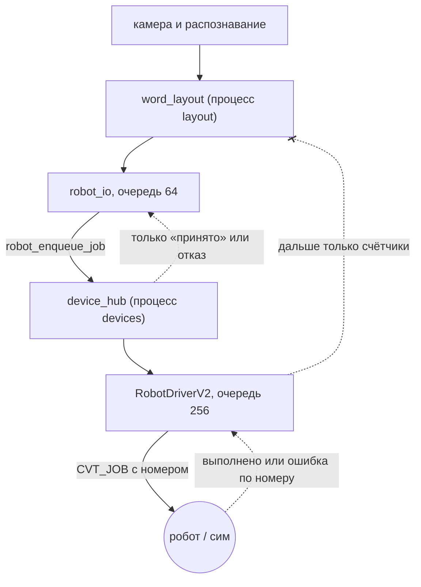
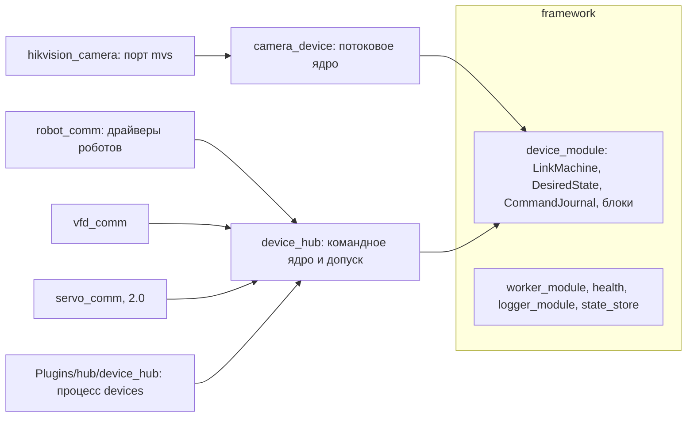
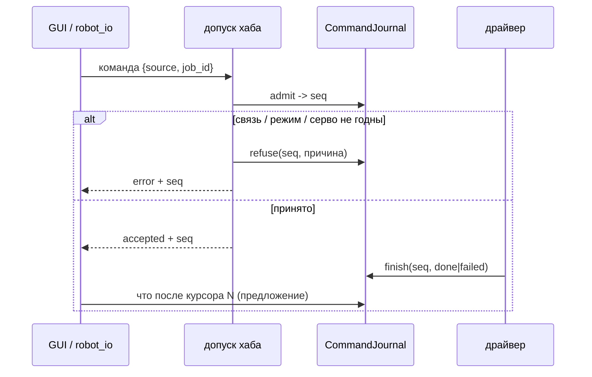

# Приборы: что сломано и какая нужна общая основа (камеры, робот, ПЧ, серво)

2026-11-26 · полоса Р2 (`inspector-bottles-6f`) · срез `main` `eaaf82a60` · **анализ, решения не приняты**. Код продукта не менялся, стенд и настоящий робот не использовались. Читатели: CTO, полоса К, координатор, владелец.

Метки: **[Л]** — лид сам повторил прогоном · **[А]** — прогон агента · **[Ч]** — только чтение кода · **[Ф]**, **[К]** — утверждение соседней полосы.

## 1. Что просит владелец

1. Правильные слои в Services и не только; без дублей в будущем.
2. Одна основа с отслеживанием состояния и журналами для камер, роботов (в том числе других фирм), ПЧ, сервоприводов.
3. Журнал команд робота должен позволять понять по командам, правильно ли всё работает.
4. Рамки: решение 29 (1.0 = 1 камера, 1 робот, 1 ПЧ); с 2026-11-30 владелец на роботе и пишет прошивку v2.

Схемы страницами (открывать в браузере, mermaid грузится из сети): [архитектура устройств](../diagrams/device-architecture/index.html), [контур робота](../diagrams/robot-contour/index.html). Страницы — версии на момент разбора; при расхождении верен этот документ.

## 2. Путь задания «буква»



| № | Находка | Наблюдение | Метка |
|---|---|---|---|
| J1 | C-104: «слово собрано» при отвергнутой букве. `95d496376` сделал отказ видимым в `robot_io`, укладку не менял (`word_layout/plugin.py:209-248`, `assembler.py:113-124`) | М отвергнута после «Домой», итог `МИР`, `done=True`; `jobs_forwarded=2`, `jobs_dropped=1` | [Л] |
| J2 | Задание принято и начато, но не выполнено | `jobs_failed=1`, `robot_io.forward_ok=True`, `health.report_error` 0 раз | [Л] |
| J3 | Задание принято и снято командой «Домой» | `park.dropped.jobs=1`, ячейка остаётся занятой | [А] |
| J4 | Параметры не доходят без смены `config_epoch` (`client_v2.py:817-820`) | в драйвере `P_ZONE_MAX` 6000, в симе осталось 5000 | [Л] |
| J5 | Есть `data/robot/<id>/params.yaml` → `robot_params` рецепта не применяются (`robot_data.py:147-165`) | — | [Ч] |
| J6 | `P_ZONE_MIN..MAX` проверяет точку **забора** (`sim_core_v2.py:1220-1231`), укладку — `P_WS_R_MAX` 600 мм. Умолчание 500 мм; в β-рецепте `robot_params` нет; расчётный забор 532–596 мм | — | [Ч] + расчёт |
| J7 | Тайм-аут IPC 1 с считается отказом, хотя задание могло встать в очередь; переполнения очередей вытесняют без записи | — | [Ч] |

Итог по заданию протокол v2 даёт (`TLM_DONE_SEQ` / `TLM_ERR_SEQ`, `client_v2.py:647-678`); сегодня он кончается в `jobs.py:84-110` счётчиками. «Выполнено» значит «рука доехала»: датчика захвата в цепочке не найдено [Ч].

## 3. Связь, серво, команды, публикация

| № | Находка | Наблюдение | Метка |
|---|---|---|---|
| C1 | C-38: тик переподключения, прошедший проверку до «Отключить», доделывает подключение | после disconnect: `probe, sync, servo, do1, tcp_close`; `TLM_SERVO=1`, SOFT 0, экран «disconnected»; окно открыто искусственной паузой | [Л] |
| C2 | Серво, выключенное оператором, включается после обрыва связи (`ops.py:121-134`, `driver.py:409-421`); в реестре дефектов не найдено | off → `TLM_SERVO=0` → обрыв, один тик → `TLM_SERVO=1` | [Л] |
| C3 | Строковый `last_error` пишется через `merge` и отвергается (`plugin.py:625,763,867-871`; `manager.py:675`; `driver.py:639`) | `status=error`, в дереве поля нет | [Л] |
| C4 | Удаление через `merge(path, {})` ничего не удаляет (`plugin.py:1140`, `manager.py:648`) | `changes_count: 0`, узел цел | [Л] |
| C5 | Режима «ручной / авто» нет (C-39) | — | [Ч] |
| C6 | Старая вкладка «Робот» шлёт имена v1 | 8 проверенных команд: «Неизвестная операция» | [Л] |
| C7 | Желание «подключён» в трёх местах (`plugin.py:274`, `base.py:101`, счётчик `state.py:391`), желаемое серво не хранится | — | [Ч] |
| C8 | `_safe_call` считает `{"status":"error"}` драйвера успехом (`plugin.py:890-896`) | — | [Ч] |

**Поправка лида к C3/C4:** это дефект **писателя**, framework менять не нужно. Явное удаление уже есть: `StateProxy.delete` (`state_store_module/proxy/state_proxy.py:294`) и серверный `handle_state_delete` (`manager/state_store_manager.py:281`, регистрация `:624,:654`); для скаляра есть `set`.

## 4. Журнал обмена (T5.6)

Пишет только обмен по проводу (`exchange_log.py:404-485`).

| Что | Наблюдение | Метка |
|---|---|---|
| Отказ после «Домой» (задание, jog) | 0 строк | [Л] |
| Одно подключение | 413 строк из кольца 2000; около 5 переподключений вытесняют всё | [Л] (413), [Ч] |
| «Выполнено роботом», ошибка робота | строк нет (`jobs_done=1`) | [Л] (done), [Ч] (ошибка) |
| Кто просил, какая буква, сквозной id | нет; `robot_io` снимает подпись перед отправкой (`robot_io/plugin.py:236-237`); `CMD_SEQ` в ответ не возвращается | [Ч] |
| Порядок строк | `seq` и `t` выдаются после возврата транспорта (`exchange_log.py:435-439`) — между потоками возможна перестановка | [Ч] |
| Читатели | `robot_exchange_log_get/set`, файл `robot_exchange_file`; GUI не читает | [Ч] |

Для прошивки v2 [Ч]: робот должен возвращать метку задания в событии done/err; `TLM_DONE_SEQ` хранит только последний номер; нужно решить, что робот делает сам при потере связи с ПК при включённом серво (не проверено ни на симе, ни на железе).

## 5. Готовность к дню с роботом (инвентаризация агента, [А]/[Ч])

- На симе: укладка слова (199 тестов прошли), драйвер v2, `robot_io` → `CVT_JOB`, «Домой», стоп, кнопки пульта.
- Нет: прошивка v2 (`robot/v2/main_v2.lua` без функций), калибровка камера–робот F7, сеть на реальных кадрах.
- Рецепт β настроен на `delta_v2`, на контроллере v1; пробный revert отката даёт конфликт.
- Известный красный: C-108 (снимок регистров `robot_io`). Большие наборы `device_hub` и `robot_comm` в разборе не запускались.

## 6. Приборы: опись механизмов

CAM — ядро `Services/camera_device`; RDR — считыватель; WEB — `CapturePlugin`; RV2/RV1 — роботы хаба; VFD, GMB, HIK — драйверы хаба. Ячейки RV1, VFD, GMB, HIK — карта помощника, RDR, WEB и часть CAM — из `design.md` плана камер.

| Механизм | Реализаций с разным поведением |
|---|---|
| Переподключение | 2 основы (сеанс CAM; база + воркер хаба) и 3 копии цикла (RV1, RV2, VFD); у RDR, WEB, GMB, HIK нет |
| Желаемое состояние | хаб (3 писателя) и камера (неявно: жив поток) |
| Тишина | 3 правила (`link_silence_s`, `conn_stale_s`, heartbeat-stale ПЧ) |
| Здоровье, готовность | 2 стиля; драйверы хаба `report_error` не зовут |
| Дерево состояния | 5 разных путей |
| Каталог команд | 3 способа (рукописные, `OpSpec`, `cmd_hik_*`) |
| Параметры | 4 способа |
| Личность | 3 способа |
| **Нет нигде** | журнал команд с отказами и источником; режим ручной/авто; исход длинной команды вызывающему; желаемое «серво/разрешение» |

**Слои** [А]: `sentrux check .` — все 43 правила зелёные, нарушений импорта нет. Неверно лежит смысл [Ч]: `kinds.py:23-28` импортирует все драйверы (новый вендор = правка хаба); `manager.py:26` берёт текст из `robot_driver_v2`; `manager.py:749-930` — `robot_data`, `robot_park_all` в общем менеджере; `plugin.py:1252-1297` — `cmd_hik_*`; `kind="hikvision"` назван по вендору; `transports.py:122-125` — правило «только robot может быть мостом»; драйвер наследует `ObservableMixin`, но слоты никто не регистрирует (`base.py:25-32`).

**Камеры** [К, `integ/dcb-phase1` `fa944d719`, не слита]:
- Годится роботу и ПЧ: поток-владелец порта с ящиком команд (`session.py:324-533`), цикл переподключения (`:665-870`), сторож зависшего вызова, блок `link`, форма `readiness`. Прочитано.
- Намертво про кадры: такт = `get_frame`, тишина и отказ считаются по кадрам.
- Желаемого поля нет. `release` между `take_device` и `session.start` отвечает `ok/idle`, потом кадры идут (прогон К на фейке). Хаб после рестарта подключает отключённое вручную.
- `drivers/hikvision_driver.py` хаба считает подключение успешным, если `open` вернул False (прогон К на заглушке). К одной камере ведут три пути.
- **Не делать общим:** «живость = пришли данные»; авто-возобновление после обрыва (камере можно, приводу нет); профиль `rest` как безопасное состояние; «один сеанс на процесс»; очередь кадров.

## 7. Правила записи состояния (согласовано Р2 и Ф, владельцем не утверждено)

- Скаляр и строка — `set`. Удаление — только `delete` (перед переходом предупредить Ф: комбо удаление игнорирует [Ф]).
- Писатель узла всегда пишет `merge` (листья — канон). Узел читают `bind_fanout` без `**` (сборка 2.8f, не слита) или листовыми подписками. `set` узла — только если все читатели пути узловые и это записано рядом с писателем. [Ф; повторено лидом: `set` узла получает только узловой подписчик]
- У узла реестра всегда есть `kind`.
- **Итог задания через дерево не доставляется** (replay отбрасывает dict, очередь state — drop_oldest; значение последнее, не очередь событий). Пункт о нём из свода снят.
- Серверная подписка на узел (S1+П2) решением владельца 2026-11-26 перенесена в 2.0.
- Итог оформляется ADR в `state_store_module/DECISIONS.md`; в файл вносит Ф (задача 2.5).

## 8. Целевая схема

### Варианты

| Вариант | За | Против |
|---|---|---|
| 1. Один базовый класс на все приборы | одна вещь | кадры и команды разные по горячему пути; класс-бог; перенос живого кода перед прошивкой |
| 2. **Тонкий контракт + два ядра** (потоковое `camera_device`, командное `device_hub`) | слоёв не прибавляется; общее только связь, желаемое, журнал, форма блоков | надо выбрать место контракта |
| 3. Оба ядра в framework | всё в одном месте | в framework попадают кадр, узел, каталоги робота; огромный перенос |

Рекомендация агента: **вариант 2, контракт — модуль framework `device_module`**.

### Место контракта — вопрос CTO и владельца

| За framework | За «ничего в framework» (принято в плане камер, вариант A) |
|---|---|
| робот, ПЧ, серво — тот самый «второй потребитель вне кадров», ради которого вариант C откладывали (`design.md` плана) | радиус правки больше; ответ владельца В2 — основа после 1.0 |
| потоки, здоровье, лог, дерево уже в framework | до 11-30 framework трогать нельзя; прежнее возражение было именно против framework |


Стрелка = «импортирует». Путь драйверов в `Services/<вендор>` — целевой, сегодня они внутри `device_hub`.

### Интерфейсы (эскиз, не контракт)

- `ReconnectPolicy(interval_s, max_attempts=0, silence_s=0.0)`
- `LinkMachine(device_id, policy, desired, clock)`: `on_connect_result(ok, error)`, `on_io(ok)`, `on_lost(reason)`, `due() -> connect|close|none`, `block()`; состояния `down|connecting|up|lost|reconnecting|failed|closing`
- `DesiredState(device_id, publish)`: `set(key, value, *, source, reason)`, `get`, `block`; ключи `connected`, `enabled`, `mode`, `params_rev`
- `CommandJournal(device_id, maxlen=500)`: `admit(op, args, *, source, job_id) -> seq`, `refuse(seq, reason)`, `finish(seq, done|failed|cancelled, detail)`, `cancel_open(reason)`, `get(since_seq, limit)`
- Командное ядро: `open()`, `close()`, `poll()`, `apply_desired(desired)`, `execute(op, args, seq)`; один `tick()` в базе вместо трёх `_ensure_connected`
- `OpSpec`: `requires` (`link`, `manual`, `auto`), `long`

Владение: связь — только поток-владелец прибора; желаемое — только допуск и рецепт при старте, драйвер его не пишет; режим — ключ `mode`; исход и команды — журнал. Записи журнала идут строками через `logger_module` (видны в `backend_ctl log_tail`), второй системы логов нет. «Стоп», «Домой», «Отключить» разрешены в любом режиме.



### Поправки лида к отчёту об архитектуре

1. **Доставка итога не решена.** В отчёте было «событие с `job_id`». Предложено: потребитель забирает из кольца журнала по курсору. Не проверено; открыты перезапуск драйвера, переполнение кольца, тайм-аут «итог неизвестен». Неизвестный итог нельзя выдавать ни за успех, ни за отказ.
2. Блоки в дерево — по разделу 7 (`merge`), а не `set` словаря, как было в отчёте.
3. Изменение `state_store` не требуется (раздел 3), дефект публикации чинится у писателя и может идти раньше, чем 1.0.
4. **Два предложения по журналу не сведены:** (а) дополнить существующий `ExchangeLog` методом `note()` и строками команд в одной точке `driver.call` (`driver.py:645`); (б) отдельный `CommandJournal`, а `ExchangeLog` оставить обёрткой транспорта. Выбор — вместе с местом контракта.

### Дополнение после ответов полосы К

**Правила желаемого состояния по ключам** (эскиз, не проверено):

| Ключ | Переживает обрыв связи | Переживает рестарт процесса |
|---|---|---|
| `connected` («оператор хочет связь») | да | **да** — сегодня нет: `Plugins/hub/device_hub/plugin.py:304-311` заново ставит желание каждому прибору рецепта при старте [Ч, агент] |
| `enabled` (серво, движение разрешено) | нет | нет |

- `ReconnectPolicy` получает `resume: "auto" | "hold"`: камера возобновляется сама, приводы ждут человека.
- **Один поток-владелец с ящиком на прибор** (маленький `DeviceOwner(serve, poll, срочная полоса)`) — кандидат на 2.0, не на 1.0. Сегодня ввод-вывод хаба идёт из двух потоков (воркер такта и исполнитель), отсюда три замка в роботе v2 (`driver.py:174-177`). Сеанс камеры как есть не переносится: ящик обслуживается только после возврата `get_frame`. Переделка перед прошивкой v2 опасна. `stop`/`abort` идут мимо очереди. Сигнатура `DeviceOwner` — набросок.
- **Тоже не общее:** проверка «жив ли прибор» (подменяемая), содержимое безопасного состояния, правило «один сеанс на процесс».
- **Камера в хабе:** `Services/device_hub/drivers/hikvision_driver.py:76-79` возвращает True независимо от результата `open()` [Ч, агент; К — прогон на заглушке]; `cmd_hik_release` (`plugin.py:1297-1320`) идёт мимо желаемого и допуска; путей к одной камере три. Отсюда: заморозить `HikvisionDriver` раньше; загрузка рецепта должна громко отказывать, если прибор `hikvision` хаба и плагин камеры делят серийный номер (есть ли такое в рецепте 1.0 — не проверено).
- Где хранить `connected` между запусками — не решено.

### Что добавлять для нового прибора

| Прибор | Файлы |
|---|---|
| Робот другой фирмы | `Services/<v>_robot/`: `protocol.py`, `driver.py` (`BaseDeviceDriver`, `OP_SPECS`), `hub_kind.py`, `testing/fake.py`, `tests/`; строка в рецепте. Хаб и GUI не меняются — при условии, что таблица видов берётся из конфига |
| Новый ПЧ | `Services/vfd_comm/protocols/<модель>.yaml` — только если `VfdClient` обобщён по карте регистров (**не проверено**) |
| Серво | `Services/servo_comm/`: `client.py`, `protocols/*.yaml`, `hub_driver.py`, `hub_kind.py`, фейк, тесты; панель GUI |
| Камера | порт `Services/<v>_camera/driver.py` (`DevicePort`), контрактные тесты, `create_port` — как сегодня |

**Не общее:** тракт кадров, SHM, `frame_watch`, план триггера; кинематика, программы, точки, СК, парковка, поводок jog, очередь CVT, прошивка; мост ПЧ через робота; хранилище данных робота; профиль движения серво.

### Дефекты как проверка схемы (так должно быть после реализации; не проверено)

| Дефект | Что делает его невозможным или видимым |
|---|---|
| C1, C2 | переподключение читает `desired`, а не `on_connect.servo`; `servo off` пишет `desired.enabled=False` |
| J1–J3 | каждое принятое задание кончается терминалом в журнале; при потере связи — `cancelled` |
| Журнал без отказов | `admit/refuse` пишется до кода драйвера |
| J4 | `params_rev` желаемый против применённого, расхождение → причина готовности |
| C3, C4 | один публикатор блоков, `set`/`delete` по разделу 7 |
| C5 | `mode` + `OpSpec.requires` в одной точке |

## 8а. Единая наблюдаемость устройств — ТРЕБОВАНИЕ ВЛАДЕЛЬЦА

**Предложение выше покрывает его только частично; судить CTO.**

Требование: каждое устройство (командные в 1.0, камеры в 2.0) отдаёт одни и те же блоки и поля (`link`, `desired`, здоровье и готовность, `last_command`); один журнал команд, читаемый одной командой `backend_ctl` для любого устройства; сообщения о здоровье и ошибках шлёт **общая основа**, а не каждый драйвер; одни и те же счётчики и замеры (переподключения; команды принятые, отказанные, неудачные; длительность команды) — существующими средствами фреймворка (`logger_module`, health, stats, `state_store`). Второй системы не заводить.

| Часть требования | В предложении |
|---|---|
| блоки `link`, `desired`; журнал команд | покрыто (эскиз) |
| здоровье и ошибки из общей основы | **не спроектировано** |
| счётчики и замеры | **не спроектировано** |

Сегодня [Ч]: драйверы хаба не зовут `report_error`; `BaseDeviceDriver` наследует `ObservableMixin`, но не регистрирует ни одного слота (`base.py:25-32`), поэтому миксин молча ничего не делает; журнал обмена по проводу есть только у робота v2 и остаётся необязательной обёрткой транспорта.

Открыто для проектирования (интерфейс не предлагается): кто в основе сообщает об ошибке и с каким контекстом; перечень счётчиков и замеров и их путь в stats и дерево; поля `last_command` и здоровья; одна команда чтения журнала для любого устройства.

## 9. Порядок переезда

Объёмы не оценены; успевают ли срезы S0 до 11-30 — не оценено.

| Срез | Содержимое |
|---|---|
| **S0, до 2026-11-30, без framework** | S0.1 желаемое в `BaseDeviceDriver` и чтение в `_run_on_connect` (C1, C2: `base.py`, `driver.py:168,409-421`, `ops.py:121-134`). S0.2 запись допуска и отказа в `_op_command`/`_safe_call` через logger и счёт `commands_ok`. Кандидат от лида: исправление писателя C3/C4 |
| **1.0** | `LinkMachine` и `CommandJournal`; RV2, RV1, VFD на них; `mode` + `requires`; исход длинной команды до `word_layout`; `params_rev`; карточка GUI по блокам |
| **2.0** | камера берёт блок `link` и журнал (после фазы 1 и задач плана камер: общий `plugin_base.py`); таблица видов из конфига, драйверы робота в `Services/robot_comm/hub/`; серво; мост ПЛК |
| **FROZEN, не удалять** | `HikvisionDriver` и `cmd_hik_*` (после замены ядром); `RobotDriver` v1 (после стенда v2); кандидаты без проверки живых рецептов: `ModbusPlugin`, `vfd_comm/service.py`, `robot_comm/service.py` |

Стык с планом камер: актуальная версия — `docs/camera-plan-merge` `fab596efa`, в `main` другая [А]. Вариант A для источников кадров сохраняется; шкалы связи хаба и камеры сводятся в одну, образец — блок камеры; «только robot — мост» заменяется зависимостью связи `depends_on`. Чужой план не правится, согласует координатор.

## 10. Вопросы владельцу (открыты)

| № | Вопрос | Предложение |
|---|---|---|
| В1 | Где тонкий контракт: framework или Services (после вердикта CTO) | агент: framework, после 11-30, чтобы не переносить дважды |
| В2 | После обрыва **или рестарта** серво остаётся выключенным до «Серво ВКЛ», а ручное «Отключить» переживает рестарт? | да на оба. Следствие: `on_connect.servo` рецепта сам привод не включает (агент допускал включение при первом подключении сеанса — решает владелец) |
| В3 | Диск уложен после «принято» или после «выполнено» | после «выполнено» |
| В4 | Режим: кто переключает, какой на старте, идут ли задания камеры только в «авто» | оператор (позже ключ ПЛК), старт в «ручном», задания камеры только в «авто», в ручном — отказ с причиной |
| В5 | Приборы с DLL производителя — отдельным процессом | да: падение DLL роняет процесс целиком; топологию задаёт GUI |

## 11. Атлас против кода (прав код) [А]

Использованы карточки `services/{device_hub, camera_device, robot_comm, vfd_comm, modbus, code_reader, hikvision_camera}`, `plugins/hub`.
Расхождения: «API (0)» у `device_hub` и `camera_device`, хотя `spi.py`, `kinds.py`, `interface.py` объявляют Public API; назначение `modbus` «связь с PLC» (на деле транспорт робота и ПЧ); `code_reader` «приём по TCP» (живой путь — SDK); `camera_device` «контракт порта и фейк» (там и сеанс-владелец); у `plugins/io` не названы `robot_io`, `robot_draw`; `atlas index --check`: `INDEX.md` отстал.

## 12. Воспроизведения

Скрипты — в [`2026-11-26_robot-device-architecture-inputs/`](2026-11-26_robot-device-architecture-inputs/). Это материалы разбора, не тесты проекта. Запуск из корня дерева (`PYTHONPATH=<корень>`, `PYTHONUTF8=1`):

```bash
bash scripts/machine_gate.sh light <сессия> .venv/Scripts/python.exe docs/reports/2026-11-26_robot-device-architecture-inputs/repro_c104.py
bash scripts/machine_gate.sh light <сессия> .venv/Scripts/python.exe -m pytest docs/reports/2026-11-26_robot-device-architecture-inputs/test_r2_probe.py -s -q -p no:cacheprovider
bash scripts/machine_gate.sh light <сессия> .venv/Scripts/python.exe -m pytest docs/reports/2026-11-26_robot-device-architecture-inputs/test_r2_journal.py -s -q -p no:cacheprovider
```

`repro_c104.py` — J1–J4; `test_r2_probe.py` — C1–C4, C6; `test_r2_journal.py` — раздел 4. Сим или подменённый транспорт, без настоящего обмена между процессами.

## 13. Что открыто и ненадёжно

- Ничего не проверено на настоящем роботе и приборах; окно C1 вживую не измерено.
- Интерфейсы раздела 8 — эскиз. `VfdClient`, имя процесса `devices` в клиентах, строки GUI с именами вендоров, живые рецепты кандидатов на заморозку не проверены.
- `MODULE_TIERS.md` и `multiprocess_framework/DECISIONS.md` при выборе яруса `device_module` не читались.
- Вердикта CTO и согласования с координатором и полосой К по этому документу ещё нет.
