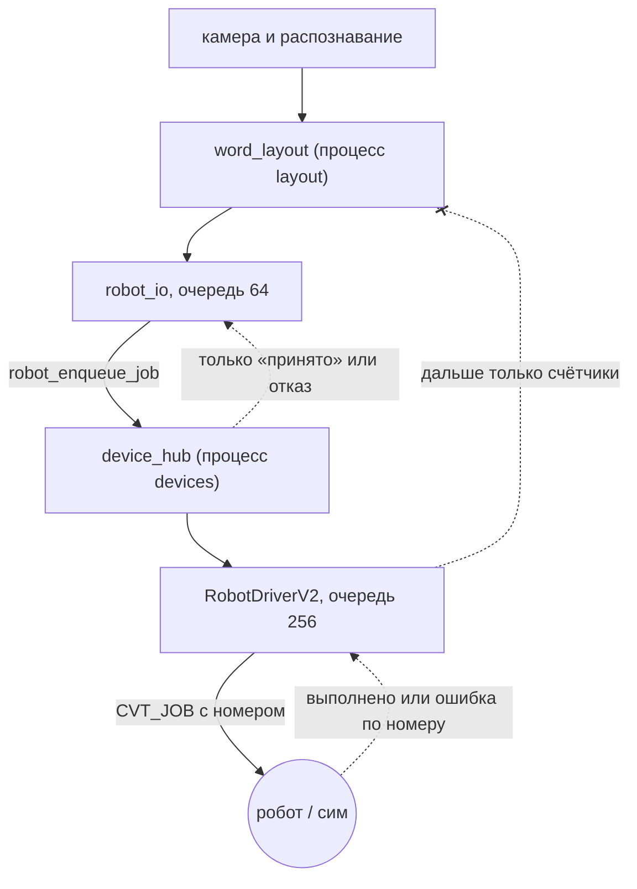
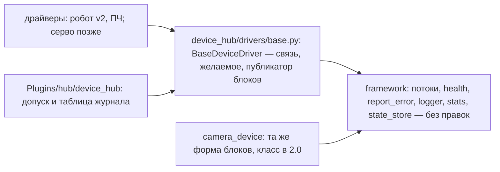
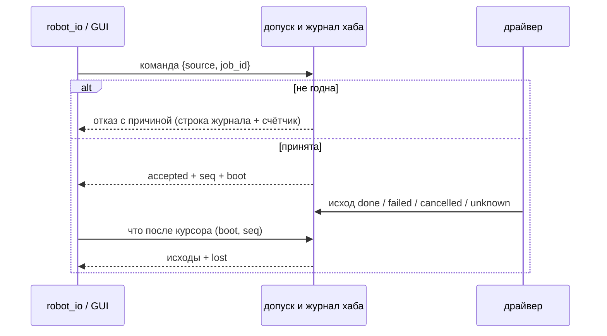

# Приборы: что сломано и какая нужна общая основа (камеры, робот, ПЧ, серво)

2026-11-26 · полоса Р2 (`inspector-bottles-6f`) · срез `main` `eaaf82a60`. Код продукта не менялся, стенд и настоящий робот не использовались. Читатели: владелец, полоса К, координатор, исполнители.

Метки: **[Л]** — лид сам повторил прогоном · **[CTO]** — проверено или решено CTO · **[А]** — прогон агента · **[Ч]** — только чтение кода · **[Ф]**, **[К]** — утверждение соседней полосы.

## Вердикт CTO 2026-11-26: принять с изменениями

Изменено против первой редакции (текст ниже уже переписан):

1. Контракт в 1.0 живёт в `Services/device_hub`; модуля framework `device_module` и вообще нового модуля или пакета нет.
2. Словарь состояний связи и адрес блоков должны быть едины; сейчас не выбраны.
3. Журнал получил исход `unknown`; «обрыв → `cancelled`» убрано; доставка итога решена: опрос по курсору из таблицы журнала в хабе.
4. Об инцидентах сообщает основа; добавлена четвёртая часть контракта — один публикатор блоков; `mode` — правило допуска хаба, не желаемое состояние.
5. Потеря связи роботом уже решена в спецификации протокола (§9): серво остаётся ON. Метка задания в прошивке не обязательна.
6. Новый порядок 1.0 и список «сейчас не делать».
7. Вопросы владельцу заменены.

Прогоном CTO проверил C1–C4, C6, J1–J4 и отсутствие отказов в журнале (все три скрипта). **Не проверено:** стенд, настоящий робот, задержка опроса, поведение предохранителя процесса, чтение `TLM_DONE_SEQ` после переподключения; чтение блоков камеры — только grep; оценка «четыре дня» — суждение, не расчёт.

## 1. Что просит владелец

1. Правильные слои в Services и не только; без дублей в будущем.
2. Одна основа с отслеживанием состояния и журналами для камер, роботов (в том числе других фирм), ПЧ, сервоприводов.
3. Журнал команд робота должен позволять понять по командам, правильно ли всё работает.
4. Рамки: решение 29 (1.0 = 1 камера, 1 робот, 1 ПЧ); с 2026-11-30 владелец на роботе и пишет прошивку v2.

Схемы страницами (открывать в браузере, mermaid грузится из сети): [архитектура устройств](../diagrams/device-architecture/index.html), [контур робота](../diagrams/robot-contour/index.html). При расхождении верен этот документ.

## 2. Путь задания «буква» (как сейчас)

| № | Находка | Наблюдение | Метка |
|---|---|---|---|
| J1 | C-104: «слово собрано» при отвергнутой букве. `95d496376` сделал отказ видимым в `robot_io`, укладку не менял (`word_layout/plugin.py:209-248`, `assembler.py:113-124`) | М отвергнута после «Домой», итог `МИР`, `done=True`; `jobs_forwarded=2`, `jobs_dropped=1` | [Л][CTO] |
| J2 | Задание принято и начато, но не выполнено | `jobs_failed=1`, `robot_io.forward_ok=True`, `health.report_error` 0 раз | [Л][CTO] |
| J3 | Задание принято и снято командой «Домой» | `park.dropped.jobs=1`, ячейка остаётся занятой | [А][CTO] |
| J4 | Параметры не доходят без смены `config_epoch` (`client_v2.py:817-820`) | в драйвере `P_ZONE_MAX` 6000, в симе осталось 5000 | [Л][CTO] |
| J5 | Есть `data/robot/<id>/params.yaml` → `robot_params` рецепта не применяются (`robot_data.py:147-165`) | — | [Ч] |
| J6 | `P_ZONE_MIN..MAX` проверяет точку **забора** (`sim_core_v2.py:1220-1231`), укладку — `P_WS_R_MAX` 600 мм. Умолчание 500 мм; в β-рецепте `robot_params` нет; расчётный забор 532–596 мм | — | [Ч] + расчёт |
| J7 | Тайм-аут IPC 1 с считается отказом, хотя задание могло встать в очередь; переполнения очередей вытесняют без записи | — | [Ч] |

Итог по заданию протокол v2 даёт (`TLM_DONE_SEQ` / `TLM_ERR_SEQ`, `client_v2.py:647-678`); сегодня он кончается в `jobs.py:84-110` счётчиками. «Выполнено» значит «рука доехала»: датчика захвата в цепочке не найдено [Ч].

## 3. Связь, серво, команды, публикация (как сейчас)

| № | Находка | Наблюдение | Метка |
|---|---|---|---|
| C1 | C-38: тик переподключения, прошедший проверку до «Отключить», доделывает подключение | после disconnect: `probe, sync, servo, do1, tcp_close`; `TLM_SERVO=1`, SOFT 0, экран «disconnected»; окно открыто искусственной паузой | [Л][CTO] |
| C2 | Серво, выключенное оператором, включается после обрыва связи (`ops.py:121-134`, `driver.py:409-421`); в реестре дефектов не найдено | off → `TLM_SERVO=0` → обрыв, один тик → `TLM_SERVO=1` | [Л][CTO] |
| C3 | Строковый `last_error` пишется через `merge` и отвергается (`plugin.py:625,763,867-871`; `manager.py:675`; `driver.py:639`) | `status=error`, в дереве поля нет | [Л][CTO] |
| C4 | Удаление через `merge(path, {})` ничего не удаляет (`plugin.py:1140`, `manager.py:648`) | `changes_count: 0`, узел цел | [Л][CTO] |
| C5 | Режима «ручной / авто» нет (C-39) | — | [Ч] |
| C6 | Старая вкладка «Робот» шлёт имена v1 | 8 проверенных команд: «Неизвестная операция» | [Л][CTO] |
| C7 | Желание «подключён» в трёх местах (`plugin.py:274`, `base.py:101`, счётчик `state.py:391`), желаемое серво не хранится | — | [Ч] |
| C8 | `_safe_call` считает `{"status":"error"}` драйвера успехом (`plugin.py:890-896`) | — | [Ч] |

C3/C4 — дефект **писателя**, framework менять не нужно: `StateProxy.delete` (`state_store_module/proxy/state_proxy.py:294`) и серверный `handle_state_delete` (`manager/state_store_manager.py:281`, регистрация `:624,:654`) уже есть; для скаляра есть `set`.

## 4. Журнал обмена T5.6 (как сейчас)

Пишет только обмен по проводу (`exchange_log.py:404-485`).

| Что | Наблюдение | Метка |
|---|---|---|
| Отказ после «Домой» (задание, jog) | 0 строк | [Л][CTO] |
| Одно подключение | 413 строк из кольца 2000; около 5 переподключений вытесняют всё | [Л] (413), [Ч] |
| «Выполнено роботом», ошибка робота | строк нет (`jobs_done=1`) | [Л] (done), [Ч] (ошибка) |
| Кто просил, какая буква, сквозной id | нет; `robot_io` снимает подпись перед отправкой (`robot_io/plugin.py:236-237`); `CMD_SEQ` в ответ не возвращается | [Ч] |
| Порядок строк | `seq` и `t` выдаются после возврата транспорта (`exchange_log.py:435-439`) — между потоками возможна перестановка | [Ч] |
| Читатели | `robot_exchange_log_get/set`, файл `robot_exchange_file`; GUI не читает | [Ч] |

## 5. Прошивка v2 и потеря связи

**Уже решено спецификацией** (`plans/robot-protocol-v2/protocol-spec.md` §9, перечитано лидом): сторожевой таймер включён по умолчанию (`P_WDG_TIMEOUT_MS = 3000`); при просрочке — стоп ПЧ, прерывание активности (`E_WDG_TIMEOUT`, `ERR_EVT + 1`), `TLM_WDG_STATE = 2`, **серво остаётся ON**; ПЧ после восстановления связи запускается явно.

Прошивке нужно [CTO]: §9 как написано и `TLM_DONE_SEQ` / `TLM_ERR_SEQ`, читаемые после переподключения. Метка задания от робота **не обязательна**: в полёте одно задание (`jobs.py:77-84`), соответствие `seq → job_id` держит ПК.

## 6. Готовность к дню с роботом (инвентаризация агента, [А]/[Ч])

- На симе: укладка слова (199 тестов прошли), драйвер v2, `robot_io` → `CVT_JOB`, «Домой», стоп, кнопки пульта.
- Нет: прошивка v2 (`robot/v2/main_v2.lua` без функций), калибровка камера–робот F7, сеть на реальных кадрах.
- Рецепт β настроен на `delta_v2`, на контроллере v1; пробный revert отката даёт конфликт.
- Известный красный: C-108 (снимок регистров `robot_io`). Большие наборы `device_hub` и `robot_comm` в разборе не запускались.

## 7. Приборы: опись механизмов

CAM — ядро `Services/camera_device`; RDR — считыватель; WEB — `CapturePlugin`; RV2/RV1 — роботы хаба; VFD, GMB, HIK — драйверы хаба. Ячейки RV1, VFD, GMB, HIK — карта помощника, RDR, WEB и часть CAM — из `design.md` плана камер.

| Механизм | Реализаций с разным поведением |
|---|---|
| Переподключение | 2 основы (сеанс CAM; база + воркер хаба) и 3 копии цикла (RV1, RV2, VFD); у RDR, WEB, GMB, HIK нет |
| Желаемое состояние | хаб (3 писателя) и камера (неявно: жив поток) |
| Тишина | 3 правила (`link_silence_s`, `conn_stale_s`, heartbeat-stale ПЧ) |
| Здоровье, готовность | 2 стиля; драйверы хаба `report_error` не зовут |
| Дерево состояния | 5 разных путей |
| Каталог команд | 3 способа (рукописные, `OpSpec`, `cmd_hik_*`) |
| Параметры | 4 способа |
| Личность | 3 способа |
| **Нет нигде** | журнал команд с отказами и источником; режим ручной/авто; исход длинной команды вызывающему; желаемое «серво/разрешение» |

**Слои** [А]: `sentrux check .` — все 43 правила зелёные, нарушений импорта нет. Неверно лежит смысл [Ч]: `kinds.py:23-28` импортирует все драйверы (новый вендор = правка хаба); `manager.py:26` берёт текст из `robot_driver_v2`; `manager.py:749-930` — `robot_data`, `robot_park_all` в общем менеджере; `plugin.py:1252-1297` — `cmd_hik_*`; `kind="hikvision"` назван по вендору; `transports.py:122-125` — правило «только robot может быть мостом»; драйвер наследует `ObservableMixin`, но слоты никто не регистрирует (`base.py:25-32`).

**Камеры** [К, `integ/dcb-phase1` `fa944d719`, не слита]:
- Годится роботу и ПЧ: поток-владелец порта с ящиком команд (`session.py:324-533`), цикл переподключения (`:665-870`), сторож зависшего вызова, блок `link`, форма `readiness`. Прочитано.
- Намертво про кадры: такт = `get_frame`, тишина и отказ считаются по кадрам.
- Желаемого поля нет. `release` между `take_device` и `session.start` отвечает `ok/idle`, потом кадры идут (прогон К на фейке). Хаб после рестарта подключает отключённое вручную (`plugin.py:304-311`).
- `Services/device_hub/drivers/hikvision_driver.py:76-79` считает подключение успешным, если `open` вернул False [Ч, агент; К — прогон на заглушке]; `cmd_hik_release` (`plugin.py:1297-1320`) идёт мимо желаемого и допуска; путей к одной камере три. Заморозка `HikvisionDriver` — работа полосы К.
- **Не делать общим:** «живость = пришли данные»; авто-возобновление после обрыва (камере можно, приводу нет); профиль `rest` как безопасное состояние; «один сеанс на процесс»; очередь кадров.

## 8. Правила записи состояния (согласовано Р2 и Ф, владельцем не утверждено)

- Скаляр и строка — `set`. Удаление — только `delete` (перед переходом предупредить Ф: комбо удаление игнорирует [Ф]).
- Писатель узла всегда пишет `merge` (листья — канон). Узел читают `bind_fanout` без `**` (сборка 2.8f, не слита) или листовыми подписками. `set` узла — только если все читатели пути узловые и это записано рядом с писателем. [Ф; повторено лидом: `set` узла получает только узловой подписчик]
- У узла реестра всегда есть `kind`.
- **Итог задания через дерево не доставляется** (replay отбрасывает dict, очередь state — drop_oldest).
- Серверная подписка на узел (S1+П2) решением владельца 2026-11-26 перенесена в 2.0.
- Итог оформляется ADR в `state_store_module/DECISIONS.md`; в файл вносит Ф (задача 2.5).

## 9. Целевая схема

### Варианты и место контракта (решено CTO)

| Вариант | За | Против |
|---|---|---|
| 1. Один базовый класс на все приборы | одна вещь | кадры и команды разные по горячему пути; класс-бог |
| 2. **Тонкий общий контракт + два ядра** (потоковое `camera_device`, командное `device_hub`) | слоёв не прибавляется; кадров и вендоров в общем нет | общая часть камеры подключается позже |
| 3. Оба ядра в framework | всё в одном месте | в framework попадают кадр, узел, каталоги робота; огромный перенос |

**Вариант 2. В 1.0 контракт живёт в `Services/device_hub`:** `drivers/base.py` (`BaseDeviceDriver`) и допуск в `Plugins/hub/device_hub/plugin.py`. Нового модуля и пакета нет. Позже записать ADR в `Services/device_hub/DECISIONS.md` (сейчас не писать). Причины [CTO]:

- в 1.0 потребитель один;
- `BaseDeviceDriver` уже держит желаемое, затвор и лимит переподключения, счётчики, качество (`base.py:89-113,155-165,266-302`);
- framework уже даёт потоки, здоровье, дверь `report_error` (`observable_mixin.py:418-456`), метрики и замеры, кольцо логов в памяти, отложенный ответ (часть — по карте помощника);
- план камер: в framework ничего.

Пересмотреть в 2.0, когда ядро камер реально импортирует тот же класс.

### Четыре части контракта

1. **Связь.** Один словарь состояний и одна схема блока, написанная один раз; контрактный тест в `Services/tests` на оба источника. **Не выбрано:** эскиз имел 7 состояний (`down|connecting|up|lost|reconnecting|failed|closing`), ядро камер (`fa944d719`, `session.py:298-299`) — `off/up/lost/idle` плюс флаг `reconnecting`. Выбрать одно до кода. Там же назвать **один способ, которым читатель получает блоки любого прибора**: сегодня камера пишет `processes.
.state.plugins.<name>`, хаб — `devices.state.<id>`. **Не назван.**
2. **Желаемое.** Запись с одним публикатором. Ключи 1.0: `connected`, `enabled`, `params_rev`. `mode` — не желаемое, а правило допуска хаба.
3. **Журнал команд** (ниже).
4. **Один публикатор блоков** (`merge`/`set`/`delete` по разделу 8).

**Владение.** Автомат связи в 1.0 — под существующим замком драйвера, пишет его только поток тика. Правило «драйвер не пишет желаемое» сегодня нарушает `base.py:289`: исчерпанные попытки — это состояние связи `failed`, желаемое не трогается. (Сам `base.py:289` в S0.1 не менять.)

**Серво и обрыв.** «`enabled` не переживает обрыв» противоречит §9 спецификации (серво остаётся ON). Согласовать **до кода 1.0** — вопрос владельцу (а). Сохранять желаемое между запусками сейчас не делаем.

### Журнал и доставка итога

Таблица журнала в хабе (не кольцо строк). Строки логгера — проекция для человека, машины их не разбирают. Одна команда хаба для любого вида прибора (`device_id`, курсор); ею же пользуется `backend_ctl`.

- `job_id` выдаёт заказчик; `robot_io` не имеет права его снимать.
- Чтения и частые операции (`get_telemetry`, `exchange_log_get`, `jog_hold`) исключаются или сворачиваются.
- Исходы длинных команд хранятся отдельно от потока отказов.
- Курсор несёт номер запуска `boot` и флаг `lost`.
- Исходы: выполнено, не выполнено, снято, **неизвестно** (`unknown`).

| Событие | Что считать |
|---|---|
| `boot` сменился | все открытые задания — `unknown` |
| курсор старее хранимого | `lost=true`; открытые задания, которых нет в ответе, — `unknown` |
| обрыв связи: задание в очереди на ПК | `cancelled` |
| обрыв связи: задание уже отправлено | `unknown`; после переподключения драйвер читает `TLM_DONE_SEQ`/`ERR_SEQ` и закрывает при совпадении (сегодня считается неудачей, `jobs.py:107-111`) |
| вышел срок ожидания у заказчика | `unknown` |

**`unknown` никогда не считается уложенным и сам не повторяется. Ячейка «уложена» только после `done`.**

### Единая наблюдаемость устройств — ТРЕБОВАНИЕ ВЛАДЕЛЬЦА

Каждое устройство (командные в 1.0, камеры в 2.0) отдаёт одни и те же блоки и поля (`link`, `desired`, здоровье и готовность, `last_command`), один журнал команд с одной командой чтения, здоровье и ошибки из общей основы, одни и те же счётчики и замеры — существующими средствами framework. Второй системы не заводить.

Решение CTO (нового механизма нет):

- **Сообщает основа**, а не каждый драйвер. Хаб подключает драйверам слоты logger, error, stats (сегодня ни одного: `base.py:25-32`, `observable_mixin.py:881-883`).
- Инцидент: связь потеряна; попытки исчерпаны; команда не выполнена или исход неизвестен. **Отказ допуска — не инцидент** (строка и счётчик). Контекст `операция@прибор`.
- Счётчики: переподключения; команды принятые, отказанные, неудачные, неизвестные; длительность команды. Одна точка подсчёта питает и блок снимка, и stats.
- Приёмка инъекцией: шторм отказов прибора A не меняет готовность и команды прибора B и не открывает предохранитель процесса `devices` (что предохранитель делает сегодня — **не проверено**).

Сегодня [Ч]: драйверы хаба не зовут `report_error`; миксин без слотов молча ничего не делает; журнал обмена по проводу есть только у робота v2 и остаётся необязательной обёрткой транспорта. Поля `last_command` и здоровья ещё не расписаны.

### Что добавлять для нового прибора (целевое, после 2.0)

| Прибор | Файлы |
|---|---|
| Робот другой фирмы | драйвер (`BaseDeviceDriver`, `OP_SPECS`), протокол, строка вида, фейк, тесты; строка в рецепте. «Без правки хаба» — только когда таблица видов берётся из конфига; в 1.0 драйверы остаются в `device_hub`, между пакетами не переносятся |
| Новый ПЧ | `Services/vfd_comm/protocols/<модель>.yaml` — только если `VfdClient` обобщён по карте регистров (**не проверено**) |
| Серво | клиент и протокол, драйвер от `BaseDeviceDriver`, строка вида, фейк, тесты; панель GUI |
| Камера | порт `DevicePort`, контрактные тесты, `create_port` — как сегодня |

**Не общее:** тракт кадров, SHM, `frame_watch`, план триггера; проверка «жив ли прибор» (подменяемая); содержимое безопасного состояния; «один сеанс на процесс»; кинематика, программы, точки, СК, парковка, поводок jog, очередь CVT, прошивка; мост ПЧ через робота; хранилище данных робота; профиль движения серво.

Приборы с DLL производителя должны иметь возможность работать отдельным процессом по рецепту [CTO]; работ в 1.0 для этого нет.

**Кандидат 2.0:** один поток-владелец с ящиком на прибор (`DeviceOwner`, набросок). Сегодня ввод-вывод хаба идёт из двух потоков, отсюда три замка в роботе v2 (`driver.py:174-177`). Сеанс камеры как есть не переносится.

### Дефекты как проверка схемы (должно быть после реализации; не проверено)

| Дефект | Что делает его невозможным или видимым |
|---|---|
| C1, C2 | намерение оператора хранится в основе и читается при переподключении |
| J1–J3 | каждое принятое задание кончается исходом, включая `unknown`; ячейка занята только после `done` |
| Журнал без отказов | строка допуска и отказа пишется до кода драйвера |
| J4 | `params_rev` желаемый против применённого; громкая строка при расхождении |
| C3, C4 | один публикатор блоков |
| C5 | режим — правило допуска в одной точке |

## 10. Порядок переезда

**До 2026-11-30** (нужно окно под большие наборы `device_hub` и `robot_comm`):

1. **S0.1 — намерение оператора** (`base.py`, `driver.py:400-421`, `ops.py:121-134`). Проверить каждого наследника (RV2 и ПЧ): память `docs/claude/memory/feedback_base_guard_dead_in_heir.md`. `base.py:289` не трогать.
2. Строка `last_error` — через `set`.
3. **S0.2 — только строки допуска и отказа** с полями `device`, `op`, `source`, `job_id`, `seq`, `verdict`, `reason`, и исправление счёта `commands_ok`. При нехватке времени выкидывается первым.
4. Громкая строка при расхождении параметров и когда `params.yaml` перекрывает рецепт.

**1.0, по порядку:** журнал и допуск → исход задания до `word_layout` → `LinkMachine` (мерж только после окна стенда) → здоровье и счётчики → `params_rev` → режим.

**Заморожено:** `RobotDriver` v1 (в `LinkMachine` не переносится).

**2.0:** камера берёт тот же класс и блоки (после фаз плана камер); таблица видов из конфига; серво; мост ПЛК; пересмотр места контракта.

**Сейчас не делать:** модуль framework и любые правки framework; `DeviceOwner` и изменения потоков робота v2; перенос драйверов между пакетами; RV1; `camera_device/plugin_base.py` и `session.py`; правки `state_store`; удаление `HikvisionDriver`/`cmd_hik_*`; сохранение желаемого между запусками.

Стык с планом камер: актуальная версия — `docs/camera-plan-merge` `fab596efa`, в `main` другая [А]. Вариант A для источников кадров сохраняется. Чужой план не правится, согласует координатор.

## 11. Вопросы владельцу

| № | Вопрос |
|---|---|
| (а) | Должен ли ПК после восстановления связи **выключать** серво, учитывая, что по §9 спецификации робот при обрыве оставляет его ON? |
| (б) | Что делает линия при `failed` или `unknown`: стоп слова, пропуск, повтор? |
| (в) | Режим «ручной / авто»: кто переключает и какой на старте? |

Решено CTO: контракт — в Services; «уложено» только после `done`; приборы с DLL производителя могут жить отдельным процессом.

## 12. Приложения

Скрипты воспроизведения, команды их запуска и расхождения атласа с кодом — в [`2026-11-26_robot-device-architecture-inputs/README.md`](2026-11-26_robot-device-architecture-inputs/README.md).

## 13. Что открыто и ненадёжно

- Не проверено: настоящий робот и приборы, стенд, окно C1 вживую, задержка опроса, предохранитель процесса, `TLM_DONE_SEQ` после переподключения.
- Не выбраны: словарь состояний связи, общий адрес блоков, поля `last_command` и здоровья.
- `VfdClient`, имя процесса `devices` в клиентах, строки GUI с именами вендоров не проверены.
- Объёмы срезов не посчитаны.
- Согласования с координатором и полосой К по этой редакции ещё нет.
