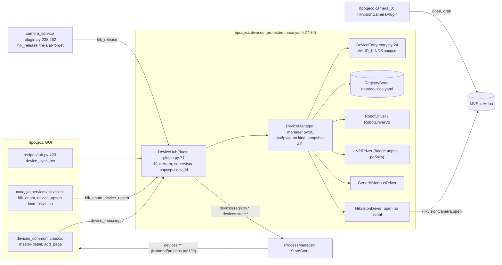

# device_hub и новое ядро камер: как хаб работает с `Services/camera_device`

Дата: 2026-10-18. Ветка `feat/code-reader-gui`, HEAD `078b96ff3`. Роль: investigator (только чтение, код не менял).
Поручение владельца: «изучи Services/device_hub — с ним тоже должен работать».

Метки: **[R]** — воспроизведено (вход -> выход), **[A]** — ADVISORY, вывод из чтения кода.
Инструменты: Read/Grep/git grep; graphify `get_neighbors HikvisionDriver` (подтвердил, что у драйвера нет скрытых
потребителей, кроме `manager.py:109,122` и `drivers/__init__.py:6`); qex не использовал (индекс от 2026-10-15).
memory hits: `scripts/memory/search.py device_hub camera driver hub` -> `project_device_hub.md`,
`feedback_modbus_device_raw_oserror_keeps_connected.md`, `feedback_unconnected_driver_reads_as_a_clean_zero.md`.

Воспроизведение: скрипт в scratchpad, `machine_gate.sh light device-hub-study`, без SDK-вызовов
(`HikvisionCamera.open` и `enum_devices` подменены). Вывод:

```
F1 connect() when open()->False: True | open got arg: 'SN1' | quality: good | is_connected: False
F2 get_params: {'status': 'error', 'message': "'CameraParameters' object has no attribute 'get_all'"}
F2 set_params: {'status': 'error', 'message': "'CameraParameters' object has no attribute 'set'"}
enum (driver op): {'status': 'error', 'message': "Mock object has no attribute 'serial_number'"}
new kind: ValueError DeviceEntry.kind 'camera' не из ['generic_modbus', 'hikvision', 'robot', 'vfd']
```

## 0. Вердикт

1. Хаб для камер — **роль (a)**: реестр, описание и зеркало состояния процесса-владельца. Хаб не открывает камеру,
   не пересылает команды владельцу и не держит кадры.
2. Нужен **один общий драйвер хаба `CameraMirrorDriver`** для всех камер (MVS, ID3013, OpenCV, будущие вендоры).
   Сейчас план 4.6 чинит только `HikvisionDriver`; считыватель и OpenCV в хаб так не попадут.
3. Зеркало строится **на подписке** `processes.*.state.plugins.*` (прецедент `telemetry_sink/plugin.py:137`),
   а не на `state_proxy.get` из командного потока: синхронный `get` с приёмного потока бросает
   `RouterReentrantRequestError` (`state_proxy.py:1502-1506`) [A].
4. Инвариант честности для любого драйвера хаба: **`connect()` возвращает то же, что `is_connected` сразу после него**.
   F1 — нарушение именно этого инварианта [R].
5. Задачу 4.6 переписать и разбить на 3 задачи (раздел H5). Стадия 0 — Opus, контракт зеркала. Tester-first — да.

## H1. Что такое device_hub

**Назначение.** Один always-on процесс `devices` (`protected: true`, `multiprocess_prototype/backend/topology/base.yaml:27-34`)
владеет всеми соединениями с устройствами (ADR-DH-001, `Services/device_hub/DECISIONS.md:3-14`). GUI и плагины ходят
к нему по IPC. Крэш процесса — ручной рестарт (ADR-PH-001, `Plugins/hub/device_hub/DECISIONS.md:3`).

**Слои.**
- `Services/device_hub` — домен: `DeviceManager` (`manager.py:30`), `DeviceEntry` (`registry/entry.py:24`),
  `RegistryStore` (`registry/store.py`), `build_transport` (`transports.py`), драйверы `drivers/*`.
  README: «НЕ зависит от `Plugins/*`, `multiprocess_prototype/*`» (`README.md:55`).
- `Plugins/hub/device_hub` — плагин `DeviceHubPlugin` (`plugin.py:71`), `DeviceHubClient` (`client.py`),
  register `DeviceHubRegisters` (`registers.py:19`).

**Жизненный цикл и scope.** `configure` создаёт `DeviceManager(store=RegistryStore(...))` (`plugin.py:156-188`);
`start` делает upsert `recipe_devices` из конфига, ставит auto-connect в очередь, создаёт воркер `device_supervisor`
(`plugin.py:190-224`); `shutdown` удаляет воркеры `dev_<id>` и зовёт `manager.shutdown()` (`plugin.py:226-242`).
Потоки: все команды — в одном потоке message_processor (`thread_safe = False`, `plugin.py:76`); connect/disconnect —
в supervisor (`plugin.py:248-301`); tick каждого устройства — в своём воркере `dev_<id>` (`plugin.py:303-416`).
Supervisor обрабатывает connect последовательно (ADR-DH-006). Потоки `RobotDriverV2` (`robot_driver_v2.py:775`, `:877`)
сейчас — голые `threading.Thread`; T5.3 переводит их в scope плагина хаба через `spawn` (`plans/robot-protocol-v2/plan.md:293`).

**Дерево состояния** (`plugin.py:10-15`, `_publish_state` `:440-454`):
`devices.registry.<id>` (merge), `devices.state.<id>.conn` (set: `connecting|connected|error|disconnected|disconnecting|failed`),
`devices.state.<id>.status` (snapshot драйвера: `quality`, `ts`, `stats` + данные kind), `.stats`, `.last_error`, `.io_peek`.

**Контракт драйвера.** Это не Protocol, а базовый класс `BaseDeviceDriver(BaseManager, ObservableMixin)`
(`drivers/base.py:33`): `kind`, `connect() -> bool`, `disconnect()`, `is_connected`, `tick(stop_event) -> dict | None`,
`call(op, args) -> dict`; общие `snapshot()` (quality/ts/stats, `:142-162`), `desired_connected`, лимит реконнекта
`max_reconnect_attempts` (`:83-91`, `:190-217`).

**Реестр и выбор драйвера.** Фабрика по `entry.kind`: `_register_defaults` (`manager.py:105-123`), для `robot` выбор
v1/v2 по `entry.protocol == "delta_v2"` (`:112-118`). Метод `register_driver_factory` (`:96`) есть, но внешних
вызовов нет: `git grep -n register_driver_factory -- ':!*/tests/*' ':!*.md'` -> только `manager.py:6,96,494`.
Набор kind закрыт: `VALID_KINDS = {"robot","vfd","hikvision","generic_modbus"}` (`entry.py:14`) — новый kind
даёт `ValueError` [R]. Значит, драйвер нового вендора сейчас требует правки `entry.py` и `manager.py`.

**Команды.** 49 алиасов (`grep -c -F '": "cmd_' plugin.py` -> 49; память `project_device_hub.md` пишет 46 — устарело):
реестр 7, соединение 2, регистры 2, робот 16, рисование 11, ПЧ 5, Hikvision 6 (`plugin.py:86-143`).
`_kind_call` (`:489-505`) проверяет `device_id` и kind и зовёт `manager.call`, который требует `is_connected`
(`manager.py:356-360`). `hik_enum` — без `device_id`, вызывает SDK прямо в командном потоке (`plugin.py:857-884`) [A].

**Рецепты.** Верхний уровень `devices:` рецепта — источник истины (план `device-tree-recipe`, Фаза B DONE).
GUI при активации шлёт `device_sync_set` (`frontend/widgets/tabs/recipes/tab.py:423-425`); хаб делает upsert, удаляет
лишние `recipe:*` и ставит connect (`plugin.py:562-629`). Файловый стор `data/devices.yaml` ещё жив (Фаза E не сделана,
`plans/device-tree-recipe.md:240`); файла на диске сейчас нет (`ls data/devices.yaml` -> No such file).
Ни один рецепт не объявляет камеру в `devices:`: `git grep -n "kind: hikvision" -- multiprocess_prototype` -> только
комментарий `services/hikvision/controller.py:115` (камеру регистрирует вкладка: `hik_enum` -> диалог -> `device_upsert`).

**GUI и backend_ctl.** GUI подписан на `devices.**` (`multiprocess_prototype/frontend/process.py:139`); виджеты
`devices_common` — `bind_fanout("devices.registry.*")`, `("devices.state.*.conn")`, `io_peek`
(`device_list_panel.py:85-86`, `combo.py:115-122`, `master_detail.py:127-144`). backend_ctl видит хаб как процесс
`devices`: команды — через `capabilities`/`send_command devices <cmd>`, состояние — `state_get devices.state.<id>` [A,
по устройству backend_ctl; живой стенд не поднимал].

### Схема хаба (как есть)



## H2. Камерные драйверы хаба сегодня

Камерный драйвер один: `HikvisionDriver` (`drivers/hikvision_driver.py:17`). Других нет:
`git grep -n -i "camera\|opencv\|code_reader" -- Services/device_hub/drivers` -> только `hikvision_driver.py`.

Что он делает и чем владеет:
- Держит свой `HikvisionCamera` (`:34`, `:75-77`) — полноценный эксклюзивный handle MVS в процессе `devices`.
- Операции `enum/open/close/get_params/set_params/release` (`:167-174`); `tick()` — `opened`, `serial` (`:98-103`).

Дефекты (все [R], вывод выше):
- **F1.** `connect()` игнорирует возврат `open()` и передаёт строку `serial` в `open(camera_index: int)`
  (`hikvision_driver.py:77` -> `core/camera.py:96`, `:128`). Итог: `True`, `quality=good`, `is_connected=False`.
  Последствие в плагине [A]: supervisor публикует `conn=connected` (`plugin.py:272-274`), первый tick — `disconnected`
  (`:364-371`); счётчик реконнекта не растёт — у драйвера нет реконнекта в `tick`.
- **F2.** `CameraParameters` — dataclass (`core/parameters.py:20-26`); методов `get_all`/`set` нет -> `AttributeError`
  уходит ответом `error`.
- **Новое, F-DH1.** `_op_enum` читает `d.serial_number`, `d.ip_address` (`hikvision_driver.py:128`); у `DeviceInfo`
  поля `index, model_name, serial, display_name` (`core/discovery.py:24-32`). Операция всегда `error`. Команда
  `hik_enum` плагина этим путём не ходит (`plugin.py:857-881`, свои `getattr`-подстановки), поэтому дефект скрыт.
- **Новое, F-DH2 [A].** `camera_service` шлёт `hik_release` с `device_id = self._device_id` (`camera_service/plugin.py:259-262`),
  а это индекс `cv2.VideoCapture`, `int` (`camera_service/config.py:46-49`). При `device_id != 0` хаб ищет устройство
  с id `1`, получает `DeviceNotFoundError` (`plugin.py:494-498`) — handle не освобождается; ответ fire-and-forget
  никто не читает. При `0` (`or ""`) идёт release всех hikvision — работает.

Кто ещё открывает ту же MVS-камеру (F14 ревью): плагин `hikvision` (`Services/hikvision_camera/plugin/plugin.py`),
`sdk_app` (`open_sdk_app`), бэкенд `camera_service/backends/hikvision.py`, драйвер хаба. Арбитраж есть только между
`camera_service` и хабом (`hik_release` + ретрай открытия, `backends/hikvision.py:44-75`). Плагин `hikvision` хаб не
спрашивает: `git grep -n "device_hub\|hik_release\|DeviceHubClient" -- Services/hikvision_camera Services/code_reader`
-> пусто. Если камеру в хабе подключить (вкладка, `device_connect`), процесс `camera_0` получит отказ открытия.
Сегодня это не стреляет только потому, что в рецептах нет `devices:` с камерой [A].

## H3. Роль хаба для камер

| Вариант | Принципы владельца | Слои | Вердикт |
|---|---|---|---|
| (a) реестр, описание, зеркало состояния владельца | №4: ни одного нового слоя на пути команды и кадра; №5: хаб падает — камера снимает дальше (и наоборот); №6: топологию формирует GUI, хаб ничего не запускает | хаб читает дерево, импорт `Services/camera_device` не нужен | **беру** |
| (b) хаб пересылает команды владельцу | +1 хоп и +1 место ошибки на каждую команду (№4); GUI уже шлёт `register_update`/`take_device` прямо в плагин (план 4.4); две дороги управления одной камерой | хаб должен знать адрес и контракт команд ядра | нет |
| (c) хаб владеет сеансом, плагины берут кадры | отвергнуто ранее: кадры через хаб, одна точка отказа на все камеры (№5), противоречит «один процесс — один прибор» ядра | — | нет |

Почему (a): у камеры уже есть владелец — процесс с плагином ядра и потоком-владельцем (`docs/design/camera-device-architecture.md:288-315`).
Хаб нужен для того, что владелец сам не даёт: единый список устройств рецепта в дереве «Сервисы», привязка
«это устройство -> этот процесс», обнаружение до создания процесса (страница «+ Добавить»).
Направление импортов: `Services/device_hub` от `Services/camera_device` не зависит — зеркало читает только ключи дерева
(строки). Прецедент Services -> Services есть (`hikvision_driver.py:40`), но для (a) он не нужен. Плагин хаба
(`Plugins/hub`) — единственное место, где есть `ctx.state_proxy` и подписка; драйвер получает кэш инъекцией.
Вердикт слоёв даёт только `sentrux check .` — я его не запускал.

## H4. Контракт интеграции: `CameraMirrorDriver`

Один драйвер хаба на все камеры. Вендор в хабе — только строка `params.driver`, его код в хаб не попадает.

**Запись реестра (`DeviceEntry`).**
- `kind: "camera"` — новый kind в `VALID_KINDS` (`entry.py:14`). `kind: "hikvision"` остаётся (FREEZE: вкладка делает
  `device_upsert kind=hikvision`, `controller.py:115`) и получает ту же фабрику с `driver="mvs"`.
- `params.driver`: `mvs | mvcr | opencv | <будущий>` — ключ реестра драйверов ядра (тот же, что у плагина).
- `params.identity`: `{kind: serial|ip|url|index, value, name}` — ровно `DeviceIdentity` ядра (решение Р3,
  `plans/camera-device-service/decisions.md:12`). `transport` пустой.

**Поиск владельца (зеркало).**
- Плагин хаба в `start` подписывается `ctx.state_proxy.subscribe("processes.*.state.plugins.**", cb, exclude_self=True, sync=False)`
  (как `telemetry_sink/plugin.py:137`) и держит индекс `identity -> (process, plugin, snapshot, ts)`.
  Совпадение — по полю `device` (identity), которое плагин ядра публикует в
  `processes.<p>.state.plugins.<плагин>` (план: `phase-6.md:71` — `state, device, device_held, profile, params, param_errors, capabilities`).
  Имя плагина хабу знать не надо: признак «камера ядра» — наличие `device` и `device_held` в снимке.
- В драйвер индекс приходит колбэком `owner_view(identity) -> dict | None` через фабрику; драйвер без IPC и без
  потоков, тестируется на словаре.
- Зачем подписка, а не `get`: команда хаба выполняется в приёмном потоке; `StateProxy.get` мимо кэша идёт в
  `router.request`, а с приёмного потока это `RouterReentrantRequestError` (`state_proxy.py:288-325`, `:1502-1506`) [A].

**Методы драйвера.**
- `connect()` — без SDK. `True` только если владелец найден и `device_held is True`; иначе `False` и `last_error`:
  `камера <identity> не открыта процессом захвата; хаб камерой не владеет`, либо
  `камерой владеет процесс <p>, состояние <state>` (если владелец есть, но прибор не держит).
  Инвариант всех драйверов хаба: `connect() == is_connected` сразу после вызова (общий контрактный тест — F1 его ловит).
- `is_connected` — владелец есть и `device_held`. `disconnect()` — только снимает зеркало (no-op для прибора).
- `tick()` — без IO: `snapshot(data={owner, owner_plugin, state, device_held, profile, fps, frames, dropped, param_errors_count, capabilities}, quality=...)`;
  `quality=good` при свежем `ts` владельца, `stale` при старом, `bad` без владельца.
- Реконнект: `max_reconnect_attempts` здесь вреден — камера может подняться позже хаба (процесс рецепта стартует
  после `devices`). Для зеркала лимит `0` (без лимита) и состояние `disconnected`, а не `failed`.
- `call()`: `owner` -> `{process, plugin}`; `read_params` -> `params`, `param_errors` из снимка владельца (только чтение).
  Ошибки — текстом, не исключением; нет владельца -> `{"status":"error","message":"камера … не открыта процессом захвата…"}`.

**Параметры и форма.** Хаб параметры не рендерит и не пишет. FieldMeta сериализуется (`data_schema_module/core/field_meta.py:364`
`to_dict`), но дублировать схему register'а в хабе — второй источник истины. `device_describe` для камеры отдаёт
`owner: {process, plugin}` и имя класса register'а; страница устройства в GUI строит форму из register'а владельца
(Task 2.3 ядра) и шлёт `register_update` прямо в процесс-владелец. `describe` сейчас кладёт в `protocol` только
`RegisterMeta` Modbus (`manager.py:385-389`) — для камеры это поле пустое.

**Команды хаба.**
- Обнаружение до создания процесса: `camera_list_devices {driver}` (device-less), реализация — через `DeviceSdk.enum_devices()`
  реестра драйверов ядра в отдельном воркере, не в командном потоке (сейчас `hik_enum` блокирует приёмный поток, `plugin.py:857-884`).
  Это единственное место, где хаб грузит DLL вендора (см. «Открыто»).
- `camera_owner {device_id}`, `camera_read_params {device_id}` — через `_kind_call` с проверкой kind `camera|hikvision`.
- Старые: `hik_enum` -> алиас `camera_list_devices driver=mvs`; `hik_get_params` -> алиас `camera_read_params`;
  `hik_open`, `hik_close`, `hik_set_params` -> отказ с текстом «хаб камерой не владеет; команда — в процесс <p>»;
  `hik_release` -> `{"status":"ok","released":[]}` без действия: у него живой вызывающий
  (`camera_service/plugin.py:262`), принцип №3. Решение Р8 «удалить» с этим расходится — вопрос владельцу.

**Файлы.**
Меняются: `Services/device_hub/registry/entry.py` (kind `camera`), `Services/device_hub/manager.py` (`_register_defaults`:
фабрика `camera`/`hikvision` с `owner_view`), `Services/device_hub/drivers/camera_mirror_driver.py` (новый),
`Services/device_hub/drivers/hikvision_driver.py` (FROZEN: перестаёт регистрироваться фабрикой; файл и тесты
остаются до решения), `Plugins/hub/device_hub/plugin.py` (подписка-индекс в `start`/`shutdown`, команды `camera_*`,
алиасы `hik_*`), `Plugins/hub/device_hub/registers.py` (телеметрия зеркала, H6), `Services/device_hub/DECISIONS.md`
(ADR-DH «хаб камерой не владеет», ADR-DH «инвариант connect»), `Services/device_hub/README.md`.
Не меняются: `transports.py`, `registry/store.py`, `drivers/base.py` (кроме, возможно, общего контрактного теста),
`robot_driver*.py`, `vfd_driver.py`, `generic_modbus_driver.py`, `client.py`, GUI `devices_common` (дерево `devices.state.<id>.conn`
то же). Отдельно GUI: страница камеры в master-detail (Фаза E `device-tree-recipe`) — вне 4.6.

## H5. Риски и пересечения с другими планами

| План | Общие файлы | Риск | Совет |
|---|---|---|---|
| `robot-protocol-v2` T5.3 [PENDING] (`plan.md:293`) | `Plugins/hub/device_hub/plugin.py` (таблица `commands`, ~20 новых `robot_*`), `manager.py:_register_defaults` (потоки v2 через `spawn` scope хаба), `scripts/lifecycle_guards/tables.py:329` | два писателя одного 925-строчного файла и одной фабрики; T5.3 меняет сигнатуру фабрик (`spawn`), 4.6 добавляет `owner_view` | порядок: T5.3 раньше 4.6b, либо стадия 0 4.6 фиксирует форму фабрики `factory(entry, proto, *, services)` и T5.3 её принимает. Один писатель за раз |
| `device-tree-recipe` Фаза E [IN PROGRESS] (`device-tree-recipe.md:240`) | `devices_common`, `hikvision/controller.py`, `config.py` (`registry_path`), ADR-DH-007 | hikvision-секция master-detail и автопоиск камер — ровно то, что даёт `camera_list_devices`; удаление стора меняет `configure` | хиквижн-секцию делать после 4.6b на командах `camera_*`; удаление стора — отдельно, не в К4 |
| `device-tree-recipe` B2 [PENDING] | `plugin.py:616-622` (порядок connect) | камера-зеркало не зависит от порядка, но тот же блок кода | не трогать в 4.6 |
| `camera-device-service` 4.2/4.4/4.5 | `camera_service/plugin.py:228-266` не в 4.5; вкладка `controller.py:133` в 4.4 | удаление `hik_release` молча ломает арбитраж `camera_service` (F-DH2 уже ломает его при `device_id != 0`) | оставить `hik_release` no-op (принцип №3) или явно включить `camera_service/plugin.py` в 4.5 |
| `lifecycle-stop-ownership` [IN PROGRESS] | `drivers/base.py` (`_on_shutdown`) — только чтение | зеркало без потоков не добавляет стоп-путей | нет |

Время прогона: `Services/device_hub/` в `scripts/machine_gate_timed.txt` -> `medium --timed`, своё окно (`plans/camera-device-service.md:153`).
Тестов в двух пакетах хаба: 312 (`git grep -c "def test_"`, сумма).

### Предложение: переписать Task 4.6 в три задачи

**4.6a — стадия 0 (Opus `reviewer`): контракт зеркала.** Без кода. Выход — текст ADR-DH и бриф: ключи снимка владельца
(`device`, `device_held`, `state`, `params`, `param_errors`, `capabilities`, `ts`) — сверить с 2.3/3.x ядра; путь
`processes.<p>.state.plugins.<плагин>` (code_reader сейчас пишет в `processes.<p>.state.code_reader`/`code_reader_sdk`,
`plugin.py:241`, `sdk_plugin.py:369` — 3.x это меняет); форма фабрики драйвера (согласовать с T5.3); судьба `hik_release`
и `hik_enum` (вопрос владельцу, Р8 против принципа №3). Зависимости: 2.3 (публикация ядра), согласование с T5.3.

**4.6b — `CameraMirrorDriver` + kind `camera` (Services).** `developer` (sonnet), tester-first: **да** (слепые литералы).
Файлы: `entry.py`, `manager.py`, `drivers/camera_mirror_driver.py`, тесты. Приёмка (литералы):
- `owner_view -> None`: `connect() is False`, `is_connected is False`, `last_error` содержит `не открыта процессом захвата`.
- `owner_view -> {"device_held": True, "state": "grabbing", ...}` с `process="camera_0"`: `connect() is True`, `tick()["owner"] == "camera_0"`, `quality == "good"`.
- Общий контрактный тест по всем фабрикам хаба: `connect() == is_connected`; для `HikvisionDriver` с `open() -> False` — красный (F1).
- `DeviceEntry(kind="camera", params={"driver":"opencv","identity":{"kind":"url","value":"rtsp://x"}})` создаётся.
- Журнал SDK-фейка: ни одного вызова за весь тест драйвера.
Gate: `medium --timed`. Зависимости: 4.6a.

**4.6c — плагин хаба: индекс владельцев, команды `camera_*`, алиасы `hik_*` (Plugins).** `developer` (sonnet),
tester-first: да. Приёмка: дельта `processes.camera_0.state.plugins.hikvision` с `device={"kind":"serial","value":"SN1"}`
-> `camera_owner` для записи с тем же serial отвечает `camera_0`; `hik_open` -> текст «хаб камерой не владеет»;
`hik_release` -> `ok`, `released == []`; `camera_list_devices` не блокирует командный поток (ответ «принято» < 50 мс,
результат — в `devices.discovery.<driver>`, либо стадия 0 выбирает синхронный ответ из воркера).
Break-injection: подписка `sync=True` из приёмного потока -> красный; `connect()` -> `True` без владельца -> красный.
Gate: medium (`Plugins/hub/device_hub/tests`). Живая проверка — в 6.x: `send_command devices camera_owner` на стенде.
Зависимости: 4.6b, 4.2 (публикация `device` у `hikvision`).

`HikvisionDriver` в К4 не удалять: убрать из фабрик, файл пометить FROZEN, тест F1 оставить как регресс контрактного теста.

## H6. Наблюдаемость

Есть сейчас [A]: `devices.state.<id>.{conn,status,stats,last_error,io_peek}`; register `DeviceHubRegisters`
(`devices_total`, `devices_connected`, `commands_ok`, `commands_err`, `last_error`, `registers.py:38-43`);
`health.report_error` на connect/tick/create_worker (`plugin.py:300`, `:383`, `:404-416`); метрик фреймворка нет:
`grep -c "publish_metric\|declare_metric\|record_timing" Plugins/hub/device_hub/plugin.py` -> 0.

Добавить для камер:
- в `devices.state.<id>.status`: `owner`, `owner_plugin`, `owner_state`, `device_held`, `owner_age_s`;
- в register: `camera_owners_seen` (размер индекса), `mirror_deltas` (счётчик дельт подписки), `mirror_last_ts`;
- лог хаба на смену владельца: `camera owner <id>: <old> -> <new> identity=<kind>:<value>`;
- конфликт: два процесса публикуют одну identity -> `health.report_error` + `conn=error`, текст с обоими процессами
  (это и есть видимый F14);
- `camera_list_devices`: `record_timing("enum_ms")` — после ухода из командного потока.

## Что я оставил открытым / ненадёжным

- Живой стенд не поднимал, backend_ctl не звал. Всё о дереве, `capabilities` и порядке дельт — [A].
- `RouterReentrantRequestError` при `state_proxy.get` из команды хаба выведен из кода (`state_proxy.py:1502-1506`),
  не воспроизведён. Реальная проверка: тест плагина хаба на живом `RouterManager`, `get("processes.x…")` из обработчика команды.
- Подписка `processes.*.state.plugins.**` в процессе `devices` — объём дельт не измерен. `telemetry_sink` берёт
  ещё шире (`processes.**`), но это один процесс. Нужен замер: дельт/с в `devices` на рецепте с 3 камерами.
  Если много — сузить паттерн до `processes.*.state.plugins.*.device_held` + `…device` и читать остальное по запросу из воркера.
- Ключи снимка ядра (`device`, `device_held`) взяты из плана (`phase-6.md:71`, `phase-3.md:32`), кода ядра ещё нет.
- Обнаружение камер в хабе грузит DLL вендора в процесс `devices`. Неизвестно: (1) безопасно ли `MV_CC_EnumDevices` и
  перечисление MvCodeReader, пока другой процесс держит прибор; (2) уживаются ли `MvCameraControl` и `MvCodeReaderCtrl`
  в одном процессе (T2 ядра — «одна DLL на процесс»). Нужен опыт на стенде (0.3/0.5 ядра).
- F-DH2 (`hik_release` с `int` id) — только чтение, через IPC не воспроизведён.
- Слои: `sentrux check .` не запускал; утверждение «зеркалу импорт `Services/camera_device` не нужен» — проект, не проверка.
- Решение Р8 («`hik_release` удаляется») расходится с принципом №3 (живой вызывающий `camera_service/plugin.py:262`).
  Это вопрос владельцу, я его не решаю.
- Утверждение «в рецептах нет камеры в `devices:`» — по `git grep "kind: hikvision"`; запись могла прийти из GUI в
  `data/devices.yaml` на другой машине (файла здесь нет).

ESCALATION -> cto
Question: оставить ли в хабе `hik_release` как no-op для живого вызывающего `camera_service`, вопреки Р8 «удалить»?
Tried: `git grep hik_release` -> вызов `Plugins/sources/camera_service/plugin.py:262`; задача 4.5 этот файл не правит.
Blocked on: решение владельца (Р8 против принципа №3).
Files: plans/camera-device-service/decisions.md:17, plans/camera-device-service/phase-4.md:95-109, Plugins/sources/camera_service/plugin.py:228-266
