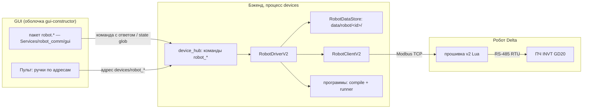
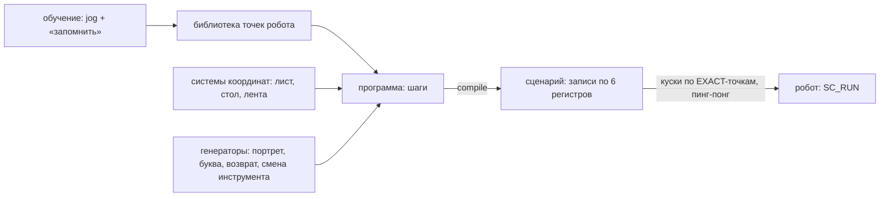

# План: протокол робота v2 — архитектура и факты платформы (§2–§4)

> Вынесено из [plan.md](plan.md) по размеру (лимит 32 КБ); текст разделов 2, 3 и 4 перенесён дословно, номера сохранены. Ссылки на §1 и §5–§10 ведут в [plan.md](plan.md).

## 2. Факты платформы: мануал + проба

Источник — официальный мануал `DELTA_IA-ROBOT_DRAStudio_RL_EN_20240920` (RL, 246 стр., лежит в
`PROJECT_INNOTECH/knowledge-base/inbox/books/`). Каждый факт перепроверяет проба на железе (GATE-1): мануал
говорит, как задумано, проба — как на этом контроллере. До отчёта пробы решения, зависящие от факта, помечены
**⚑ GATE-1** и имеют запасной вариант.

| Факт (стр. мануала) | Следствие для v2 | Статус |
|---|---|---|
| Пользовательский Modbus `0x1000..0x1FFF`; **`0x3000..0x3FFF` сохраняется при выключении** (12-2) | карта v2 в официальном диапазоне; зеркало параметров — в сохраняемой области: робот после перезапуска работает на последних применённых значениях | ⚑ GATE-1 (`retain-check`) |
| 4-я ось в `WritePoint`/`ReadPoint` — **`"RZ"`** (5-9, 5-10) | v1 пишет `"R"` (`main_actual.lua:501,511`) — поворот укладки v1, скорее всего, не работает; v2 пишет только `"RZ"` | ⚑ GATE-1 (тесты 13, 34) |
| `ReadPoint` есть (5-9) | прошивка сверяет точку перед ходом; teach читает точки обратно | ⚑ GATE-1 |
| Таймер `TimerOn/TimerRead`, мс (3-4..3-5) | сторожевой таймер на настоящих часах, а не на оценке циклов | ⚑ GATE-1 (тест 6, Mirror) |
| `MultiTask` помечен устаревшим; `AuxTasks` режет по 15 мс (11-4..11-6) | v2 остаётся на `MultiTask` осознанно: только он даёт стоп и энкодер ВО ВРЕМЯ хода. Риск — исчезновение в новой прошивке контроллера (§7) | мануал + v1 |
| `MotionStop` тормозит с текущим замедлением (1-51), `DecL` до 25000 (2-8) | уровень HARD поднимает `DecL` до `P_DEC_STOP` перед `MotionStop` | ⚑ GATE-1 (быстрый стоп) |
| Встроенный мастер RS-485 `RSmasterRead/RSmasterWrite` (12-6) | мост к ПЧ без своего CRC и `SCM_FreePort` — если порт можно перевести в режим мастера | ⚑ GATE-1 (тест 22) |
| `ContinueCartesianJOG` — не блокирует, едет до `MotionStop` (1-52) | непрерывный jog «держи кнопку — едет» с поводком по `TimerRead` | ⚑ GATE-1 (тест 35) |
| Локальные точки 1001..31000 не пишутся во внутреннюю память, но должны быть заведены в проекте (5-5); глобальные — пишутся (5-2) | рабочие точки прошивки — локальные, если их можно завести; иначе глобальные, как v1 | ⚑ GATE-1 (тест 24) |
| В ключевых словах есть `goto` (ii) | Lua ≥ 5.2; прошивка — на подмножестве, доказанном v1, до отчёта пробы | мануал |
| Есть `MovLR`, `MArchP/MArchL`, `OpenWorkSpace/WorkSpace`, `registerErrorHandleFile` | арочный ход — резерв KIND для pick-and-place; штатная зона DRAStudio — второй слой защиты рядом с проверкой прошивки | мануал |
| Диапазоны суставов DRS: J1/J2 (J4 ±360 — `params.md:33`) | пределы — данные `RobotModel` (`joint_limits`), заглушки J1 ±132 / J2 ±150 по памяти о паспорте; sim отвергает JOINT за пределом (T2.J2) | ⚑ GATE-1 (шильдик / мануал DRS) |
| Скорость суставов при `SpdJ` 100% | `joint_speed` модели → длительность JOINT в sim; пока пол — декартово время T2.2 | ⚑ GATE-1 (замер `MovP`) |
| `MovP` в точку с суставом за пределом | sim: NAK `E_RANGE` / `R_OUT_OF_ZONE`; если прошивка узнаёт только по аварии — ACK + `E_MOTION_FAULT` в одной ветке `_check_motion` | ⚑ GATE-1 |
| `RobotHand()` после стопа посреди смены руки (мануал 5.2.8: текущая физическая рука) | sim выводит `TLM_HAND` из суставов, а не из `P_HAND` | ⚑ GATE-1 |
| RZ −170 → +180 через `MovP`: кисть крутится на 10° или на 350° | sim берёт ближайший к текущему оборот J4 в пределах | ⚑ GATE-1 |
| Режим **Virtual Robot** в DRAStudio (FAQ Delta 2336) | если исполняет Lua и отдаёт Modbus TCP — официальный стенд прошивки без железа | шаг 0 пробы |

Сухой прогон пробы уже нашёл: `os.clock()` — процессорное время, во время `DELAY` оно стоит. Таймер на нём не
сработал бы никогда. Часы v2 — только `TimerRead`.

## 3. Как было → как будет (сводка)

| | v1 (`robot/main_actual.lua`, 1195 строк) | v2 |
|---|---|---|
| Режимы | 5 режимов по регистру `REG_MODE`, переключать «только когда свободен» | режима нет: активность выводится из команды |
| Команды | 5 пар флаг/busy, у каждой свой протокол | один mailbox: seq, ACK/NAK, код ошибки |
| Ошибки | «залипший busy», молчаливое усечение точек, ошибка видна только в консоли DRAStudio | ответ всегда; async-ошибки счётчиком; текст для оператора |
| Стоп | регистр со значениями, разными по режимам; в DRAW глухо | `STOP_REQ` вне mailbox, одна запись, работает при любой активности |
| Параметры | 11 регистров CFG + константы в Lua; менять — перезаливать | ~70 параметров с ПК, классы применения, хранятся на ПК и на роботе |
| Рисование, возврат, смена инструмента | зашиты в прошивку (~350 строк) | программы точек на ПК; прошивка исполняет точки |
| Безопасность | нет проверки координат; стоп проверяется вручную после каждого хода | кольцевая зона SCARA + отрезки; стоп — структурно после каждого примитива; сторожевой таймер |
| Карта регистров | 4 рукописные копии (Lua, `registers.py`, YAML, симулятор) | одна YAML → кодоген |
| GUI | вкладка прототипа, 33 вызова `draw_*` | пакет `robot.*` сервиса + ручки Пульта по адресам |
| Роботов | один | сколько угодно, данные и калибровка — по роботу |

## 4. Архитектура

### 4.1 Слои и владельцы

Правило слоёв проекта (`framework → Services → Plugins → prototype`) не нарушается:

| Где | Что | Слой |
|---|---|---|
| `Services/robot_comm/protocols/delta_v2.yaml` | единственный источник карты, опкодов, errno, параметров | Services |
| `Services/robot_comm/codegen.py` → `core/protocol_v2.py`, `core/params_v2.py`, Lua-блок | производные копии (freshness-тест) | Services |
| `Services/robot_comm/core/client_v2.py` | транзакции mailbox, пробa `PROTO_VER`, пинг-понг буфера | Services |
| `Services/robot_comm/programs/` | точки, системы координат, программы, компиляция в сценарий, генераторы (рисование, возврат, смена инструмента) | Services |
| `Services/robot_comm/calibration/` | лента, пользовательские СК, точки инструмента (Qt-free) | Services |
| `Services/robot_comm/store.py` | `RobotDataStore` — данные робота на диске, ревизия при записи | Services |
| `Services/robot_comm/server/sim_core_v2.py` | исполняемая спека протокола | Services |
| `Services/robot_comm/gui/` | пакет виджетов `robot.*` (единственное место с Qt) | Services/gui |
| `Services/device_hub/drivers/robot_driver_v2.py` | драйвер v2; v1-драйвер не трогается | Services |
| `Plugins/io/robot_draw`, `robot_io`, `Plugins/sim/robot_host` | потребители: генератор рисования, подача CVT, робот v2 в симуляторе линии | Plugins |
| `multiprocess_prototype/` | только сборка: пакет подключён в раскладку; старая вкладка — для устройств v1 | prototype |

Драйвер выбирается фабрикой хаба по полю `protocol` записи устройства (`delta_universal3` → v1,
`delta_v2` → v2): второе поле `params.protocol` не нужно (`Services/device_hub/manager.py:107-112`).

### 4.2 Протокол (детали — [protocol-spec.md](protocol-spec.md))

Четыре плоскости: команды (mailbox), безопасность (`HB_PC`, `STOP_REQ`), параметры (словарь + зеркало),
данные (телеметрия, буфер сценария). ПЧ — замороженный mailbox `0x1200` как в v1 (на нём работают
`Services/vfd_comm` и `belt.*` симулятора), мост в прошивке: опрос по периоду, keepalive для таймаута связи ПЧ,
`E_VFD_LINK` при обрыве.

### 4.3 Параметры — один путь от YAML до кнопки (Ц1)

1. YAML `params:` → кодоген → Lua-таблица `PDEF`, Python `PARAMS`, `RobotParamsV2(SchemaBase)` с `FieldMeta`
   (подпись, единицы, min/max, группа) — **форма GUI строится из метаданных**, новый параметр = строка YAML.
2. Запись: виджет, Пульт или `backend_ctl` → команда `robot_param_set{device_id, name, value}` (с ответом) →
   драйвер → `PARAM_SET` → ACK → `RobotDataStore` сохраняет → `devices.state.<id>.params` обновляется.
   NAK → ответ с кодом и русским текстом, хранилище не трогается.
3. Регистр фреймворка (`register_update`) для этого **не подходит**: он синхронный и локальный
   (`plugin_orchestrator.py:422`), а NAK робота приходит позже по Modbus.
4. Хранение — на ПК (источник истины) и на роботе в сохраняемой области (последние применённые, ⚑ GATE-1).
   Метка `P_CONFIG_EPOCH` ловит расхождение (перезапуск программы, чужой ПК) → ПК отправляет свои значения.
5. Классы применения: `live` (можно на ходу — скорость), `idle` (между командами), `reinit` (CVT, порт ПЧ —
   после `PARAM_APPLY`). Перезаливка прошивки нужна только при изменении её кода.

### 4.4 Программы точек (Ц4)

- **Точка** — имя, X/Y/Z/RZ, рука, система координат (СК). Обучается jog'ом (непрерывным или шагом) и
  кнопкой «запомнить» (поза из телеметрии).
- **СК** (пользовательская) — задаётся тремя обученными точками (начало, ось X, плоскость). Программа в СК листа
  или стола **переносится между роботами** и после перестановки стола: переобучаются три точки, не программа.
- **Программа** — шаги: ход (к точке или координате; LINE / LINE_PASS / JOINT; скорость), выход DO,
  пауза, скорость, ускорение, точность. `compile()` проверяет зону SCARA и отрезки, переводит СК в базу робота
  и выдаёт записи сценария. Прошивка программу не знает — только точки и действия.
- **Длинные программы** исполняются кусками по EXACT-точкам с подкачкой второй половины буфера, пока робот
  исполняет первую; пауза между кусками — один оборот mailbox.
- **Генераторы** выдают программы: портрет/буквы (штрихи → П-переезды, высоты пера, скорости), возврат на
  ленту, смена инструмента. Рисование в прошивке больше не живёт.
- Точки расширения (без правки уже написанного): новое действие (например, «ждать вход» — `WAIT_DI`), новый вид
  хода (арочный `MArchP` для pick-and-place), новый генератор.

### 4.5 Калибровка (Ц3)

| Калибровка | Как | Результат |
|---|---|---|
| Камера ↔ робот | существующий `Plugins/calibration/camera_robot` (читает `robot_get_telemetry` — форма ответа в v2 сохраняется) | матрица камеры |
| Пользовательская СК (лист, стол) | три обученные точки | СК в хранилище робота |
| Лента | отметить объект на ленте в двух положениях, энкодер в обоих → мм/импульс и направление | `P_BELT_FACTOR`, `P_BELT_DIR` → `PARAM_APPLY` |
| Точки инструментов | обучение over/sock/exit для смены инструмента | точки в библиотеке |
| Зона | радиусы и Z из паспорта модели (DRS40L/60L/70L: вылет 400/600/700 мм) + проверка обучением крайних точек | `P_WS_*` |

Мастера калибровки — команды бэкенда `robot_calib_*` (Qt-free, тестируются без GUI) + виджет `robot.calibration`.

### 4.6 Пакет GUI `robot.*` (Ц2)

По решению владельца 09-26 ([constructor-layers.md](../frontend-constructor/constructor-layers.md)) виджеты
сервиса живут в `Services/robot_comm/gui/` и видят мир только через контекст виджета: команда с ответом,
glob-подписка на состояние. Друг на друга не ссылаются.

| Виджет | Что делает |
|---|---|
| `robot.status` | активность, поза, серво, ошибки с текстом, ПЧ, кнопки СТОП / ВЫКЛ серво |
| `robot.params` | форма из метаданных YAML по группам; NAK подсвечивает поле текстом ошибки; «применить» для `reinit` |
| `robot.jog` | непрерывный jog (держи — едет, поводок), шаг 0.1/1/10 мм, «запомнить точку» |
| `robot.programs` | библиотека точек и программ, редактор шагов, запуск / стоп / прогресс по кускам |
| `robot.calibration` | мастера §4.5 |

Те же действия доступны **ручками Пульта** и `backend_ctl` по адресам `devices/robot_*` — без виджета.
Зависимости: `gui-constructor` Task 1.0 (правило `Services/<x>/gui/`), 1.5 (контекст виджета); движок форм
промоутится из прототипа (`frontend-constructor` T3.6) — пакет робота его второй потребитель, поэтому Ф6
выполняет промоушен сама, если T3.6 к её старту не сделан.

### 4.7 Несколько роботов (Ц5)

- Каждый робот — запись в реестре устройств со своим `device_id`, адресом и протоколом; драйвер на робота.
- В драйвере и клиенте нет глобального состояния; всё — поле экземпляра.
- Данные — `data/robot/<device_id>/` (параметры, точки, СК, программы, калибровка).
- Каждый виджет пакета привязан к выбранному `device_id`; два робота — два экземпляра виджета в раскладке.
- Программы в пользовательских СК переносимы между роботами.
- Мост к ПЧ — свойство конкретного робота (у второго робота ПЧ может не быть).
- Вне плана: общая рабочая зона двух роботов (резервирование зон на ПК) — отдельный план, когда появится.

### 4.8 Прошивка (детали — [firmware-architecture.md](firmware-architecture.md))

Исходники модулями `robot/v2/src/NN_*.lua`, на контроллер — один собранный `main_v2.lua`. Одна обёртка
длинной команды (`run_long`) и один путь к движению (`move`): стоп — нелокальный выход `error(ABORT)`, пролог и
эпилог скорости на любом выходе. Подмножество языка — доказанное v1 и пробой. **Сухой прогон прошивки** —
та же техника, что у пробы (`dry_run.py`: настоящий Lua через lupa + заглушки DRAS), из «необязательного»
стала базовой частью Ф4.

### 4.9 Работа без робота

1. `sim_core_v2` — исполняемая спека протокола на Python (Ф2), на нём приложение целиком.
2. Сухой прогон прошивки v2 в lupa (Ф4) — Lua-логика против той же спеки.
3. DRAStudio Virtual Robot — если шаг 0 пробы покажет, что он исполняет Lua и отдаёт Modbus TCP.
4. Симулятор линии: `Plugins/sim/robot_host` понимает v2 (задача Ф2, была пробелом ред. 1).
