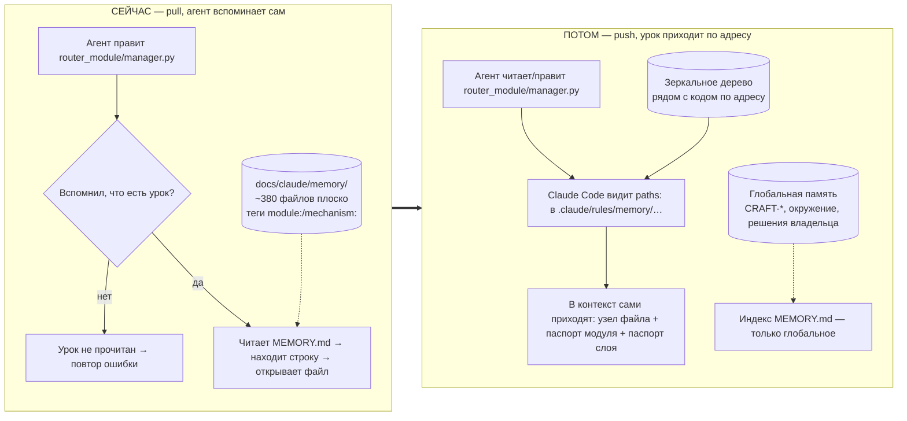
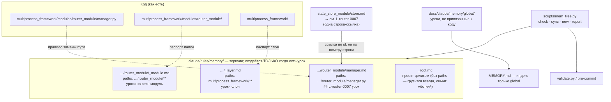
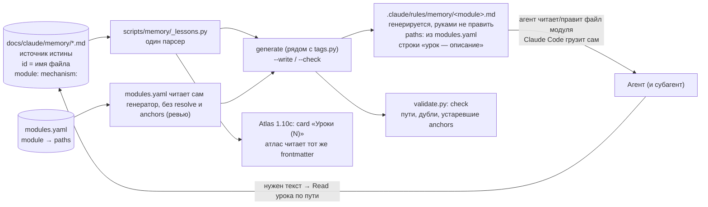

# Зеркальное дерево памяти — черновик дизайна для ревью

Статус: черновик, ждёт ревью Opus. Автор идеи — владелец. Дата: 2026-10-11.
Зона: `workspace/dev/` (дизайн-заметка, не план). Если ревью одобрит — план уйдёт в `plans/`.

## 1. Что хотим

Память агента (уроки, ловушки, решения владельца) привязать к **месту в коде**, к которому она относится,
и доставлять агенту **сама**, когда он трогает это место. Сегодня агент должен вспомнить и сам пойти за уроком.

Одной фразой: **из «память лежит в списке, агент ищет» в «память лежит рядом с кодом по адресу, агент получает её при касании»**.

## 2. Как сейчас (измерено 2026-10-11)

| Что | Значение | Откуда |
|---|---|---|
| Файлов памяти в канонической папке | ~380 верхнего уровня: 288 `feedback`, 80 `project`, 3 `reference`, 5 `CRAFT-*`, индекс, `TAGS.yaml` | `ls docs/claude/memory` |
| Файлов в архиве | 185 | `docs/claude/memory/_archive/` |
| Объём | 3,2 МБ | `du` |
| Индекс `MEMORY.md` | 7 737 Б (канон), 8 039 Б (локальный кэш); грузится в каждую сессию, потолок 8 КБ | `wc -c` |
| Файлов с тегом `module:` | 225 из ~380 | `grep` |
| Значения `module:` | 54 разных, многозначные (`process_module`, `tools/backend_ctl`, `scripts`, …). ИСПРАВЛЕНО после разбора Atlas: это id из `modules.yaml`, у каждого есть `paths`; путь → модуль даёт `scripts/atlas/modules.py:67-79` (побеждает самый длинный префикс). Сопоставление однозначное, но грубое (уровень модуля, не файла) | `grep` + разбор Atlas |
| Размер кода | 3 914 `.py` в git, 35 модулей в `multiprocess_framework/modules` | `git ls-files` |
| Path-scoped правила | `.rules/` — 8 файлов (`commits`, `framework`, `gui`, `logging`, `module-state`, `plugins`, `prototype`, `services`); корневой `CLAUDE.md` сам говорит: «загрузчика у них нет» | `ls .rules` |
| `.claude/rules/` | не существует | `ls` |

Как память достигает агента сейчас:
1. В каждую сессию целиком попадает `MEMORY.md` (~35 указателей и правила).
2. Всё остальное агент читает, **только если сам решил**, что тема подходит (по строке индекса или по `grep module: X`).
3. Субагент получает память, только если лид вписал её в промпт.

То есть доставка основана на том, что кто-то вспомнил. Это **pull**.

НЕ измерено (честно): как часто нужный урок реально доходит до агента сейчас; сколько токенов память съедает за сессию;
сколько повторных ошибок уже случилось из-за недоставки. Эти числа даёт пилот (раздел 8), без них «стоит ли оно того» — гипотеза.

## 3. Как будет

### 3.1 Диаграмма: сейчас и потом

### 3.2 Диаграмма: устройство дерева и ссылок

### 3.3 Правила

1. **Зеркало разреженное.** Узел `<код>.md` создаётся, только когда у места появился урок. Полной копии дерева нет.
2. **Урок хранится один раз** — в самом узком узле, которого он касается (файл → модуль → слой → корень).
3. **Ссылка по уникальному id.** Заголовок урока `## L-<область>-<номер>`; в других местах строка `→ L-router-0007`. Разрешается поиском id по дереву, не по пути и не по строкам, поэтому перенос файла ссылки не рвёт. Номер строки — только необязательная подсказка.
4. **Адрес = путь.** Правило замены: путь файла кода без расширения + `.md`. Паспорт папки — `_module.md`, слоя — `_layer.md`.
5. **Узел сам себя адресует.** Во frontmatter `paths:` равен адресу в коде. Это проверяет `check`, а не человек.
6. **Лимит узла** (черновик: 40 строк, паспорт модуля — 80). Больше — дробить или поднимать в общий узел.
7. **Не привязанное к коду** (CRAFT-*, окружение Windows, решения владельца) — `docs/claude/memory/global/`, индекс `MEMORY.md` остаётся, но только для него.
8. **Якоря устаревания.** В уроке `anchors: [символ или файл, дата]`. `check` предупреждает, если символ исчез или файл с тех пор сильно изменился.

### 3.4 Автоматика (ответ на «кто двигает зеркало»)

`scripts/mem_tree.py` (один скрипт, без зависимостей):
- `check` — висячие ссылки, дубли id, узел без файла кода (сирота), `paths:` не совпадает с адресом, превышение лимита, устаревшие якоря. Встраивается в `validate.py` и pre-commit.
- `sync` — по `git diff --name-status` двигает зеркальные узлы вслед за `git mv` кода и правит `paths:`; удалённый код → узел в `_orphans/` с пометкой, не молчаливое удаление.
- `new` — создаёт урок в нужном узле: по пути правки сам выбирает самый узкий узел, выдаёт id.
- `report` — какие узлы реально загружались (если доступен хук `InstructionsLoaded`), для пилота и для чистки мёртвых.

## 3A. Atlas: что уже есть и как это стыкуется (добавлено по просьбе владельца)

Разбор сделал Opus-исследователь по коду и планам (`plans/2026-10-04_atlas/`, `scripts/atlas/`, `scripts/memory/`). Ссылки — на источники.

### Что такое Atlas (в объёме, нужном для этого вопроса)
- Реестр «доказанности», строится из git, планов, `modules.yaml` и кода. Лежит в SQLite `data/atlas.sqlite` в `.gitignore`: это **кэш**, не источник истины (`plan.md:52`, `store.py:30-49`).
- «Карточка» — не хранимая сущность, а вывод `atlas card <module>`, собранный из БД и git (`views.py:1-8`). Хранятся `Node{kind,id,path,status,time}`, `Edge`, `Finding`.
- Виды узлов включают `lesson` (id = имя файла, ребро `about` lesson→module) — **заложено в ADR-ATL-001, адаптера в коде нет** (`DECISIONS.md:41-84`).
- Адаптеры: `modules`, `plans`, `commits`, `code`, `rules`. Команды: `build`, `check`, `card`, `pack`, `index`, `log`.
- Единица Atlas — **модуль**; узел «файл» отклонён («6,8 тыс. файлов», `DECISIONS.md:165`).
- Доставка у Atlas только **pull** (CLI, `pack` в брифе, будущий MCP 1.10e). Push по `paths:` нет.
- Статус: фазы 0–1.9d готовы, 2.4 в работе, K0b впереди (возможна заморозка Atlas, оценка kill 40–50 %, `plan.md:98,194`).

### Что Atlas уже делает для памяти (трек 2.4g, DONE)
- `scripts/memory/{_lessons,tags,search}.py`, `TAGS.yaml` (30 механизмов); 251 урок перетеган, правило `module:` ⊆ id из `modules.yaml` проверяет `validate.py`.
- Индекс памяти **не хранится** (решение Р1) — строки собираются при запросе. Субагенты уроков не пишут, а отдают блок `MEMORY LESSON`.
- Свежесть в Atlas — число содержательных коммитов в зоне документа, выводится из git без записи в файл (`O3_git_freshness.md`, вариант B′). Хешей содержимого и якорей на символ нет.
- Переиспользуемое: `check._renames` (`git diff -M --name-status`) — ядро для `sync`; `modules.resolve`; модель находок с храповиком (новое блокирует, старое видно); `index --write/--check` как образец генерируемых файлов.

### Пересечения с черновиком (по пунктам)
| Пункт | Atlas | Черновик (вариант B) | Итог |
|---|---|---|---|
| Id урока | имя файла | `L-<область>-<номер>` | **дублирование** — два id на один урок |
| Единица привязки | модуль | файл | **конфликт детализации** (Atlas отказался от узла «файл») |
| Источник истины | файлы в git, БД — кэш | перенос уроков в `.claude/rules/memory/` | конфликта нет, если уроки остаются в `docs/claude/memory/` |
| Доставка | только pull | push по `paths:` | **дополняют** |
| check / sync | rename-следование, находки, храповик | свой `mem_tree check/sync` | риск **двух check** |
| Индексы | генерируются, руками не править | — | прецедент для генерируемого слоя |

### Варианты объединения
- **A. Урок = узел Atlas, слой `.claude/rules` генерируется из БД Atlas.** Слой зависит от выживания ядра Atlas (kill 40–50 %), адаптер lessons выпадает из очереди (1.4 заморожена).
- **A-lite (рекомендация исследователя).** Источник истины — плоские `docs/claude/memory/*.md`, id = имя файла. Во frontmatter добавляются необязательные `paths:` (уже модуля) и `anchors:`. Генератор рядом с `tags.py`/`search.py` читает тем же парсером `_lessons` и берёт пути модулей из `scripts/atlas/modules.py`, **без БД Atlas**. На каждый модуль пишет `.claude/rules/memory/<module>.md`: `paths:` из `modules.yaml`, строки «путь — description» (указатели, не тела). Режим `--check` в `validate.py`. 1.10c (`card` «Уроки (N)») читает тот же frontmatter — второго парсера нет. Если `paths:` перестанут работать — деградация до сегодняшнего `search.py`.
- **B. Исходная идея владельца** — независимое зеркальное дерево + свой `mem_tree`. Больше всего работы, два id, два check, противоречит отказу ADR от узла «файл».
- **C. Без дерева, push строить в Atlas на хуках.** Изобретает то, что Claude Code уже делает через `paths:` (проба раздела 4); K0b может заморозить Atlas.

### Что в A-lite отличается от исходной идеи (требует решения)
1. **Гранулярность: модуль, а не файл.** Файловую точность можно вернуть опционально: `paths:` в frontmatter отдельного урока (например, на один файл), генератор сворачивает в правило этого файла.
2. **Указатели вместо тел.** Агент получает при касании не текст урока, а список «путь — описание»; тело читает по требованию. Дешевле по контексту, но остаётся ручной шаг — это **полу-push**. Альтернатива: помечать критичные уроки `deliver: inline`, тогда тело вкладывается. Что надёжнее в смысле «точно получать пользу»?
3. **Нет переноса 380 + 185 файлов.** Миграция сводится к добавлению `paths:`/`anchors:` там, где это нужно.

### Диаграмма A-lite

### Конфликты по срокам с Atlas
- **Kill №6 «повторные грабли»** (`plan.md:126`) меряет ту же метрику. Atlas уроки пока не доставляет, искажать нечего; нужна атрибуция: строка в план Atlas с датой и SHA слияния генератора, K1.1 считает повторы до и после (по ревью).
- 1.10d добавит в `modules.yaml` строки `scripts/{atlas,…,memory}`; адрес доставки уроков `module: scripts` не меняется, меняется только `card` (исправлено по ревью).
- **R5 открыт:** у `.rules/*` (8 файлов) нет загрузчика; перенос в `.claude/rules/` не решён (`rules_map_24a.md:221`). Это тот же механизм — решать вместе.
- 1.10b (SessionStart + PostToolUse-журнал) пересекается с `report` из варианта B.
- Исследователь поднял эскалацию к CTO: внедрять A-lite до K1.1 или после? Это решение владельца/CTO; ревью просим высказаться.

## 4. Проверено вживую (2026-10-11)

Проба: временный `.claude/rules/zz_probe_paths.md` с `paths: workspace/dev/style-bench/**` и маркером; субагент (general-purpose, Haiku) на Windows.
- Шаг 1, до чтений: маркера в контексте нет.
- Шаг 2, после Read постороннего файла: маркера нет.
- Шаг 3, после Read `workspace/dev/style-bench/README.md`: маркер пришёл **отдельным блоком** «Contents of …\zz_probe_paths.md», загруженным харнессом, не внутри результата Read.
Вывод: ленивая доставка по `paths:` работает на Windows и у субагента. Проба удалена, дерево чистое.
Не проверено: поведение в git worktree; несколько совпавших правил сразу; Grep без Read (по документации не триггерит); поведение при 200+ узлах; влияние на скорость старта.

## 5. Универсальность («на будущее»)

Универсальность держится на трёх решениях:
1. **Источник истины — обычный Markdown + frontmatter `paths:`.** Это формат, у которого есть аналоги у других инструментов (Cursor `globs`, Copilot `applyTo`, `AGENTS.md` в подпапках). Если сменится агент, дерево переносится генератором-адаптером, а не переписывается.
2. **`mem_tree` не знает про наш проект.** Все привязки — в `mem_tree.toml`: корни кода, корень зеркала, правило имени, лимиты. Для другого проекта меняется только конфиг.
3. **Язык кода не зашит.** Правило имени — настройка (`.py → .md`; для смешанных репозиториев `manager.py → manager.py.md`, чтобы `manager.py` и `manager.pyi`/`manager.ts` не столкнулись).
Дисциплина против раздувания: адаптеры под другие инструменты НЕ пишем сейчас, только оставляем место в конфиге (ponytail: не строить заранее).

## 6. Затраты и выгода

| | Сейчас | Потом |
|---|---|---|
| Доставка урока | агент вспоминает (pull) | по касанию кода (push), без участия агента |
| Охват субагентов | только если лид вписал в промпт | свойство самого файла, субагент получает так же (проба шаг 3) |
| Дубликаты | возможны, склейка вручную (`merged_from`) | запрещены правилом «один раз + ссылка по id» |
| Устаревание | выявляется случайно | `check` ловит исчезнувший символ/файл |
| Контекст на старте | `MEMORY.md` ~8 КБ | меньше: только global-индекс; код-уроки приходят по требованию |
| Контекст при работе | 0 лишнего, но и 0 пользы, если не вспомнили | растёт на размер загруженных узлов; зависит от лимитов и числа касаний |
| Поиск «что мы знаем про модуль X» | grep по `module:` | открыть `_module.md` и каталог узлов |
| Стоимость внедрения | — | скрипт `mem_tree` (3–4 функции), миграция ~380 + 185 файлов, правки правил агентов |
| Риск | недоставка | неверная привязка; лишние узлы в контексте; тихая поломка загрузки после обновления Claude Code |

Миграция: `memory-classifier` (Haiku) размечает каждый файл → предлагаемый адрес; Sonnet выборочно проверяет; 155 файлов без `module:` и многомодульные уроки идут вручную или в global. Старая плоская папка остаётся на время пилота и читается как раньше.

## 7. Риски и ловушки, которые я вижу сам

1. **Узлы, привязанные к «модулю», а не пути.** `module:` у нас не пути (`tools/backend_ctl`, `scripts`) — маппинг в адреса неоднозначен.
2. **Сквозные уроки** (ловушка на стыке router ↔ state_store) — узкий общий предок `modules/` слишком шумный. Кандидат: хранить в узле того модуля, где ловушка проявилась, с id-ссылкой из другого.
3. **Правила грузятся при Read/Write/Edit, не при Grep/поиске.** Агент, который только ищет, ничего не получит.
4. **Раздувание контекста** при рефакторинге на 20 файлов: до 20 узлов + паспорта. Нужен бюджет и дедупликация (по документации каждый файл грузится один раз — не проверено).
5. **Дрейф формата** после обновления Claude Code: `paths` — единственное читаемое поле frontmatter, поведение может смениться.
6. **Бремя сопровождения**: если `new` неудобен, агенты будут писать в старую папку. Нужен один путь записи.
7. **Урок про механизм, а не про код** (инъекции, «зелёный под заплатой») в дерево не ложится. Он остаётся global.

## 8. Как измерить «стоит ли»

ЗАМЕНЕНО ревью: этот пилот не годен; действует замер из [memory-mirror-tree-review.md](memory-mirror-tree-review.md) (шаг 0 без агентов, затем 10 пар задач, список до генератора).

Пилот на одном модуле (`router_module`, 4 урока с `module:` и ещё связанные) + одном сквозном сценарии.
1. Берём N=20 реальных прошлых инцидентов из памяти (вход: «агент трогает файл F, делает задачу T»).
2. **Как сейчас:** свежему агенту даём `MEMORY.md` и задачу T; судья (не автор) смотрит, дошёл ли он до нужного урока, и сколько токенов потратил.
3. **Как будет:** тот же сценарий с деревом; считаем recall (нужный урок пришёл), precision (сколько лишних узлов), токены.
4. Порог «стоит ≥» задаёт ревью; черновик: recall ≥ +30 п.п. при том же или меньшем числе токенов, и 0 тихих потерь.
5. Break-injection: удалить символ, переименовать файл кода, дублировать id, сломать `paths:` — `check` обязан каждое поймать (ожидаемый набор красных пишется до запуска).

## 9. Вопросы к ревью

0. **Главный.** Сравни варианты A, A-lite, B, C раздела 3A. Какой механизм надёжный и универсальный и при этом даёт пользу, а какой лишний слой? Допустимо предложить гибрид (например, A-lite + `deliver: inline` + опциональный файловый `paths:`). «Как сейчас → как будет → стоит ли» — числами там, где они есть, и явной пометкой «гипотеза» там, где их нет.
0a. Указатели против тел (раздел 3A): что реально гарантирует, что агент получит пользу?
0b. Порядок относительно Atlas K1.1 и kill №6 (раздел 3A): до, после или совместно? Как не испортить замер Atlas?
1. Достаточна ли разреженная схема «узел только при уроке» — или паспорт модуля нужен всегда?
2. Имя узла: `manager.md` (по желанию владельца) против `manager.py.md` (без коллизий). Что надёжнее для универсальности?
3. Ссылка только по id: достаточно ли, нет ли сценария, где id-ссылка рвётся тихо?
4. Дерево прямо в `.claude/rules/memory/` (меньше слоёв, но смешивается с правилами) или отдельная папка + генерация правил (больше слоёв, но чище)? Принцип владельца №4: меньше слоёв лучше.
5. Что делать с `.rules/` (8 файлов «без загрузчика») — это тот же механизм? Слить?
6. Годится ли пилот и порог из раздела 8, чтобы честно ответить «стоит ли»? Что недоучтено?
7. Что в дизайне нарушает «каждый компонент подключаемый, сбой одного не валит соседей»? Что будет, если `paths:` перестанут работать — деградируем ли мы до сегодняшнего состояния?
8. Где дизайн избыточен (ponytail) и что лишнее можно выкинуть, не потеряв пользу?
9. Универсальность из раздела 5 — реальна или декоративна?

## 9A. Вердикт ревью Opus

Итерация 2 из 2 тоже CHANGES REQUESTED: механизм годен, пакет к плану не готов (12 неточностей исправлены 2026-10-11; остаются шаги G0 и список из 10 задач). Итерация 1: строить урезанный «A-lite-min», начать с пробы G0. Полный текст: [memory-mirror-tree-review.md](memory-mirror-tree-review.md).

## 10. Что осталось открытым или ненадёжным

- Все выводы о пользе — гипотеза до пилота; текущий recall не измерен.
- Проба доставки проверена один раз, на одном субагенте и одном пути; worktree и массовые касания не проверены.
- Сведения о других инструментах (Cursor, Copilot, docrot, basic-memory и т.д.) взяты из отчёта веб-агента; часть страниц он не открывал.
- Лимиты 40/80 строк — черновые, не обоснованные замером.
